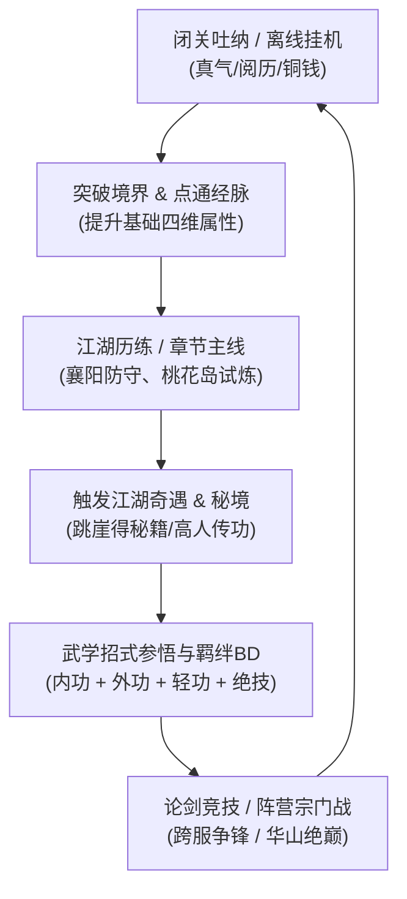
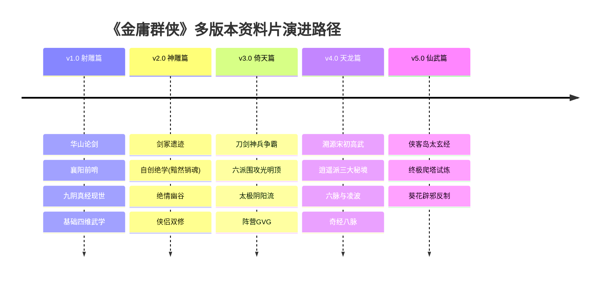
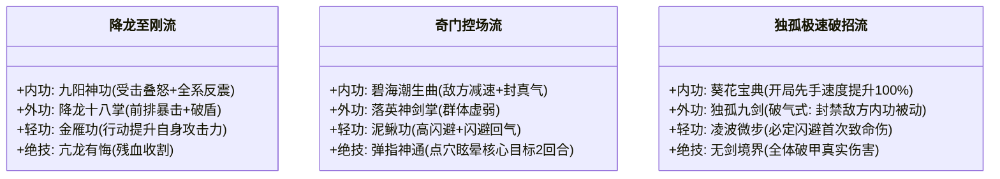

# 《金庸群侠：问道武林》（暂定名）产品策划与版本演进方案

> **项目定位**：经典金庸世界观 · 新国风放置卡牌与武学构筑RPG  
> **目标平台**：移动端（竖屏单手操作为主）/ 微信小游戏  
> **核心体验**：离线真气吐纳、奇遇机缘顿悟、多维武学BD搭配、代际江湖演进。

---

## 目录
1. [产品定位与核心玩法循环](#一-产品定位与核心玩法循环)
2. [世界观设定与版本演进路线图](#二-世界观设定与版本演进路线图)
3. [核心战斗与“内·外·轻·绝”武学体系](#三-核心战斗与内外轻绝武学体系)
4. [放置养成与金庸特色奇遇机制](#四-放置养成与金庸特色奇遇机制)
5. [社交交互与阵营PVP系统](#五-社交交互与阵营pvp系统)
6. [商业化与长线运营设计](#六-商业化与长线运营设计)
7. [研发排期与Demo里程碑建议](#七-研发排期与demo里程碑建议)

---

## 一、 产品定位与核心玩法循环

### 1.1 核心循环模型（Core Loop）
游戏以“**闭关挂机积累修为 $\rightarrow$ 闯荡江湖触发奇遇 $\rightarrow$ 收集参悟传世神功 $\rightarrow$ 构筑武学流派推图 $\rightarrow$ 华山论剑问鼎武林**”为闭环。

### 1.2 玩家画像与痛点解法
* **受众**：25~45岁泛武侠用户、金庸书迷、轻度偏中度的放置挂机玩家。
* **痛点突破**：传统放置数值膨胀过快且没有武侠味。本作主打**“低频操作、高深度策略构筑”**与**“还原金庸原著奇遇爽点”**，拒绝千篇一律的修仙换皮。

---

## 二、 世界观设定与版本演进路线图

遵循“**以《射雕》筑基建构数值阶梯 $\rightarrow$ 顺延《神雕》《倚天》强化宗门与神兵 $\rightarrow$ 溯源《天龙》《侠客》打开战力上限**”的发展脉络。

---

### 2.1 基础版本 1.0：【射雕篇·华山论剑】（游戏骨架）

* **剧情主线**：以少年侠客入世为引，重历郭靖南下、结识黄蓉、赵王府盗药、桃花岛三道试题、二次华山论剑等大事件。
* **成长心智模型**：
  * **新手期（无名小卒）**：江南七怪武学（越女剑、柯镇恶降魔杖法），机制多但伤害一般，熟悉破防、流血等基础状态。
  * **筑基期（渐入佳境）**：全真教马钰道家吐纳心法（开启**离线挂机核心倍率**）、梁子翁宝蛇血（气血上限质变）。
  * **大成期（一代宗师）**：降龙十八掌、左右互搏、空明拳。
* **初版战力天花板（五大流派代表）**：
  * **东邪·黄药师**：奇门五行 / 控场封穴流
  * **西毒·欧阳锋**：白驼蟾蜍 / 叠毒引爆流
  * **南帝·一灯大师**：一阳指力 / 破甲爆发流
  * **北丐·洪七公**：刚猛降龙 / 连击暴伤流
  * **中神通·王重阳**：先天道法 / 护体纯阳流
* **初版核心追求**：争夺《九阴真经》（拆解为：上卷心法、下卷招式、梵文总纲），全部参悟可解锁全屏真气特效。

---

### 2.2 资料片 2.0：【神雕篇·剑冢绝学】（深度拓展）

* **剧情背景**：时间线推进三十年，襄阳烽火再起，神雕大侠名动江湖。
* **新增核心系统**：
  1. **剑冢试炼（神兵境界体系）**：
     * **利剑无意**（暴击、敏捷） $\rightarrow$ **软剑无常**（闪避、反击） $\rightarrow$ **重剑无锋**（绝对格挡、无视护甲） $\rightarrow$ **木剑/无剑**（化气为剑、法术系真气外放）。
  2. **绝学自创系统**：
     * 借鉴杨过创“黯然销魂掌”。玩家在经历心境磨砺后，可将所学外功残卷融合，自定义技能名称、触发前置条件与特效。
  3. **侠侣双剑合璧**：
     * 上阵特定CP（如杨过+小龙女、郭靖+黄蓉）解锁“双剑合璧”被动连携技。

---

### 2.3 资料片 3.0：【倚天篇·神兵问世与宗门争锋】（中后期生态）

* **剧情背景**：百年传承，武当张三丰开宗立派，明教与六大门派并立，武林争夺“屠龙刀”与“倚天剑”。
* **新增核心系统**：
  1. **神兵熔炼与兵刃藏密**：
     * 玩家收集刀剑碎片，修复屠龙刀（破甲吸血特效）与倚天剑（暴击真实伤害）。击碎神兵可产出《武穆遗书》（全队防御光环）与《九阴速成篇》。
  2. **大型阵营对抗：【六派围攻光明顶】**：
     * 全服划分“六大正派”与“西域明教”两大阵营。
     * 地图据点争夺、资源矿脉开采、定时决战光明顶总坛。
  3. **太极两仪机制**：
     * 引入武当“借力打力”反伤机制与明教“乾坤大挪移”技能伤害转移机制。

---

### 2.4 资料片 4.0：【天龙篇·武学盛世】（战力升维 / 溯古神话）

* **引入方式**：玩家在倚天境界达到大圆满，触发“无量玉洞溯古幻境”，穿越回北宋高武黄金时代。
* **战力维度升级**：
  1. **奇经八脉与六脉神剑**：
     * 脱离常规兵器，进入“凌空虚指、无形剑气”阶段。通过打通任督二脉、手太阴肺经等，构建远程真气爆发流。
  2. **逍遥三大宗**：
     * 北冥神功（攻击偷取敌方怒气/真气）。
     * 八荒六合唯我独尊功（低血量返老还童，解除全部负面状态并爆发）。
     * 小无相功（复制敌方释放的非绝世主动招式）。
  3. **世界终极PVE：【少室山大会】**：
     * 阶段性挑战鸠摩智、萧远山、慕容博，终极守关Boss为“少林扫地僧”（三尺气墙绝对防御机制）。

---

### 2.5 终局与特殊玩法资料片：【侠客行·荒岛寻仙】 & 【笑傲江湖·五岳正邪】

* **侠客岛（终极爬塔秘境）**：
  * 玩家手持“赏善罚恶令”登岛，岛上有24间石室。
  * 不看常规悟性数值，而是要求玩家解开不同的武学组合谜题，终极奖励为《太玄经》（攻击附带混沌属性伤害，无视一切护体罡气）。
* **笑傲江湖（特色机制补充）**：
  * **独孤九剑破招机制**：总诀式、破剑式、破气式——在战斗中直接封印敌方对应槽位的武学。
  * **辟邪/葵花极端流**：极速出手与极高暴击，但需扣除主角特定防御属性作为代价值。

---

## 三、 核心战斗与“内·外·轻·绝”武学体系

放置游戏战斗采用**战前深度策略配置 + 战中自动释放**机制。速度值决定行动条推进。

### 3.1 核心四维武学插槽设计

每个角色配备4个核心武学槽位，各司其职，相辅相成：

| 槽位 | 属性作用 | 战中表现 | 原著典型功法示例 |
| :---: | :---: | :---: | :---: |
| **内功（心法）** | 基础气血、内力上限、伤害减免、被动光环 | 受到攻击或行动结束时触发被动机制 | 《九阴真经总纲》《九阳神功》《神照经》《易筋经》 |
| **外功（招式）** | 基础攻击力、破防值、单体/群体主动输出 | 行动轮次根据CD或序列释放招式 | 《降龙十八掌》《打狗棒法》《独孤九剑》《玄铁剑法》 |
| **轻功（身法）** | 出手顺位（速度）、闪避率、追击连击概率 | 影响入场站位与行动先后、触发飘逸闪避 | 《凌波微步》《神行百变》《金雁功》《螺旋九影》 |
| **绝技（奥义）** | 极限爆发、全屏伤害、战场环境改变 | 怒气值攒满（100点）即刻插队打断释放 | 《黯然销魂掌》《六脉神剑·剑气纵横》《太极拳·圆转不断》 |

---

### 3.2 典型流派构筑（Build）示例

---

## 四、 放置养成与金庸特色奇遇机制

### 4.1 离线闭关与经脉系统
1. **闭关吐纳房**：
   * 采用“马钰传授郭靖睡梦吐纳”的理念，即便离线，主角与上阵侠客也在持续汲取天地灵气。
   * 产出：**修为真气（升级）、江湖阅历（主线门槛）、武学残卷、淬炼玄铁**。
2. **冲穴突破（经脉树）**：
   * 设任脉、督脉、冲脉、带脉四大主脉。每冲破一个穴位（如百会、膻中、涌泉），提供百分比四维加成或特殊词条（如“暴击时恢复2%气血”）。

### 4.2 “金庸式”随机奇遇事件库

放置推图过程中，每隔一段时间或推至特定章节，随机刷新奇遇：

* **悬崖奇遇（跳崖不死必得机缘）**：
  * *事件*：行至绝壁，采药失足跌落云海。
  * *分支*：
    * 选【探查枯藤山洞】 $\rightarrow$ 概率获得《九阳真经残页》或上古玄铁；
    * 选【随溪流漂泊】 $\rightarrow$ 偶遇绝情谷底小龙女，获得稀有玉蜂浆（提升根骨资质）。
* **茶馆轶事与江湖传闻**：
  * 酒楼偶遇落魄乞丐，选择【赠予烧鸡美酒】 $\rightarrow$ 触发洪七公传授半式降龙掌；若选择【无视】则扣除少许铜钱但避免麻烦。
* **古井古墓解谜**：
  * 简易三消或八卦推盘，解开重阳宫活死人墓石棺暗号，获得速通扫荡券与绝品轻功。

---

## 五、 社交交互与阵营PVP系统

### 5.1 华山论剑（天梯竞技场）
* **赛季制**：每两周为一个论剑周期。
* **五绝称号争夺**：
  * 排行榜前5名分别赋予全服唯一荣誉头衔：**“东邪”、“西毒”、“南帝”、“北丐”、“中神通”**。
  * 获得头衔的玩家将在襄阳城中心建立雕像，全服玩家每日可膜拜并领取铜钱与阅历。

### 5.2 襄阳守卫战（全服协作PVE）
* 每周两次全服限时活动，蒙古铁骑大军压境。
* 玩家以宗门或个人为单位防守不同城门（东门、西门、粮道），击退多波次敌人，依据累计总伤害结算稀有功法残页与铸造材料。

---

## 六、 商业化与长线运营设计

放置游戏不宜采用逼氪抽卡的硬付费模式，应采用**“轻抽卡、重深度养成与长效通行证”**模式：

### 6.1 付费架构设计
1. **侠客寻访（轻卡池抽卡）**：
   * 抽卡保底机制透明，心愿单系统让玩家定向获取《射雕》/《神雕》核心搭档（如黄药师、周伯通）。
2. **江湖令（Battle Pass / 赛季通行证）**：
   * 分为“初涉江湖”（免费档）与“名震八荒”（高级付费档）。奖励随玩家挂机推图等级提升而解锁，核心产出当季专属典藏武学（如《九阴神爪》）与主角定制时装。
3. **闭关聚灵阵（月卡/终身特权）**：
   * 购买后提升离线挂机收益上限（从8小时延长至24小时）、战斗2倍速与一键跳过权限、每日免费赠送奇遇刷新次数。

### 6.2 运营节奏排期
* **首月节奏**：围绕《射雕》核心剧情，开展“开服七日登顶华山”、“全真道观祈福”活动，赠送紫色品质侠客穆念慈、郭靖。
* **第2~3个月**：上线 2.0 资料片《神雕篇》，开启跨服个人竞技与自创绝学系统。
* **第4~6个月**：上线 3.0 资料片《倚天篇》，开启全服阵营领地战（围攻光明顶）。

---

## 七、 研发排期与Demo里程碑建议

| 阶段 | 周期 | 核心交付物 | 验证目标 |
| :---: | :---: | :--- | :--- |
| **Demo 阶段** | 4~6周 | 基础闭关挂机房 + 竖屏自动回合战斗Demo + 《射雕》前3章推图 + 4门基础武学 | 验证战斗节奏、数值成长爽感与离线挂机收益模型。 |
| **Alpha 阶段** | 8~10周 | 完整武学“内/外/轻/绝”装配系统 + 奇遇随机池（10个原型） + 华山论剑竞技场 + 抽卡卡池 | 跑通核心玩法闭环，进行小规模核心武侠用户盲测。 |
| **Beta 阶段** | 8周 | 射雕三部曲完整剧情贯通 + 经脉突破 + 商业化计费系统 + 襄阳守卫战公会战 | 数值压力测试、留存率测试（次留目标 $\ge 45\%$，7留 $\ge 20\%$）。 |
| **正式公测** | 运营上线 | 1.0版本完整上线，储备2.0《神雕篇》开发内容至80% | 启动首发买量与社群口碑传播。 |
