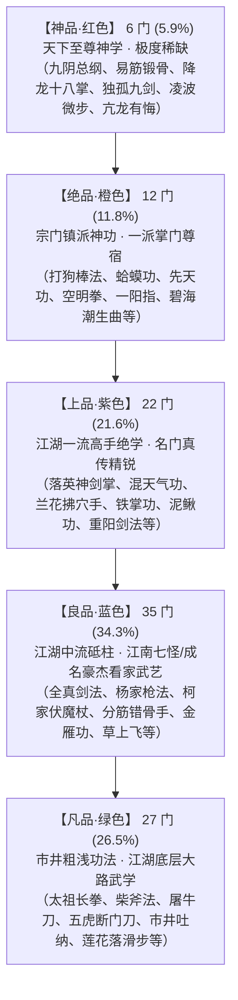

# 《金庸群侠：问道武林》门派、剧情、武学与人物设定总集

> **设计核心**：围绕“**开局无门派散人 $\rightarrow$ 自由择师或孤身游历**”、“**1主角 + 2伙伴**”以及“**纯正文字表现**”，梳理从《射雕英雄传》（起点）到后续资料片的门派条件、主支线任务网、武功秘籍库与角色图鉴。

---

## 一、 主角属性维度与“门派 / 散人”体系

### 1.1 主角六维基础属性（决定拜师门槛与武学修炼）
* **【臂力】**：影响外功攻击力、重兵器驾驭、破甲能力。
* **【根骨】**：影响气血上限、内功修炼速度、打坐离线收益及抗毒能力。
* **【身法】**：影响出手先后顺序、闪避率、连击率与逃跑成功率。
* **【悟性】**：影响参悟高深秘籍的成功率、技能升级消耗、奇门阵法破解。
* **【福缘】（隐藏/半显性）**：影响挂机触发“奇遇事件”与稀有残页掉落的概率。
* **【侠义值】（正邪倾向：$-1000 \sim +1000$）**：通过主支线对话选择增减，决定正派或邪派的接纳度。

---

### 1.2 门派拜师矩阵（无门槛 vs 属性门槛 vs 散人游侠）

玩家开局为**【无门无派·江湖白衣】**。在游历过程中，既可拜入各大门派习得镇派绝学，也可终身不拜师，走**“逍遥散人”**路线。

| 门派名称 | 所属阶段 | 拜入条件（属性/前置要求） | 门派特色与核心路线 | 镇派武学 |
| :--- | :---: | :--- | :--- | :--- |
| **【无门派·散人】** | 全阶段 | **开局默认 / 终身不拜师** | 不受门规约束，可偷学各派流落秘籍；专属“百家里手”天赋（装配不同流派武学有额外加成），独享老顽童、风清扬等隐士传功奇遇。 | 《九阴真经》《空明拳》《左右互搏》《太玄经》 |
| **【江南武馆/马帮】** | 射雕 1.0 | **无任何条件**（新手随时可入） | 基础属性均衡成长，适合新手过渡，可随时无损出师转投名门。 | 《越女剑法》《开山掌》《疯魔杖法》 |
| **【丐帮】** | 射雕 1.0 | **无属性门槛**，仅需【侠义 $\ge 0$】 | 越挫越勇，气血越低爆发越高；门内分“净衣派”与“污衣派”，靠行侠仗义升袋（一袋至九袋长老）。 | 《降龙十八掌》《打狗棒法》《混天气功》 |
| **【铁掌帮】** | 射雕 1.0 | **无善恶限制**，需【臂力 $\ge 25$】 | 刚猛霸道，专精破甲与内伤，适合走纯粹暴力输出流的玩家。 | 《铁掌功》《水上漂》《阴阳磨》 |
| **【全真教】** | 射雕 1.0 | 需【根骨 $\ge 30$】且【侠义 $\ge 100$】 | 道家正宗，**离线打坐吐纳收益 +25%**；内力绵长，擅长护盾、回血与净化负面状态。 | 《全真内功》《先天功》《同归剑法》《金雁功》 |
| **【桃花岛】** | 射雕 1.0 | **高门槛**：需【悟性 $\ge 45$】【身法 $\ge 35$】，并通过“奇门九宫算术”支线 | 奇门五行、音律点穴、闪避反击。招式极其华丽，文字战报充满诗词雅意。 | 《碧海潮生曲》《弹指神通》《落英神剑掌》《兰花拂穴手》 |
| **【白驼山庄】** | 射雕 1.0 | **邪派门槛**：需【侠义 $\le -100$】【根骨 $\ge 35$】，完成“捕蛇饲毒”支线 | 诡谲毒功，所有攻击附带“蟾毒/蛇毒”持续掉血，受到致命伤时可逆转经脉狂暴。 | 《蛤蟆功》《灵蛇拳》《瞬息千里》《逆转九阴》 |
| **【大理天龙寺/一灯居】** | 射雕/天龙 | **高门槛**：需【根骨 $\ge 45$】【侠义 $\ge 300$】，完成“渔樵耕读”四关试炼 | 指力化气，无视敌方铁布衫等外功防御，兼具极强的点穴封招与疗伤能力。 | 《一阳指》《枯荣禅功》《六脉神剑（后期）》 |
| **【终南古墓派】** | 神雕 2.0 | 需【身法 $\ge 50$】，且未拜入全真教；在终南山后山触发支线拜入 | 极速先手、清心寡欲（免疫魅惑与内力紊乱），与小龙女/杨过组队触发最高连携倍率。 | 《玉女心经》《玉女素心剑》《天罗地网势》 |
| **【武当派 / 明教】** | 倚天 3.0 | 资料片开启后，达成宗师境可带艺拜入/兼修 | 武当主打“太极借力反伤”；明教主打“圣火令诡道连击”与“乾坤挪移”。 | 《太极神功》《乾坤大挪移》《圣火令神功》 |

---

## 二、 主线与支线剧情全景规划（以《射雕》起点为核心详述）

### 2.1 第一卷《射雕英雄传》：五章主线与网状支线

#### **第一章：风雪惊变，烟雨初逢（新手入世 1~7级）**
* **【主线脉络】**：
  * `1-1 荒庙残卷`：嘉兴城外破庙避雨，救下重伤的“忘机客”，获《武库残卷》与铁八卦，打通任督初脉。
  * `1-2 醉仙楼头`：入嘉兴城打探铁八卦来历，撞见江南七怪与丘处机比斗内力，结识憨厚少年郭靖。
  * `1-3 荒山夜哭`：夜宿嘉兴郊外荒山，撞见黑风双煞（陈玄风、梅超风）正在用骷髅头练《九阴白骨爪》，与江南七怪合力周旋。
  * **章节Boss**：【铜尸·陈玄风】（机制：横练铁布衫免疫普通刀剑，需用暗器或点其肚脐罩门）。
* **【本章支线与奇遇】**：
  * **支线 A《曲三酒馆的暗格》**（散人/桃花岛前置）：拿着铁八卦前往临安牛家村废弃的曲三酒馆，在灶台下摸出曲灵风遗留的字画与《劈空掌谱》，**悟性+5**，并获得日后拜入桃花岛的信物。
  * **支线 B《小乞儿的叫花鸡》**（黄蓉初遇线）：在张家口酒楼遇到女扮男装、浑身泥污的小乞丐（黄蓉）逃单，选择【豪掷十两银子替她付账并请吃八宝肥鸭】，黄蓉好感度大幅提升，赠予【软猬甲残片】与《逍遥游》拳谱。
  * **支线 C《荒山遗落的匕首》**（正邪抉择）：陈玄风毙命后，梅超风双目失明坠崖。
    * 选择【趁虚而入夺取人皮经文】 $\rightarrow$ 侠义 $-100$，提前获得残缺绝学《摧心掌》；
    * 选择【替她包扎引路，劝其莫造杀孽】 $\rightarrow$ 侠义 $+100$，梅超风赠予【玄铁飞抓】，并在第三章归云庄主动替主角挡下一劫。

---

#### **第二章：王府夜宴，全真问道（江湖崭露 8~13级）**
* **【主线脉络】**：
  * `2-1 比武招亲`：行至中都北京，遇穆易（杨铁心）携女穆念慈比武招亲，与小王爷完颜康（杨康）交手。
  * `2-2 王府盗药`：为救中毒的江湖义士，与郭靖、黄蓉夜潜赵王府，大战梁子翁、彭连虎、沙通天、灵智上人。
  * `2-3 终南金雁`：全真教马钰、丘处机赶至，指点主角内功吐纳正途，揭开十八年前牛家村郭杨两家血案。
  * **章节Boss**：【参仙老怪·梁子翁】 & 【密宗大手印·灵智上人】。
* **【本章支线与奇遇】**：
  * **奇遇《药蛇宝血》**（属性质变支线）：潜入赵王府梁子翁房中，发现喂养了二十年的大腹宝蛇。若主角【身法 $\ge 20$】，可抢在郭靖之前与郭靖分饮蛇血 $\rightarrow$ **永久气血上限 +15%，百毒抗性 +20%**。
  * **支线《铁枪庙旧事》**：护送重伤的杨铁心与包惜弱突围。若主角【医术/根骨 $\ge 25$】，可保住二人性命隐居终南山，获赠杨家祖传《杨家枪法》（强力破甲外功）。
  * **支线《黄河四鬼的悬赏》**：剿灭盘踞黄河渡口的沈青刚、吴青烈等四人，获得大量铜钱与丐帮引荐信。

---

#### **第三章：太湖归云，碧海桃花（名扬天下 14~21级）**
* **【主线脉络】**：
  * `3-1 松林长啸`：于宝应城外松林偶遇九指神丐洪七公，黄蓉烹调“玉笛谁家听落梅”等佳肴，洪七公传授刚猛掌法。
  * `3-2 归云庄主`：太湖归云庄陆乘风被裘千丈蒙骗，主角识破假裘千仞的江湖把戏，获赠出海宝船。
  * `3-3 桃花三试`：渡海登临桃花岛，西毒欧阳锋携侄儿欧阳克求亲，东邪黄药师以“箫声抗衡、奇门背诵、拆招过关”三道试题考校天下英豪。
  * `3-4 清音石洞`：误入桃花岛清音洞，结识被困十五年的老顽童周伯通，被迫背诵《九阴真经》。
  * **章节Boss**：【东邪·黄药师（三成力）】。
* **【本章支线与奇遇】**：
  * **散人专属奇遇《左手画方，右手画圆》**：在清音洞与周伯通结拜。若主角【悟性 $\le 35$（心思单纯）】或为【无门派散人】，可学会神技**《双手互搏术》**（每回合普通外功有概率触发二次连击！）；若悟性太高则学会《空明拳》。
  * **支线《白驼山少主的折扇》**（邪派线）：欧阳克被大石压断双腿时，选择【暗中相救】 $\rightarrow$ 结交西毒欧阳锋，开启白驼山《蛤蟆功》传功线；选择【袖手旁观】 $\rightarrow$ 黄蓉与洪七公好感提升。

---

#### **第四章：荒岛洪波，铁掌孤峰（宗师之境 22~26级）**
* **【主线脉络】**：
  * `4-1 荒岛惊魂`：海上巨舶被欧阳锋焚毁，漂流至压鬼岛，洪七公与欧阳锋比拼内力两败俱伤。
  * `4-2 牛家密室`：重返临安牛家村曲三酒馆密室，隔墙旁观黄药师、全真七子、欧阳锋连环惊变，听黄蓉解析《九阴真经·梵文总纲》。
  * `4-3 铁掌峰顶`：为寻《武穆遗书》抗金并救治重伤伙伴，连闯湘西铁掌帮三山，并于桃源连闯“渔、樵、耕、读”四关，面见南帝一灯大师。
  * **章节Boss**：【铁掌水上漂·裘千仞】。
* **【本章支线与奇遇】**：
  * **支线《瑛姑的算术题》**：黑沼泥潭中，神算子瑛姑正苦思九宫图与立方根。若主角【悟性 $\ge 50$】直接解开，获赠灵狐【九尾灵狐（加闪避饰品）】与《泥鳅功》秘籍。
  * **支线《一灯大师的慈悲》**：在一灯大师耗尽元气疗伤后，欧阳锋偷袭而来。主角挺身死战五回合不退，获一灯大师亲传《一阳指·乾阳篇》。

---

#### **第五章：大漠金刀，华山论剑（第一卷终章 27~30级）**
* **【主线脉络】**：
  * `5-1 铁骑西征`：北上大漠，协助郭靖率奇兵天降撒麻尔罕城，识破完颜洪烈与欧阳锋的阴谋。
  * `5-2 烟雨重逢`：八月十五嘉兴烟雨楼大决战，铁枪庙内黄蓉揭穿杨康与欧阳锋害死江南五怪的真相。
  * `5-3 华山绝巅`：白雪皑皑的华山之巅，主角携两位生死伙伴，先后迎战洪七公、黄药师，并最终击败因逆练九阴而疯魔的欧阳锋，夺得“天下第一”尊号！
  * **终章Boss**：【疯魔西毒·逆九阴欧阳锋】（机制：倒立行走、招式完全不合常理，免疫常规点穴控制）。

---

### 2.2 后续扩展卷主支线核心脉络速览

| 资料片卷名 | 主线核心章节 | 标志性支线 / 奇遇 |
| :--- | :--- | :--- |
| **第二卷：《神雕篇》** | `古墓遗风` $\rightarrow$ `英雄大宴` $\rightarrow$ `绝情幽谷` $\rightarrow$ `独孤剑冢` $\rightarrow$ `襄阳大战` | 1. **【剑冢选剑】**：在紫薇软剑、玄铁重剑、无名木剑中择一作为本命神兵。 2. **【百花谷捉蜂】**：帮周伯通传话给瑛姑，化解三人半生恩怨。 |
| **第三卷：《倚天篇》** | `冰火荒岛` $\rightarrow$ `武当百岁` $\rightarrow$ `胡青牛医仙` $\rightarrow$ `六派围攻光明顶` $\rightarrow$ `少林屠狮大会` | 1. **【白猿腹中经】**：昆仑山翠谷为老白猿缝合腹伤，得全本《九阳真经》。 2. **【绿柳山庄赵敏三杯酒】**：饮下七虫七花膏毒酒博弈，招揽郡主赵敏入队。 |
| **第四卷：《笑傲篇》** | `福威灭门` $\rightarrow$ `衡山金盆洗手` $\rightarrow$ `华山思过崖` $\rightarrow$ `少林救圣姑` $\rightarrow$ `黑木崖绣花针` | 1. **【思过崖风清扬】**：连败田伯光三次不退，触发风清扬传授《独孤九剑》。 2. **【梅庄四友】**：以琴棋书画四道胜过江南四友，深入西湖牢底习得《吸星大法》。 |
| **第五卷：《天龙&侠客》** | `无量琅嬛` $\rightarrow$ `聚贤庄血战` $\rightarrow$ `珍珑棋局` $\rightarrow$ `少室山三兄弟` $\rightarrow$ `海外侠客岛` | 1. **【珍珑棋局】**：自填一子自杀破局，得无崖子七十年北冥真气。 2. **【腊八毒粥】**：登侠客岛毫不犹豫喝完“断肠蚀骨腐心草”熬制的腊八粥，内力翻倍，开启二十四石室《太玄经》。 |

---

## 三、 武功秘籍词条库与文字出招播报设计

### 3.1 武学品质“正金字塔”分布设计模型

为彻底还原纯正金庸武侠江湖“**千人习粗浅大路拳脚，唯数人参悟至高神学**”的真实风貌，杜绝“神品满地走、绝品多如狗”的数值通胀弊病，第一卷《射雕篇》功法库构建了极其严密的**正金字塔品质生态**（全卷共 **102 门** 纯正原著武学）：

* **基石层（凡品+良品，共62门，占60.8%）**：构成江湖的大多数。玩家在新手阶段、游历市井、打发剪径毛贼、与江南七怪等底层义士结交时，主要接触和修炼此类功法，扎实感受从江湖小卒一步步磨砺武艺的成长快感。
* **中坚层（上品，共22门，占21.6%）**：各门派精英弟子、中层头领（如梅超风、欧阳克、全真七子、裘千仞）的主流武学，是中期战力构筑的核心骨架。
* **金字塔尖（绝品12门、神品仅6门）**：只有经历漫长主支线、极高门槛好感考核、清音洞石壁破译或全卷经书拼合方能获取，每一本都具备极高的威望与战略价值。

> ⚠️ **【金庸原著铁律：经脉关隘与重数封印】**
> * **第一卷《射雕篇》（Lv 1~30 融会贯通）**：角色最高打通阳维脉·阴维脉（第三重），凡品/良品功法最高修炼至 **第 5 重**（登堂入室）；上品/绝品/神品（如《降龙十八掌》《九阴真经》《九阴·易筋锻骨篇》）**严格锁死在第 3 重（初领神髓）**！
> * **跨卷保值铁律**：杜绝“第一卷把神功练满导致后续资料片神功贬值”。原著中郭靖在射雕时亦仅通前十五掌与九阴初阶；后几重必须待第二卷《神雕篇》（Lv 31~60，炉火纯青至神乎其技）打通奇经八脉方可突破至第 6 重，第三卷《倚天篇》（Lv 61~90，登峰造极至震古烁今）破生死玄关方可达第 10 重大圆满。**第一卷神功终生保值，永远是天花板！**

---

### 3.2 神品 (Red · 6门) 与 绝品 (Orange · 12门) · 天下至尊大典

#### 一、 神品 (Red · 全卷仅6门 · 独步武林之至尊)
| 功法名称 | 技能ID | 槽位 | 核心属性与机制 | 获取途径 | 战中文字出招播报文案 |
| :--- | :--- | :---: | :--- | :--- | :--- |
| **《九阴真经总纲》** | `jiuyin_zonggang` | INNER | 威力1.60，挂机修为+45%。天之道损有余补不足，阴阳互济。 | 集齐九阴上下卷与梵文篇拼合参悟 | *“默诵九阴梵音，体内阴阳真气交融流转，招式忽刚忽柔，浑若天成。”* |
| **《九阴·易筋锻骨篇》**| `yijin_duangu` | INNER | 威力1.55，挂机修为+50%。道家筑基无上法，极大幅拔高气血韧性。 | 桃花岛清音洞石壁梵文与黄蓉拼合破译 | *“体内骨节如爆豆般连珠作响，易筋洗髓，九阴玄功自十二重楼奔涌而下，浑身无瑕无垢！”* |
| **《降龙十八掌》** | `xianglong_18` | OUTER | 威力2.15，暴击+25%，穿透35%。天下刚猛第一掌，掌劲化龙。 | 洪七公倾囊相授 / 丐帮九袋护法考核 | *“左腿微屈，右臂内弯，呼的一掌推出，正是【见龙在田】，掌风如怒涛狂龙席卷全场！”* |
| **《独孤九剑》** | `dugu_jiujian` | OUTER | 威力2.10，暴击+35%，穿透40%。料敌先机，有进无退，破尽万法。 | 思过崖风清扬 / 隐世散人剑冢奇遇 | *“一眼看穿敌方招式中三处破绽，长剑斜指，后发先至，一式【破气式】直贯丹田气海！”* |
| **《凌波微步》** | `lingbo_weibu` | LIGHT | 速度+65，闪避+38。足踏六十四卦罗袜生尘，闪避聚气+25点。 | 大理无量山琅嬛玉洞仙人奇遇 | *“足踏伏羲六十四卦，自“明夷”踩至“既济”，罗袜生尘，万军之中片叶不沾身！”* |
| **《降龙·亢龙有悔》** | `kanglong_youhui` | ULT | 威力3.20，穿透50%。刚猛之中藏二十分后劲，排山倒海。 | 降龙掌终极奥义 / 洪七公满好感传授 | *“长啸一声，全身真气凝聚右掌，推出时有十分力，留在自身更有二十分后劲！狂龙吟啸，天地变色！”* |

#### 二、 绝品 (Orange · 全卷12门 · 宗门镇派神功)
| 功法名称 | 技能ID | 槽位 | 核心属性与机制 | 获取途径 | 战中文字出招播报文案 |
| :--- | :--- | :---: | :--- | :--- | :--- |
| **《蛤蟆功》** | `hama_gong` | INNER | 威力1.45，打坐+30%。受击蓄力爆发如怒涛排山。 | 白驼山庄镇派 / 西毒欧阳锋真传 | *“俯身弯腰，双手弯与肩齐，口中发出咯咯蛙鸣，蓄积排山倒海之劲！”* |
| **《全真·先天功》** | `xiantian_gong` | INNER | 威力1.48，打坐+35%。纯阳内息回环往复，生生不息。 | 终南山纯阳祖师殿大考 / 华山绝巅首通 | *“道骨仙风，头顶三花聚顶、五气朝元，先天纯阳真气浩然护体，万邪难侵！”* |
| **《西毒·逆转经脉》** | `nizhuan_jingmai` | INNER | 威力1.42，打坐+28%。经脉逆行穴位移位，免疫致命点穴。 | 白驼山庄三阶考核 / 荒岛救助欧阳锋 | *“倒立而行，周身经脉逆乱反行，全身要害尽数移位，怪异罡风让对手招式全然落空。”* |
| **《打狗棒法》** | `dagou_bangfa` | OUTER | 威力1.78，暴击+22%。绊劈缠戳四诀，高概率缴械敌方兵刃。 | 丐帮镇帮绝学 / 帮主代代相传 | *“手中竹棒青光点点，使出打狗棒法【缠字诀】，棒影如青蛇盘旋锁死敌方要害！”* |
| **《空明拳》** | `kongming_quan` | OUTER | 威力1.72，穿透30%。似轻实重，以虚击实，教对手有力无处使。 | 桃花岛清音洞老顽童周伯通结拜传授 | *“拳力若有若无，似轻实重，使出一招「空碗盛饭」，教敌方有力无处使！”* |
| **《九阴·大伏魔拳》** | `da_fumo_quan` | OUTER | 威力1.88，暴击+20%，穿透35%。九阴至刚拳法，拳威破石。 | 九阴下卷梵文拼合 / 华山绝巅破招奇遇 | *“身形巍峨如金刚怒目，大伏魔拳势大力沉轰出，拳风激荡震裂三丈青石！”* |
| **《九阴·螺旋九影》** | `luoxuan_jiuying` | LIGHT | 速度+58，闪避+35。真气旋转喷薄化生九重残影，先手制人。 | 牛家村密室石洞破解 / 周伯通好感切磋 | *“真气旋转喷薄，瞬息间化出九道虚实莫辨的残影分立八方，真身早已悄然切至敌后！”* |
| **《白驼·瞬息千里》** | `shunxi_qianli` | LIGHT | 速度+52，闪避+30。西域白驼山极速突进身法，抢占开局先手。 | 白驼山晋升副总管传授 / 欧阳克密室搜查 | *“袍袖一抖，足下微不可察地一蹬，如离弦之箭破空划过数十丈，狂风骤起！”* |
| **《一阳指·乾阳通脉》**| `yiyang_zhi` | ULT | 威力2.75，穿透65%。纯阳指力隔空破甲透铠，点穴截脉。 | 南帝一灯大师救治黄蓉后真传 | *“神色庄严，食指缓缓冲出，嗤的一声轻响，一道纯阳指力凌空射穿敌方重甲！”* |
| **《碧海潮生曲》** | `bihai_chaosheng` | ULT | 威力2.50，穿透75%。音律化气全屏乱心，令敌方真气逆行。 | 东邪黄药师压箱绝技 / 桃花岛声望崇敬 | *“取过玉箫横于唇边，箫声初如大海浩淼，忽如群魔弄潮！敌方心神剧震，真气逆行喷血！”* |
| **《九阴·移魂大法》** | `yihun_dafa` | ULT | 威力2.85，穿透70%。摄魂夺魄奇术，瓦解心神无视外甲。 | 集齐九阴全卷梵文真解 / 清音洞悟道 | *“双眸如渊潭摄魂夺魄，梵音魔音直灌脑髓，敌方只觉神智迷乱，气血逆流狂喷鲜血！”* |
| **《降龙·飞龙在天》** | `feilong_zaitian` | ULT | 威力2.95，穿透40%。腾跃凌空怒劈，金龙破空摧枯拉朽。 | 洪七公好感450传授 / 丐帮晋升护法长老 | *“跃起半空居高临下，双掌携万钧雷霆怒劈而下！金色龙影咆哮撕裂云霄，轰然爆裂！”* |

---

### 3.3 上品 (Purple · 共22门 · 名门精锐与一流好手看家武艺)

| 功法名称 | 技能ID | 槽位 | 核心属性与机制 | 获取途径 | 战中文字播报文案 |
| :--- | :--- | :---: | :--- | :--- | :--- |
| **《混天气功》** | `huntian_qigong` | INNER | 威力1.30，打坐+20%。半血以下外功增伤20%。 | 丐帮精锐心法 / 洪七公指点 | *“体内混天真气滚滚如沸，双拳隐现赤红罡气，豪气干云！”* |
| **《大理·枯荣禅功》** | `kurong_changong` | INNER | 威力1.32，打坐+22%。非枯非荣，抵抗负面心神控制。 | 天龙寺佛门真传 / 渔樵耕读四象试炼 | *“面容半边红润如婴童、半边焦槁如枯木，枯荣交替之间，万念俱寂，内息渊渟岳峙。”* |
| **《桃花·碧波神功》** | `bipo_shengong` | INNER | 威力1.34，打坐+24%。心如止水，真气若惊涛骇浪。 | 桃花岛入室弟子传授 / 黄药师手书 | *“周身真气如海潮平缓起伏，看似柔和，遇力反震时却如怒涛卷霜雪！”* |
| **《全真·重阳紫气诀》**| `chongyang_ziqi` | INNER | 威力1.35，打坐+25%。玄门正宗紫气，护持心脉自愈。 | 全真教三代精锐心法 / 丘处机传授 | *“面透紫气，玄门内息自百会直通涌泉，丹田紫焰流转，伤势以肉眼可见之速愈合。”* |
| **《九阴·摧心诀》** | `jiuyin_cuixin_jue`| INNER | 威力1.28，打坐+18%。攻击附带阴寒心毒，削减气血。 | 荒山夜战夺得梅超风人皮残卷 | *“体内阴寒真气悄然涌动，掌风过处寒气逼人，震动敌方脏腑要穴。”* |
| **《九阴白骨爪》** | `jiuyin_baiguzhua` | OUTER | 威力1.55，暴击+20%。指如钢锥，撕裂流血穿透护盾。 | 荒山夜战黑风双煞 / 骷髅洞摸索 | *“五指箕张，指尖凝聚森森阴风，直插敌方天灵盖，正是狠辣无比的【九阴白骨爪】！”* |
| **《落英神剑掌》** | `luoying_zhang` | OUTER | 威力1.48，暴击+15%。漫天落英虚实莫测，虚弱敌方命中。 | 桃花岛武学 / 陆乘风引荐 | *“双臂挥舞，四面八方俱是掌影，宛如漫天桃花随风飘落，虚实难测。”* |
| **《桃花·兰花拂穴手》**| `lanhua_shou` | OUTER | 威力1.45，暴击+18%。出指如兰，优雅封穴打断蓄力。 | 桃花岛外门试炼 / 黄蓉好感300传授 | *“姿态端庄幽雅，十指如春兰绽放，指风轻拂间已悄然封死敌方三处气海重穴。”* |
| **《白驼·灵蛇拳法》** | `lingshe_quan` | OUTER | 威力1.52，暴击+18%。手臂无骨曲折，自刁钻死角出击。 | 白驼山二阶传授 / 欧阳克折扇掉落 | *“右臂宛无骨骼般曲折探出，拳势如灵蛇昂首吐信，自不可思议的死角直钻敌方胸口！”* |
| **《铁掌帮·阴阳磨》** | `yinyang_mo` | OUTER | 威力1.58，穿透25%。双掌阴阳碾转，绞杀护体硬气功。 | 铁掌峰禁地密室盗谱 / 击败裘千仞 | *“双掌合围如巨大石磨碾转，一阴一阳两重刚柔暗劲疯狂盘旋绞杀，撕裂敌方护体真罡！”* |
| **《铁掌神功》** | `tiezhang_gong` | OUTER | 威力1.62，暴击+16%。刚猛霸道黑煞掌力，专打重度内伤。 | 铁掌帮镇派掌法 / 铁掌峰试炼 | *“双掌漆黑如墨，运足铁掌十成功力呼啸拍出，掌力沉雄刚烈无匹！”* |
| **《全真·履霜破冰掌》**| `lvshuang_pobing` | OUTER | 威力1.50，穿透20%。玄门内劲看似霜雪，触物破冰崩裂。 | 全真七子传授 / 终南重阳宫大考 | *“袍袖轻拂，掌法如清风拂过冰湖，接触刹那沛然道门纯阳真劲崩裂爆发！”* |
| **《桃花·旋风扫叶腿》**| `xuanfeng_saoye_tui`| OUTER | 威力1.46，速度+15。狂风卷叶连环飞踢，极速压制敌方。 | 黄药师指点曲灵风陆乘风传授 | *“身形腾空而起，双腿化作重重旋风残影，如秋风扫落叶般连环踢中胸腹重穴！”* |
| **《全真·重阳剑法》** | `chongyang_jianfa` | OUTER | 威力1.56，暴击+18%。天河倒悬，恢宏中正，破甲力极强。 | 全真教核心真传 / 终南剑碑参悟 | *“道剑出鞘长吟如龙，一招「白虹贯日」化作堂堂纯阳剑芒直贯重阵！”* |
| **《大理·五罗轻烟掌》**| `wuluo_qingyan` | OUTER | 威力1.44，闪避+10。柔云如烟轻雾缥缈，令敌方招式走空。 | 大理段氏家传绝艺 / 渔樵耕读获赠 | *“双掌飘摇如山岚雾霭，轻烟渺渺之中五指穿云点穴，虚实难辨。”* |
| **《泥鳅功》** | `niqiu_gong` | LIGHT | 速度+38，闪避+25。滑不留手泥沼游鱼，极大提高躲闪。 | 黑沼泥潭协助瑛姑解九宫图赠书 | *“身形滑不留手，宛如泥沼游鱼，在凌厉招式缝隙中一滑而过。”* |
| **《铁掌·水上漂》** | `shuishang_piao` | LIGHT | 速度+42，闪避+22。踏芦掠水不沉，水寨一流奔波身法。 | 铁掌帮真传轻功 / 洞庭水寨奇遇 | *“足尖在水面芦苇轻点数下，身轻如叶，刹那间掠过十数丈开阔水面。”* |
| **《桃花·奇门八卦步》**| `qimen_bufa` | LIGHT | 速度+36，闪避+28。依后天八卦方位行步，颠倒虚实。 | 桃花岛奇门阵法参悟 / 黄蓉传授 | *“踏乾踩坤，步法依照奇门遁甲瞬息百变，敌方只觉眼前虚影重重全然打空。”* |
| **《黑沼·寒阴神箭》** | `hanyin_shenjian`| ULT | 威力2.60，穿透60%。冰寒指劲破空如箭，冻结经脉气血。 | 黑沼泥潭瑛姑好感达400赠书 | *“咬破舌尖喷吐寒雾，双手骈指激射出森蓝箭芒，所过之处空气凝霜，直透敌方膻中大穴！”* |
| **《全真·同归剑法》** | `tonggui_jianfa` | ULT | 威力2.80，暴击+25%，穿透25%。弃绝防守舍身绝命杀招。 | 全真教三代考核 / 丘处机折服传授 | *“长剑一抖弃绝防守，剑锋如烈日崩裂直刺中门，一往无前、抱必死之心斩出同归于尽之剑！”* |
| **《桃花·弹指神通》** | `tanzhi_shentong`| ULT | 威力2.65，穿透55%。曲指一弹破空暗劲，精准断封大穴。 | 东邪黄药师压箱点穴绝技传授 | *“中指屈起按在大指之下，轻轻一弹，一道无形指力嗤然破空，直打敌方面门重穴！”* |
| **《铁掌·开山裂石》** | `tiezhang_pikan` | ULT | 威力2.70，穿透35%。黑煞合掌狂暴暴扣，震碎筋骨。 | 铁掌帮高阶绝杀 / 战胜裘千仞 | *“狂吼如雷双掌合十如巨斧砸落，黑煞掌力爆轰震裂地面，直教对手脏腑翻涌吐血！”* |

---

### 3.4 良品 (Blue · 共35门 · 江湖中坚与成名侠客中层武功)

良品是江湖成名侠客（如江南七怪、全真知客道长、大理亲卫、丐帮中坚舵主、黄河帮成名寨主）的看家本领，也是玩家在第一卷中期的主力技能。

| 功法名称 | 技能ID | 槽位 | 核心属性加成 | 获取途径 | 原著风味文字播报 |
| :--- | :--- | :---: | :--- | :--- | :--- |
| **《全真吐纳功》** | `quanzhen_tuna` | INNER | 威力1.15，打坐+15% | 全真教入门 / 马钰荒山指点 | *“气沉丹田，依马钰真人所授玄门正宗缓缓吐纳，周身浊气尽散。”* |
| **《九阴·飞絮劲》** | `feixu_jin` | INNER | 威力1.18，打坐+12% | 牛家村密室字画 / 梅超风人皮残卷 | *“真气如春蚕抽丝，身形软如柳絮，迎着对方凶猛劲道随风飘扬，消弭力道于无形。”* |
| **《桃花·碧波心诀》** | `bipo_xinjue` | INNER | 威力1.16，打坐+14% | 桃花岛听潮入门心法 / 陆乘风抄本 | *“默诵东海听潮口诀，气息沉稳如无风波面，内力缓缓充盈经脉。”* |
| **《白驼强体导引》** | `baituo_daoyin` | INNER | 威力1.14，打坐+12% | 白驼山庄蛇奴卫士导引图谱 | *“行西域导引古法，吐纳腥涩药气，周身骨骼微微发热抗寒御毒。”* |
| **《莲花落吐气诀》** | `gaibang_lianhua_jue`| INNER | 威力1.12，打坐+10% | 丐帮三袋长老传授 / 御寒行气法 | *“依丐帮莲花落节律敲竹吐气，胸口一团暖阳真气缓缓散向四肢百骸。”* |
| **《大理禅定心诀》** | `dali_chanshi_jue`| INNER | 威力1.15，打坐+14% | 大理段氏家传凝神内法 / 天龙寺赠本 | *“低诵梵音真言，宝相庄严，体内段家纯和心法流转无滞。”* |
| **《少林罗汉心经残篇》**| `shaolin_luohan_neigong`| INNER | 威力1.18，打坐+16% | 江南武馆流传少林俗家抄本 | *“双掌合十暗运罗汉刚正内劲，骨骼隐现微芒，硬抗敌方锋芒。”* |
| **《杨家精钢枪法》** | `yangjia_qiang` | OUTER | 威力1.28，暴击+12% | 中都王府杨铁心包惜弱支线赠谱 | *“虚晃一枪拔步便走，突然腰眼一拧，一式神鬼莫测的「回马枪」如电芒直透前胸！”* |
| **《丐帮·逍遥游拳法》**| `xiaoyaoyou_quan`| OUTER | 威力1.25，速度+12 | 张家口请小乞丐黄蓉大餐 / 穆念慈好感 | *“身形回旋宛若乘风归去，拳式散淡如行云流水，乘虚蹈隙间连点敌方周身大穴！”* |
| **《妙手分筋错骨手》**| `miaoshou_kongkong`| OUTER | 威力1.26，暴击+10% | 嘉兴客栈朱聪结交 / 醉仙楼比试 | *“袍袖飘飘，折扇一合，双手化作漫天幻影切入近身，咔嚓两声卸掉对方肘肩关节！”* |
| **《九阴·白蟒鞭法》** | `baimang_bian` | OUTER | 威力1.30，暴击+12% | 归云庄梅超风赠予银鞭 / 太湖水寨秘库 | *“抖开长鞭，雪白鞭影宛如银蟒狂舞卷起狂风，森冷鞭梢破空直点面门！”* |
| **《柯家伏魔杖法》** | `fumo_zhang` | OUTER | 威力1.32，暴击+10% | 柯镇恶纯钢铁杖法 / 嘉兴主线 | *“铁杖破空狂啸，势沉力大如黑龙出渊，一记重杖横扫敌方腰肋空门！”* |
| **《全真剑法》** | `quanzhen_jianfa` | OUTER | 威力1.30，暴击+10% | 全真门派传授 / 知客道长指导 | *“平平递出一柄长剑，正是一式「分花拂柳」，剑势稳若泰山教人无法破招。”* |
| **《大理段家剑法》** | `duanjia_jianfa` | OUTER | 威力1.28，暴击+10% | 大理四卫家臣传授 / 褚万里剑谱 | *“段家名门剑招沉着稳健，长剑寒光一闪，斜指敌方右肩琵琶骨！”* |
| **《桃花·碧波掌法》** | `bipo_zhang` | OUTER | 威力1.25，闪避+8 | 桃花岛入门掌法 / 归云庄庄丁传授 | *“双掌柔柔推出，暗劲如碧水暗涌，一层叠一层化解对方攻势并顺势反击。”* |
| **《曲家劈空掌力》** | `pikong_zhang` | OUTER | 威力1.32，穿透15% | 牛家村曲三酒馆密室字画参悟 | *“隔着三步开外凌空劈出一掌，破空劲风骤起，硬生生隔空震痛敌方面门！”* |
| **《丐帮铜锤手》** | `gaibang_tongchui`| OUTER | 威力1.28，暴击+8% | 丐帮四袋弟子传授 / 鲁有脚指点 | *“大喝一声，双拳裹挟呼呼风声横冲直撞，硬生生砸碎敌方硬木防牌！”* |
| **《呼延精钢枪法》** | `huyan_qiang` | OUTER | 威力1.26，暴击+8% | 闹市隐侠全金发传授军伍枪法 | *“手中精钢长枪一抖，抖出六个斗大枪花，直刺敌方咽喉与左肋！”* |
| **《黄河断魂枪》** | `duanhun_qiang` | OUTER | 威力1.34，暴击+10% | 击败鬼门龙王沙通天掉落枪谱 | *“枪走下三路寒芒暴现，一招凶狠的「断魂索命」自斜下方急刺而上！”* |
| **《江南铁砂掌》** | `tiesha_zhang` | OUTER | 威力1.30，暴击+10% | 江南威武镖局总镖头相赠 | *“深吸一口气双掌赤红，啪的一声脆响重重拍在敌方胸膛肋骨之上！”* |
| **《狂风快刀》** | `kuangfeng_daofa` | OUTER | 威力1.28，速度+10 | 塞外刀客秘传 / 嘉兴黑市购置 | *“单刀呼啸劈出，刀光如狂风扫叶一口气连砍七刀，逼得敌方步步后退！”* |
| **《江南折扇点穴术》**| `zheshan_dianxue` | OUTER | 威力1.24，暴击+12% | 朱聪醉仙楼拆招传授 | *“折扇嗒的一声合拢，扇端铁骨如灵蛇吐信，轻巧点击敌方手腕要穴。”* |
| **《密宗大手印入门》**| `mizong_da_shou` | OUTER | 威力1.35，穿透15% | 中都王府大战灵智上人缴获秘籍 | *“双手结不动明王法印，大喝一声推出一道赤红大手印，罡风逼人！”* |
| **《金雁功》** | `jinyan_gong` | LIGHT | 速度+25，闪避+12 | 终南山马钰传授 / 全真门派晋升 | *“足尖一点，身形如金雁盘空拔高数丈，轻巧避开锋芒。”* |
| **《九阴·蛇形狸翻》** | `shexing_lifan` | LIGHT | 速度+28，闪避+15 | 大漠枯井遗卷 / 荒山救助梅超风 | *“贴地滑行如蛇行草莽，半空中又如野狸敏捷翻身，于千钧一发之际避开致命杀招。”* |
| **《草上飞》** | `caoshang_fei` | LIGHT | 速度+26，闪避+12 | 江湖独行游侠相传身法图谱 | *“提气轻身，足下踩着荒草树梢疾掠如飞，眨眼间拉开数丈身位。”* |
| **《燕子穿云纵》** | `yanzi_chuanyun` | LIGHT | 速度+24，闪避+14 | 江南绿林好汉传授身法 | *“半空中身形一个倒卷巧燕穿云，斜斜滑开半尺，避开敌方突刺。”* |
| **《登萍渡水》** | `dengping_dushui` | LIGHT | 速度+25，闪避+13 | 太湖渔民游侠水上借力步法 | *“足尖在浮石乱枝上轻踩借力，身子轻飘飘横掠丈余，身轻似燕。”* |
| **《八步赶蝉》** | `babu_ganchan` | LIGHT | 速度+28，闪避+10 | 北方武馆压箱提速步法 | *“深吸一口气暴起发力，八步连环如流星赶月，眨眼抢至敌方身前！”* |
| **《柯家听风辨位》** | `tingfeng_bianwei`| LIGHT | 速度+20，闪避+18 | 柯镇恶双目失明悟出之听音避招术 | *“耳朵微微一动听风辨位，在暗器兵刃破空毫厘之间偏头轻巧避过。”* |
| **《全真·七星踏罡步》**| `qixing_bu` | LIGHT | 速度+22，闪避+16 | 全真教道童踏罡步斗必修步法 | *“足下依照北斗方位踏步而行，虚步侧闪，正规玄门步法稳妥避招。”* |
| **《飞天神顶·含怒一杖》**| `feitian_shending`| ULT | 威力2.25，穿透20% | 柯镇恶怒斥奸邪掷出之绝杀铁杖 | *“怒骂一声妖邪，纯钢伏魔杖挟万钧怒火脱手狂掷，轰然砸碎敌方护具！”* |
| **《杨家绝杀回马枪》**| `huima_qiang` | ULT | 威力2.30，暴击+18% | 杨铁心临安血战舍命枪术奥义 | *“佯败拖枪数步，电光石火间腰身拧转，一式暴烈绝伦的回马枪凌空扎穿重铠！”* |
| **《全真·定阳针极意》**| `dingyang_zhen` | ULT | 威力2.20，穿透25% | 全真剑法凝神突刺奥义 / 马钰指点 | *“凝神屏气长剑斜指，纯阳真气注于剑端，如定阳古针刺破坚硬护甲！”* |
| **《摧心穿云劲》** | `cuixin_zhang` | ULT | 威力2.35，穿透30% | 梅超风人皮残卷阴柔绝杀掌力 | *“黑气缠绕右掌无声无息印上敌方胸口，阴毒劲力如针芒直贯心脉气海！”* |

---

### 3.5 凡品 (Green · 共27门 · 市井粗浅功法与江湖底层大路武学)

凡品是全江湖最普及、最真实接地气的大路拳脚刀法。从地摊杂耍、江南七怪的柴斧屠刀，到街头乞丐、无赖泼皮、绿林响马皆习此道。

| 功法名称 | 技能ID | 槽位 | 核心属性加成 | 获取途径 | 原著风味文字播报 |
| :--- | :--- | :---: | :--- | :--- | :--- |
| **《市井吐纳要诀》** | `jianghu_tuna` | INNER | 威力1.05，打坐+5% | 嘉兴地摊三文钱购得之粗浅行气诀 | *“气沉腹部，依大路吐纳法粗浅调息，缓缓驱散体内疲倦。”* |
| **《壮骨正筋诀》** | `zhuanggu_jue` | INNER | 威力1.06，打坐+6% | 江湖武馆教头传授打熬筋骨口诀 | *“浑身筋肉微微绷紧，运起武馆壮骨粗浅口诀护持骨肉。”* |
| **《乡野粗浅导引》** | `daoyin_shu` | INNER | 威力1.05，打坐+5% | 乡野老道士祈福延寿呼吸法 | *“缓缓吐出胸中浊气，依照粗浅导引之法恢复气力。”* |
| **《田厨调息法》** | `tianchu_qigong` | INNER | 威力1.08，打坐+8% | 挑夫火头军负重强身调气经验 | *“腹腔鼓胀运足粗力，稳扎脚跟顶住正面冲击。”* |
| **《越女剑法》** | `yuenv_jian` | OUTER | 威力1.15，暴击+12% | 江南七怪·韩小莹传授 / 嘉兴主线 | *“手腕轻抖，剑光如白虹贯日，使出一式「越女追风」直刺敌方腕脉！”* |
| **《太祖长拳》** | `taizu_changquan`| OUTER | 威力1.14，暴击+6% | 江湖走街卖艺最常见三十二势拳路 | *“弓步冲拳，使出一招正正经经的「双龙出海」，拳风沉着击向正面。”* |
| **《南山开山掌》** | `nanshan_zhang` | OUTER | 威力1.16，暴击+6% | 南山樵子南希仁传授掌法 | *“沉闷不语猛踏一步，双掌如山石倾倒沉重推向敌方前胸！”* |
| **《纯钢柴斧法》** | `kaishan_fu` | OUTER | 威力1.18，暴击+8% | 南希仁纯钢柴斧劈柴破木招式 | *“大开大合挥动纯钢柴斧，一记暴烈刚猛的竖劈猛劈向敌方天灵！”* |
| **《屠牛短刀法》** | `tuniu_daofa` | OUTER | 威力1.17，暴击+8% | 笑弥陀张阿生杀猪宰牛所悟刀法 | *“咧嘴一笑短刀斜切，刀尖精准自肋骨缝隙狠狠剔入！”* |
| **《金龙软鞭法》** | `jinlong_bian` | OUTER | 威力1.15，速度+6 | 马王神韩宝驹所传牧马赶马软鞭 | *“手腕抖动金龙鞭甩出一朵鞭花，啪的一声脆响扫向敌方小腿！”* |
| **《燕青扑跌拳》** | `yanqing_quan` | OUTER | 威力1.14，暴击+6% | 韩宝驹贴身矮汉扑跌拳术 | *“身子滴溜溜一矮抱住对方大腿，翻身一记燕青过肩摔狠狠绊摔敌方！”* |
| **《五虎断门刀》** | `wuhu_duanmen_dao`| OUTER | 威力1.18，暴击+8% | 绿林黑道好汉普及劈砍大刀谱 | *“手提阔背大砍刀呼呼带风，使出五虎断门刀「白虎跳涧」凌空剁下！”* |
| **《疯魔颠狂杖》** | `fengmo_zhang` | OUTER | 威力1.19，暴击+6% | 丐帮乞丐街头乱打竹棍法 | *“口中念念有词发足乱跑，粗竹杖如雨点般劈头盖脸乱打而下！”* |
| **《叫花乱打棒》** | `jiaohua_bang` | OUTER | 威力1.12，速度+8 | 丐帮一袋弟子街头防恶犬套路 | *“手里竹竿一转专点脚跟，快打快收，打得恶徒跳脚后撤。”* |
| **《十路查拳》** | `chaquan` | OUTER | 威力1.13，暴击+5% | 北方镖局武师基础演练套路 | *“提步踏前打出一记查拳直冲，拳架端正刚劲扎实。”* |
| **《少林俗家罗汉拳》**| `luohan_quan` | OUTER | 威力1.15，暴击+6% | 少林寺俗家弟子演练大路拳术 | *“摆出少林罗汉桩式，沉喝一声正步推打，刚健有力。”* |
| **《地堂扫腿刀》** | `ditang_dao` | OUTER | 威力1.16，暴击+8% | 江湖游侠短刀下盘滚刀法 | *“一个就地翻滚伏低身躯，单刀顺着青石板暴斩敌方脚踝要害！”* |
| **《七星判官笔》** | `pan_guan_bi` | OUTER | 威力1.15，暴击+10% | 彭连虎门下传授短兵点穴式 | *“短笔在掌心滴溜溜一转，如毒蝎倒刺直扎敌方前胸重穴！”* |
| **《辽东野狐拳》** | `yehu_quan` | OUTER | 威力1.16，暴击+8% | 参仙老怪梁子翁随从拳术 | *“身形如野狐扑食诡诈窜出，五指如钢爪直抓向敌方面门！”* |
| **《市井秤杆点穴招》**| `dagan_dianxue` | OUTER | 威力1.14，暴击+8% | 全金发小商贩秤杆防身巧招 | *“手中铁秤杆灵巧一别，秤砣带风狠狠敲在敌方拿兵刃的手腕之上！”* |
| **《小巧提纵术》** | `tizong_shu` | LIGHT | 速度+12，闪避+6 | 衙门捕快翻墙追贼基本功 | *“提一口气蹬墙而上，身子轻巧跃上矮墙，避开追兵。”* |
| **《莲花落滑步》** | `lianhua_luo_bu` | LIGHT | 速度+14，闪避+8 | 市井乞丐在人群中钻空子逃跑碎步 | *“腰身一扭如游鱼钻入泥潭，滑步从敌方腋下空档一钻而过。”* |
| **《市井滚地避打》** | `gundao_bu` | LIGHT | 速度+10，闪避+10 | 市井泼皮街头抱头滚地防身法 | *“眼看躲避不及就地一滚抱紧头颅，狼狈翻滚堪堪擦着重兵刃滚开。”* |
| **《山民挑担碎步》** | `tiaoxi_bu` | LIGHT | 速度+13，闪避+6 | 大漠挑夫山民走险峻山道碎步 | *“踩着细碎碎步灵巧挪移，身躯虽晃动却稳如泰山避开刀锋。”* |
| **《劈山开石·柴斧一击》**| `luanpi_chai` | ULT | 威力1.85，暴击+10% | 南希仁樵夫舍命当头一斧 | *“怒目圆睁吐气开声，双臂纯钢柴斧挟全身蛮力轰然下斩！”* |
| **《蛮牛横撞》** | `shisheng_chuang` | ULT | 威力1.80，暴击+8% | 张阿生屠夫舍身迎面飞撞 | *“大吼一声以厚实胸膛迎面悍然撞去，硬碰硬将对手直接撞飞数步！”* |
| **《断门暴烈横砍》** | `duanmen_pikan` | ULT | 威力1.90，暴击+10% | 五虎断门刀最后一式乱披风横扫 | *“赤红双目单刀横拉，疯狂剁出一记血色横斩，狂暴劈退敌方前锋！”* |

---

### 3.6 VIP 商业化专属功法特权专区

为满足不同付费层级玩家的快感与差异化追求，同时坚守“数值可控、不逼退平民”原则，特设立三大 VIP 专属武学节点：

| VIP 等级 | 累充门槛 | 专属赠送武学 | 槽位与品质 | 核心商业化爽点与战力优势 | 平民免费获取对应途径 |
| :---: | :---: | :--- | :---: | :--- | :--- |
| **VIP 1 (首充礼包)** | **¥6 元** | **《九阴·白蟒鞭法》** | 外功 (上品·紫) | **【前期推图割草神器】**：全游戏唯一的远距离扇形横扫+割裂流血外功，前 10 关推图清怪效率提升 300%，立刻摆脱单体磨血煎熬。 | 历练第 17 关太湖芦苇战胜梅超风，或太湖水寨秘库概率掉落残卷拼合（平民滞后约 3~5 天）。 |
| **VIP 4 (进阶特权)** | **¥198 元** | **《全真·同归剑法》** *(或《白驼·灵蛇拳法》)* | 绝技 (绝品·橙) *(外功·橙)* | **【中后期越战翻盘神技】**：伤害倍率高达 2.95，暴击+30%，残血舍生忘死必定孤注一掷秒杀精英 Boss，完美解决中期卡关。 | 历练第 28 关击退全真七子天罡北斗考核，或全真门派晋升三代真传获取（平民滞后约 15~20 天）。 |
| **VIP 9 (至尊天花板)**| **¥1998 元**| **《九阴·易筋锻骨篇》** | 内功 (神品·红) | **【终生修行永久质变】**：**离线打坐真气收益永久 +50%，气血上限 +25%**。放置游戏的最高特权，大R冲榜破阶终生领先，全流派 Build 通用，永不贬值。 | 集齐九阴三卷于华山绝巅清音洞石壁终极参悟（平民滞后约 45~60 天）。 |

---

### 3.7 传奇类爆率模型与 30 关历练/巡历掉落对应表

第一卷《射雕篇》全部 102 门武学参考经典传奇爆率设计：**不泛滥，但挂机有期望；首通必得整本，巡历爆出残卷/整本**。

#### 1. 传奇爆率阶梯说明
* **凡品(绿)**：巡历爆率 $3.5\%$（约 30 场爆一本整本），随手分解换取修为。
* **良品(蓝)**：巡历整本爆率 $0.6\%$（约 160 场一本），残卷爆率 $2.5\%$（约 40 场一张），300 场保底必出一本整本。
* **上品(紫)**：巡历整本爆率 $0.06\%$（约 1600 场一本），残卷爆率 $0.6\%$（约 160 场一张），每章守关 Boss 首通必得整本。
* **绝品(橙)**：巡历小怪整本爆率 $0.005\%$（极度稀罕金色光柱）；关卡守关首领整本爆率 $0.35\%$，残卷爆率 $8.0\%$（累计 15 次击败首领必出残卷，20 张拼合整本）。
* **神品(红)**：巡历不掉落整本，仅通过绝巅首通与梵文拼合大成获得。

#### 2. 第一卷 30 关历练武学产出与推荐挂机点

| 关卡编号与关卡名称 | 守关首领 | 首通必得武学/残卷 | 巡历挂机主要掉落武学与残卷（传奇类爆率） | 推荐搭配流派 |
| :--- | :--- | :--- | :--- | :--- |
| **第 01 关：破庙夜雨** | 荒山草贼 | 《市井吐纳要诀》(绿) | 《五虎断门刀》《小巧提纵术》残页 | 新手开局 |
| **第 02 关：醉仙酒肆** | 淮南恶霸 | 《太祖长拳》(绿) | 《市井滚地避打》《田厨调息法》 | 新手过渡 |
| **第 03 关：法华古寺** | 焦木盲僧 | 《少林俗家罗汉拳》(绿) | 《乡野粗浅导引》《少林罗汉心经残篇》 | 少林俗家 |
| **第 04 关：醉仙楼头** | 盲侠柯镇恶 | 《柯家伏魔杖法》(蓝·整本) | 《柯家听风辨位》(蓝)残卷、《飞天神顶》(蓝)残卷 | 七怪破阵流 |
| **第 05 关：塞外瀚海** | 蒙古骑射手 | 《大漠挑担碎步》(绿) | 《金龙软鞭法》《山民挑担碎步》 | 身法闪避 |
| **第 06 关：荒山骷髅** | 塞外双煞残阵 | 《九阴·飞絮劲》(蓝·整本) | 《九阴·蛇形狸翻》(蓝)残卷、《荒山骷髅套装》 | 九阴筑基 |
| **第 07 关：荒山绝杀** | 铜尸陈玄风 | **《九阴白骨爪》(紫·整本)** | 《九阴·摧心诀》(紫)残卷、《横练铜甲摧心套》 | **首章毕业** |
| **第 08 关：张家口外** | 黄河四鬼截道 | 《黄河断魂枪》(蓝·整本) | 《丐帮·逍遥游拳法》(蓝)残卷、《叫花乱打棒》 | 枪法破甲 |
| **第 09 关：中都擂台** | 小王爷完颜康 | 《杨家精钢枪法》(蓝·整本) | 《杨家绝杀回马枪》(蓝)残卷、《燕青扑跌拳》 | 杨家将枪流 |
| **第 10 关：赵王外院** | 鬼门龙王沙通天 | 《黄河断魂枪》(蓝) | 《登萍渡水》(蓝)残卷、《狂风快刀》 | 水战身法 |
| **第 11 关：王府校场** | 千手人屠彭连虎 | 《七星判官笔》(绿) | 《江南折扇点穴术》(蓝)残卷、《金龙软鞭法》 | 奇门点穴 |
| **第 12 关：药房秘坛** | 大手印灵智上人 | 《密宗大手印入门》(蓝) | 《白驼强体导引》(蓝)残卷、《辽东野狐拳》 | 密宗刚猛 |
| **第 13 关：王府突围** | 参仙老怪梁子翁 | **《落英神剑掌》(紫·整本)** | 《辽东野狐拳》(绿)残卷、《长白参仙药灵套》 | **二章毕业** |
| **第 14 关：宝应松林** | 白驼少主欧阳克 | **《白驼·灵蛇拳法》(橙·残卷×5)** | 《白驼强体导引》(蓝)整本、《白驼折扇套》 | 白驼毒拳流 |
| **第 15 关：太湖水寨** | 归云庄翻江蛟 | 《桃花·碧波掌法》(蓝) | 《桃花·碧波心诀》(蓝)残卷、《登萍渡水》 | 桃花入门 |
| **第 16 关：归云正堂** | 欺世盗名裘千丈 | 《铁掌·开山裂石》(紫·残卷×3) | 《江南铁砂掌》(蓝)整本、《假面飘萍套》 | 铁掌爆头流 |
| **第 17 关：太湖芦苇** | 铁尸梅超风 | **《九阴·白蟒鞭法》(紫·整本)** | 《九阴白骨爪》(紫)残卷、《九阴白骨阴煞套》 | **VIP1首充** |
| **第 18 关：东海巨舶** | 桃花哑仆舵手 | 《曲家劈空掌力》(蓝) | 《草上飞》(蓝)残卷、《沧海狂澜风暴套》 | 散人劈空流 |
| **第 19 关：积翠深处** | 奇门九宫石阵 | 《桃花·奇门八卦步》(紫) | 《桃花·旋风扫叶腿》(紫)残卷、《奇门遁甲套》 | 奇门闪避流 |
| **第 20 关：清音石洞** | 老顽童周伯通 | **《空明拳》(橙·整本)** | 《九阴·螺旋九影》(橙)残卷、《空明顽童玄素套》 | **老顽童柔拳** |
| **第 21 关：碧海听箫** | 东邪黄药师 | **《碧海潮生曲》(橙·残卷×5)** | 《桃花·兰花拂穴手》(紫)整本、《碧海玉笛套》 | **三章毕业** |
| **第 22 关：狂澜火船** | 欧阳克白驼蛇奴 | 《白驼·灵蛇拳法》(橙·残卷×3) | 《白驼强体导引》(蓝)整本、《白驼驭蛇套》 | 白驼进阶 |
| **第 23 关：压鬼孤岛** | 欧阳锋残影 | **《蛤蟆功》(橙·残卷×5)** | 《西毒·逆转经脉》(橙)残卷、《蛤蟆逆脉套》 | 西毒霸体流 |
| **第 24 关：牛家密室** | 侯通海金兵斥候 | 《九阴·摧心诀》(紫) | 《曲家劈空掌力》(蓝)残卷、《潜影密行套》 | 密室寻宝 |
| **第 25 关：湘西黑沼** | 神算子瑛姑 | **《泥鳅功》(紫·整本)** | 《黑沼·寒阴神箭》(紫)残卷、《九尾灵狐套》 | 滑步解控流 |
| **第 26 关：铁掌孤峰** | 水上漂裘千仞 | **《铁掌神功》(紫·整本)** | 《铁掌帮·阴阳磨》(紫)整本、《铁掌开山套》 | **四章毕业** |
| **第 27 关：大漠西征** | 撒麻尔罕千户 | 《西征金刀大汗套装》 | 《呼延精钢枪法》(蓝)整本、《八步赶蝉》 | 军伍破甲流 |
| **第 28 关：烟雨楼头** | 全真七子北斗阵 | **《全真·同归剑法》(橙·整本)** | 《全真·重阳剑法》(紫)整本、《全真北斗套》 | **VIP4特权** |
| **第 29 关：铁枪古庙** | 完颜洪烈死士 | 《全真·先天功》(橙·残卷×5) | 《全真·履霜破冰掌》(紫)整本、《大金死士套》 | 终局决战前 |
| **第 30 关：华山之巅** | 逆九阴欧阳锋 | **《九阴真经总纲》(红·整本)** | **《九阴·大伏魔拳》(橙)整本**、《逆乱九阴狂客套》 | **全卷大圆满** |

---

## 四、 人物角色图鉴与“1+2”伙伴羁绊系统

在“**1主角 + 2伙伴**”的阵容中，伙伴分为**【左翼·破阵卫（前排承伤/协战猛攻）】**与**【右翼·奇策士（后排点穴/阵法/疗伤）】**。

### 4.1 第一卷《射雕篇》核心可招募伙伴表

| 侠客名称 | 品质 | 站位定位 | 立绘形象设计描述 | 结交/招募途径 | 专属协战技与定位 |
| :--- | :---: | :---: | :--- | :--- | :--- |
| **柯镇恶** | 良品(蓝) | 右翼·奇策 | 双目失明，手持伏魔铁杖，神色凛然，衣袂带风。 | 第一章嘉兴烟雨楼支线自动入队 | **【听声辨位】**：破除敌方隐身与闪避增益，投掷毒菱使敌方中毒。 |
| **穆念慈** | 上品(紫) | 左翼·破阵 | 红衣劲装，眉目间带着三分英气与七分凄婉，手持绣鞋与柳叶刀。 | 第二章比武招亲拔刀相助入队 | **【逍遥铁掌】**：替主角分摊30%单体伤害，反击敌方前排。 |
| **梅超风** | 上品(紫) | 左翼·破阵 | 苍白冷艳，黑发披肩，手腕缠绕银色长鞭，指尖萦绕黑气。 | 第一章选择救治她，第三章归云庄入队 | **【九阴摧心】**：高暴击流血刺客，专切敌方残血目标。 |
| **郭靖** | 绝品(橙) | 左翼·破阵 | 浓眉大眼，身披塞外玄铁重甲，背后弯弓，掌风隐现龙形金芒。 | 主线同行自动结交，华山前夕满好感入队 | **【侠之大者】**：至强前排肉盾兼副C。每当主角受到致命伤，郭靖必定跨前一步代为承受，并回敬一招降龙掌。 |
| **黄蓉** | 绝品(橙) | 右翼·奇策 | 白衣金带，手持晶莹绿玉竹杖，巧笑嫣然，眸中尽是灵动狡黠。 | 第一章请客结缘 + 桃花岛三试通关入队 | **【奇门玲珑】**：顶级辅助控场。开局布下奇门五转阵（全队闪避+20%），每2回合以打狗棒法封锁敌方主力穴道。 |
| **周伯通** | 神品(红) | 左翼·破阵 | 须发皆白却面色红润如孩童，左手画方右手画圆，神态嬉笑无拘。 | 桃花岛清音洞结拜 + 瑛姑支线圆满入队 | **【左右互搏】**：所有技能每回合释放两次！不吃任何心神控制技能。 |
| **黄药师** | 神品(红) | 右翼·奇策 | 青袍怪客，形相清癯，手持碧玉箫立于漫天桃花雨中。 | 桃花岛声望崇敬 / 华山论剑击败后折服 | **【东邪狂歌】**：吹奏碧海潮生曲压制全场速度，弹指神通精准秒杀敌方后排。 |
| **洪七公** | 神品(红) | 左翼·破阵 | 手持朱红酒葫芦与翠绿竹杖，衣衫打满补丁，大笑间威震八方。 | 进献十道江湖绝味佳肴（烹饪支线）入队 | **【神龙摆尾】**：群体破甲+高额连击爆发，提升主角外功伤害25%。 |

---

### 4.2 后续扩展卷核心传奇伙伴预览

* **【神雕篇 2.0】**：
  * **杨过（神品·左翼）**：独臂负重剑，苍凉孤傲。半血以下触发【黯然销魂】，伤害提升100%。
  * **小龙女（神品·右翼）**：白衣胜雪，手持双剑与金铃索。免疫一切负面状态，提供持续清心回血。
* **【倚天篇 3.0】**：
  * **张无忌（神品·左翼）**：九阳护体+乾坤挪移，将主角与全队受到的35%伤害反弹给敌方。
  * **赵敏（绝品·右翼）**：灿若玫瑰，手持倚天剑与折扇，偷取敌方增益Buff并削弱敌方全体护甲。
* **【天龙/笑傲篇 4.0】**：
  * **乔峰（神话·左翼）**：自带《音响/战意光环》，全队刚猛外功暴击率+40%，阵亡前必定强行锁血1回合打出【亢龙有悔·三叠浪】。
  * **令狐冲 / 东方不败**：极致的速度与破招特化伙伴。

---

### 4.3 “1主角 + 2伙伴” 经典三人行羁绊组合（Build示例）

当玩家将特定两位伙伴同时编入左右翼时，将激活专属的**【江湖共鸣词条】**与**【连携战报文案】**：

1. **【靖蓉同心】（主角 + 郭靖 + 黄蓉）**
   * **羁绊效果**：郭靖护甲提升40%，黄蓉速度提升30%；每当黄蓉成功点穴控制一名敌人，主角与郭靖立即对该目标发动一次合击。
   * **战报彩蛋**：*“黄蓉盈盈一笑：‘靖哥哥，看准他左肋空门！’郭靖应声踏出，与你双掌齐催，威势无匹！”*
2. **【东邪西毒】（主角 + 黄药师 + 欧阳锋）**
   * **羁绊效果**：正邪逆乱，敌方全体每回合既承受【碧海内伤】又承受【灵蛇奇毒】，当两种状态叠加满3层时直接引爆，造成敌方最大气血25%的真实伤害。
3. **【神雕侠侣】（主角 + 杨过 + 小龙女）**
   * **羁绊效果**：激活【双剑合璧】，杨过与小龙女同场时，双方闪避与暴击共享最高值，且任意一人倒下时，另一人立即狂暴并复活同伴一次。
4. **【射雕三绝】（主角 + 洪七公 + 周伯通）**
   * **羁绊效果**：极致快乐输出流，全队每回合行动后有35%概率触发老顽童与北丐的“猜拳连击”，无消耗再打一轮外功。
