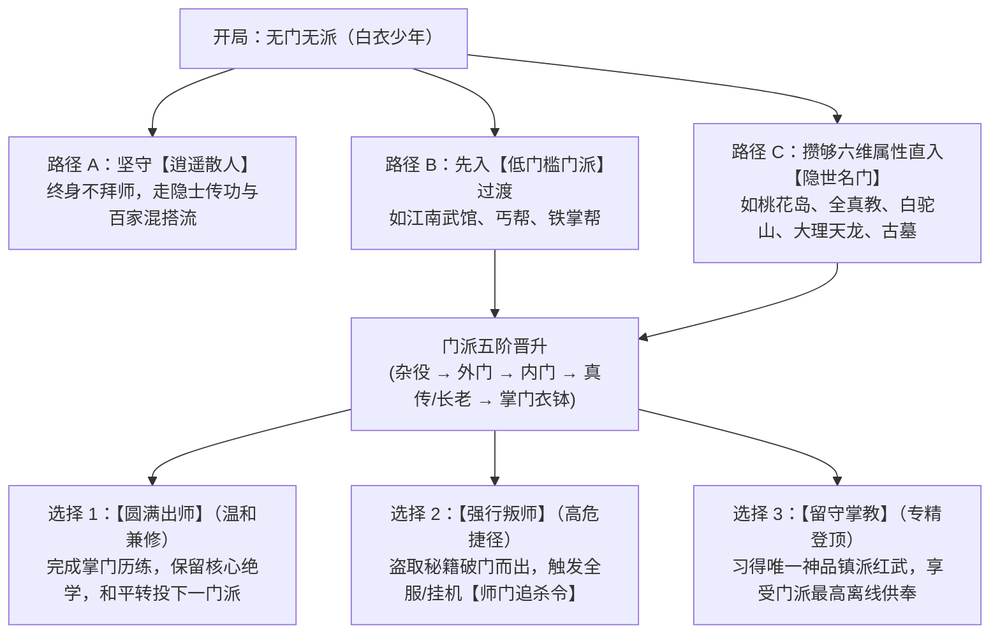

# 《金庸群侠：问道武林》门派晋升、考核、叛师与散人机制设定集

> **设计核心**：打破传统放置游戏“选定职业定终身”的死板套路，构建**“门派五阶晋升 $\rightarrow$ 圆满出师兼修百家 / 强行叛门遭追杀 / 终身白衣成散人武圣”**的高自由度江湖生态。一切考核、偷师、追杀均以极具金庸韵味的**文字交互**呈现。

---

## 一、 门派生涯与散人双轨制总览

玩家开局身为**【无门无派·白衣少年】**，在江湖历练中面临三条截然不同的武道成长路径：



---

## 二、 各大门派“五阶辈分”与晋升考核详情

每个门派内部均划分为 **5个辈分阶梯**。玩家通过在门派挂机当差或完成门派委托积累**【门派贡献】**，满值后必须通过一场极具原著特色的**【晋升文字考核】**方可升阶。

---

### 2.1 【丐帮】—— 升袋制度与污净之争（无门槛入门）

| 阶位 | 门派头衔 | 解锁权限与武学 | 晋升考核剧情与文字试炼 |
| :---: | :---: | :--- | :--- |
| **一阶** | **一袋弟子** | 习得《太祖长拳》《叫花身法》；解锁“讨饭化缘”挂机差事 | **【入门】**：无属性要求，仅需【侠义 $\ge 0$】，向鲁有脚奉上一碗酒即可入帮。 |
| **二阶** | **三袋弟子** | 习得《莲花落》《疯魔杖法》；气血低于50%时防御+10% | **【考核·捉拿采花贼】**：在嘉兴城外追缉恶霸，三回合内将其击倒。 |
| **三阶** | **六袋精锐**<br>*(分支抉择)* | 习得《混天气功》《逍遥游》；<br>必须选择加入**【污衣派】**（根骨/防御+15%）或**【净衣派】**（身法/铜钱收益+20%） | **【考核·轩辕台立威】**：面对净衣派彭长老的刁难，选择【硬接三掌不退（入污衣）】或【以巧辩折服众人（入净衣）】。 |
| **四阶** | **九袋护法长老** | 习得绝品《打狗棒法（前六诀）》《降龙掌（残篇三式）》；**解锁【圆满出师】权限** | **【考核·君山大会】**：揭穿杨康与简长老、彭长老夺权阴谋，连战三大长老车轮战。 |
| **五阶** | **神丐衣钵传人** | 习得神品**《降龙十八掌（全本）》《天下无狗》**，获传神兵**【绿玉打狗棒】** | **【终极考核·百味戏老毒物】**：为洪七公寻齐“叫花鸡、二十四桥明月夜、玉笛谁家听落梅”三道绝味，并在压鬼岛协助洪七公击退欧阳锋。 |

---

### 2.2 【桃花岛】—— 奇门音律与东邪门规（高悟性门槛）

| 阶位 | 门派头衔 | 解锁权限与武学 | 晋升考核剧情与文字试炼 |
| :---: | :---: | :--- | :--- |
| **一阶** | **候补扫花童** | 习得《桃华落英掌（基础）》《八卦步》 | **【入门】**：需【悟性 $\ge 45$】【身法 $\ge 35$】，持有【曲三铁八卦】并通过岸边桃花阵五步走位文字谜题。 |
| **二阶** | **记名弟子** | 习得《兰花拂穴手》《东风绝技》；离线挂机额外产出【九花玉露丸】 | **【考核·哑仆试剑】**：在不伤及岛上哑仆性命的前提下，于10回合内卸掉哑仆手中兵刃。 |
| **三阶** | **入室弟子**<br>*(冯默风同辈)* | 习得《落英神剑掌》《玉箫剑法》《奇门五转》 | **【考核·归云庄救师兄】**：下山协助陆乘风重振太湖归云庄，以奇门五行阵困住完颜洪烈卫队。 |
| **四阶** | **桃花岛真传** | 习得绝品《弹指神通》《旋风扫叶腿》；**解锁【圆满出师】权限** | **【考核·冯氏墓前】**：黄药师于亡妻墓前吹箫，你需在箫声内力威压下支撑8回合心神不乱（考校根骨与定力）。 |
| **五阶** | **东邪衣钵传人** | 习得神品**《碧海潮生曲》《九阴真经（桃花岛推演版）》**，获赠**【碧玉箫】** | **【终极考核·烟雨楼独抗群雄】**：当江南与中原武林误会黄药师害死七怪时，你挺身而出，携两位伙伴连破全真七子天罡北斗阵！ |

---

### 2.3 【全真教】—— 玄门正宗与打坐加倍（根骨与正气门槛）

* **一阶（知客道童） $\rightarrow$ 二阶（四代弟子） $\rightarrow$ 三阶（三代精锐） $\rightarrow$ 四阶（北斗护法·可出师） $\rightarrow$ 五阶（玄门掌教候选）**。
* **核心门派特权**：全真弟子在【闭关打坐】时，根据阶位享有 **15% ~ 40% 的离线修为额外加成**；但受限于门规**“戒酒色、戒杀生”**，全真弟子若【侠义值 $< 0$】或在酒馆奇遇中饮酒吃肉，会被扣除门派贡献并罚跪重阳宫！
* **五阶终极考核【天罡北斗大阵】**：与丘处机、马钰、王处一等六子同结北斗阵，迎战前来夺经的西毒欧阳锋，阵眼不破即获王重阳遗留秘籍**《先天功》**。

---

### 2.4 【白驼山庄】—— 西域毒道与逆练奇功（邪派高风险路线）

* **一阶（捕蛇杂役） $\rightarrow$ 二阶（饲毒使者） $\rightarrow$ 三阶（白衣护卫） $\rightarrow$ 四阶（白驼副总管·可出师） $\rightarrow$ 五阶（西毒少主）**。
* **核心门派特权**：可在门派毒窟中将普通暗器与兵刃淬炼**【西域怪蛇奇毒】**；与正派NPC交谈时自带“威吓”选项（可直接抢夺支线NPC财物，但侠义值暴跌）。
* **五阶终极考核【逆转经脉】**：欧阳锋强令你倒立试练篡改版《九阴真经》。若主角【根骨 $\ge 65$】挺过经脉逆行之痛，习得神品**《逆九阴·蛤蟆功》**（免疫一切点穴控制，攻击附带狂暴吸血）。

---

### 2.5 【终南古墓派】—— 寒玉苦修与原著“叛全真”彩蛋

* **常规拜入**：无门派散人且【身法 $\ge 50$】，在终南山后山解救被李莫愁围困的孙婆婆即可拜入。
* **🔥 原著情怀彩蛋路线：【叛全真·入古墓（复刻杨过之路）】**
  * 若玩家先拜入**【全真教】**升至二阶（四代弟子），在门派考核中故意选择**【顶撞赵志敬，打伤鹿清笃逃往后山】**；
  * 此时将**免除普通叛师的修为扣除惩罚**，直接触发《孙婆婆舍命相护》剧情，无缝拜入**【古墓派】**！且自带专属隐藏称号**【叛教孤鸿】**（学习《玉女心经》时自动补全其中的“全真内功克制篇”，对全真教与名门正派伤害永久+25%！）。

---

## 三、 【无门派·逍遥散人】专属成长轨与四大特权

如果玩家选择**“从头到尾不拜入任何门派”**（或出师后恢复自由身），绝不会沦为二等公民，反而将开启极具爽感的**“隐士奇遇与百家宗师”**路线：

### 3.1 散人五阶江湖声望头衔
随着主线推进与击败成名高手，散人自动晋升江湖名望：
`一阶：白衣少侠` $\rightarrow$ `二阶：独行快剑` $\rightarrow$ `三阶：百家里手` $\rightarrow$ `四阶：隐世奇侠` $\rightarrow$ `五阶：无冕武圣（与五绝平起平坐）`

### 3.2 散人独享的四大核心特权

| 特权名称 | 机制与文字表现说明 |
| :--- | :--- |
| **1. 【百无禁忌·武学混搭】** | 名门弟子装备敌对或异派武学有“真气冲突”（如全真弟子用《九阴白骨爪》威力降低30%）。而**散人毫无门派桎梏**，当4个槽位分别装配4个不同来源的功法时，激活被动**【兼收并蓄】**：全属性+20%，连击率+15%。 |
| **2. 【隐士无门户之见】** | 金庸笔下最强的高手往往讨厌名门规矩：<br>• **周伯通**：见你是无门派白衣，大喜过望，直接传授完整版**《双手互搏术》+《空明拳》**；<br>• **风清扬（笑傲篇）**：若你是散人，无需经历漫长思过崖任务，直接倾囊相授**《独孤九剑·九式合一》**；<br>• **侠客岛（终卷）**：散人因为没有学过僵化的各派剑法招式，参悟石壁《太玄经》的成功率比名门掌门高出 **50%**！ |
| **3. 【暗中窥武·实战偷师】** | 散人在与各大门派Boss交战时，战报界面独有一个**【凝神偷师】**按钮。只要在战斗中承受住对方绝招不死，且主角【悟性】达标，战后有概率直接领悟对方招式的**【散人推演版】**！ |
| **4. 【黑市鬼市通行证】** | 每晚子时开启“嘉兴鬼市”，名门弟子入内会被扣除侠义值，唯有散人可自由买卖各派流落的禁书残页与奇毒暗器。 |

---

## 四、 【圆满出师】vs【强行叛师】规则与追杀演出

为了允许玩家打造诸如“全真先天功 + 桃花弹指神通 + 古墓玉女剑”的跨门派Build，游戏设计了两种离开当前门派的方式：

### 4.1 方式一：圆满出师（堂堂正正，和平转门派）
* **开启条件**：达到当前门派 **四阶（真传/长老）**，门派贡献满值。
* **出师大考**：与本门掌门（或最高战力宿老）进行一场“十回合切磋考校”，撑过十回合不败即可获赐【出师玉牒】。
* **继承规则**：
  * **100%保留**已学会的门派外功、轻功与绝品（橙色）内功；
  * 门派专属的最高阶**神品（红色）镇派心法**（如全真《先天功》、白驼《逆九阴》）在转投其他门派时，威力折算为80%（作为辅修保底）；
  * 原门派好感度保持【敬重】，随时可回原门派购买丹药，且不会触发任何追杀。

---

### 4.2 方式二：强行叛师（欺师灭祖 / 盗经狂徒）
当玩家不想苦熬贡献值，或者在藏经阁偷学了高阶秘籍后想立刻转投死敌门派时，可点击**【破门叛师】**。

#### **1. 叛师即时铁则**
* **门派除名**：该门派好感度直接降为 **【不共戴天（-1000）】**，本存档内永久不可再次拜入该门派。
* **散功追讨**：掌门隔空震碎你体内20%的本门内功修为（若背包内提前备有奇珍【天山雪莲】或【九阴总纲护体】，可强行护住心脉免除折损！）。
* **武学保留**：已习得的招式**全部保留**（不会被系统强行删除技能槽，还原真实武侠的“偷学带走”爽感）。

#### **2. 【师门追杀令】动态挂机事件（核心文字演出）**
叛师后的 **72小时（或后续推进的15个关卡节点）** 内，玩家处于【师门通缉】状态。在日常挂机打坐或跑图时，文字框会突然变红报警：

```text
================ ⚠️ 【突发·师门追杀令】 ================
【风声鹤唳】你正在林间闭目吐纳，忽听四周竹叶飒飒作响，七道凌厉剑气已封死你全部退路！
【来敌现身】【全真教·丘处机】须发皆张，手按长剑喝道：
           “孽障！当日马师兄好心传你玄门吐纳正宗，你竟敢背弃祖师、私盗秘籍！今日便替重阳祖师清理门户！”
           >>> 触发强制遭遇战：【全真七子·天罡北斗截杀阵】！

👉 【选项 A：拔剑死战，以杀止杀！】（胜出可掠夺【全真剑谱残页】，彻底粉碎追杀令，恶名远播！）
👉 【选项 B：自断一成修为，磕头求饶】（损失当前等级30%修为，追杀令暂时解除）
👉 【选项 C：施展绝顶轻功，遁入云雾】（需【身法 ≥ 55】，65%概率无损逃脱）
=========================================================
```

#### **3. 反杀执法队后的逆天奖励**
若玩家与2位伙伴实力强横，连续 **3次反杀** 前来追杀的师门执法长老，原门派将因忌惮你的武功而撤回追杀令，同时主角获得唯一传奇红印称号：
* **【破门狂枭】**：*“欺师又如何？天地为炉，万法归我！”*（对原门派及同阵营敌人造成的最终伤害永久提升25%，暴击伤害提升30%）。

---

## 五、 门派日常挂机差事与文字互动池

加入门派后，主界面的“离线挂机日志”会根据玩家所在门派，动态刷出完全不同的门派生活文字，让纯文字世界充满烟火气：

* **【在桃花岛挂机】**：
  > *【申时·试剑亭】你帮哑仆清扫落英，忽闻竹林深处传来黄药师幽怨的箫声。你顺着箫声节拍挥掌，对《落英神剑掌》的虚实变化又多了一分领悟。（门派贡献 +35，悟性阅历 +120）*
* **【在丐帮挂机】**：
  > *【酉时·破庙篝火】你与几位污衣派师兄围坐火堆旁分食叫花鸡，鲁有脚长老拍着你的肩膀大笑，指点了你两招粗中有细的伏魔杖法。（门派贡献 +40，根骨阅历 +150）*
* **【在古墓派挂机】**：
  > *【亥时·寒玉床室】你盘坐于苦寒刺骨的千年寒玉床之上，初时冻得全身颤抖，急忙催动《玉女心经》抵御寒毒，半个时辰后，头顶白气蒸腾，内力精进神速！（门派贡献 +45，打坐真气收益翻倍！）*
* **【在白驼山庄挂机】**：
  > *【子时·万蛇毒窟】你提着竹篓深入地底毒窖投喂西域怪蛇，一条金环毒莽猛地窜起咬向你手腕，被你眼疾手快一指弹开，身法愈发诡谲敏捷。（门派贡献 +40，毒抗 +2，身法阅历 +130）*
