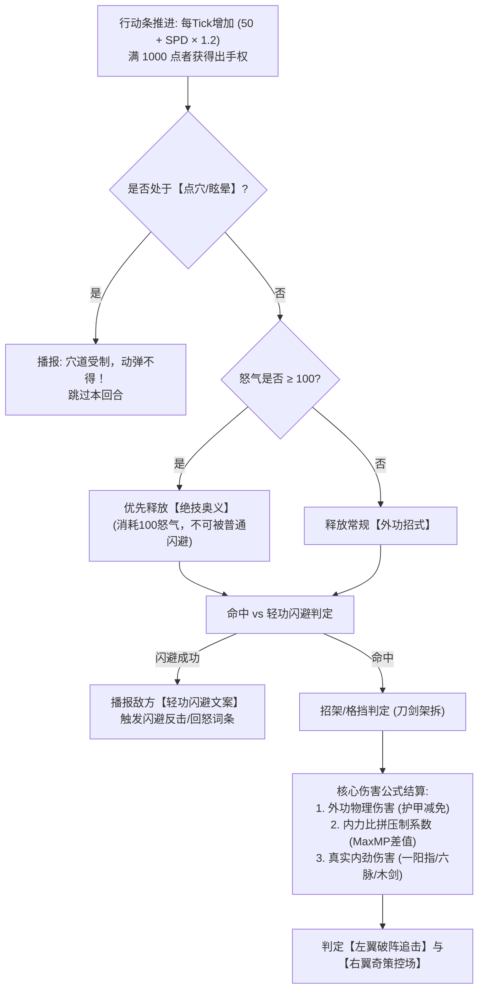

# 《金庸群侠：问道武林》放置数值模型、境界突破与战斗公式设定集

> **设计核心**：
> 1. **克制数值膨胀**：拒绝动辄“百亿/兆”的修仙式崩坏数值，保持纯正武侠的真实量感（新手百血、宗师数万血、终局百万血）。
> 2. **还原金庸“内力比拼”**：独创**【外功招式护甲减免 + 内力深浅压制】**双轨伤害公式，让“内力深厚者震伤对手、内力不足者强练神功反噬”在数据底层真实生效。
> 3. **挂机节奏张弛有度**：采用“平滑日常挂机 + 境界突破阶跃质变”曲线，精准控制首日、次日、7日与月度资料片成长体验。

---

## 一、 全局数值尺度与生命线控制

为保证文字战报阅读清爽，全周期（1~150级，跨越五部资料片）数值跨度控制在 **$10^3$ 到 $10^6$** 之间：

| 成长阶段 | 等级区间 | 对应剧情卷 | 主角标准气血 (HP) | 标准单次外功伤害 | 战力标杆 Boss 参考 |
| :--- | :---: | :--- | :---: | :---: | :--- |
| **初涉江湖** | 1 ~ 15 级 | 射雕·第一章 | $500 \sim 2,200$ | $80 \sim 350$ | 江南七怪 ($1,800$ HP) / 陈玄风 ($4,500$ HP) |
| **名动一方** | 16 ~ 45 级 | 射雕·二至三章 | $2,500 \sim 18,000$ | $400 \sim 3,200$ | 梁子翁 ($15,000$ HP) / 梅超风 ($32,000$ HP) |
| **一代宗师** | 46 ~ 75 级 | 射雕·华山论剑 | $20,000 \sim 85,000$ | $3,500 \sim 18,000$ | 裘千仞 ($120,000$ HP) / 华山五绝 ($250,000$ HP) |
| **大巧不工** | 76 ~ 105 级 | 神雕 & 倚天篇 | $90,000 \sim 320,000$ | $20,000 \sim 65,000$ | 金轮法王 / 百岁张三丰 ($800,000$ HP) |
| **震古烁今** | 106 ~ 135 级 | 笑傲 & 天龙篇 | $350,000 \sim 750,000$ | $70,000 \sim 160,000$ | 东方不败 / 少室山扫地僧 ($2,500,000$ HP) |
| **天人合一** | 136 ~ 150 级 | 侠客岛·终卷 | $800,000 \sim 1,500,000$ | $180,000 \sim 350,000$ | 龙岛主 & 木岛主合击 ($6,000,000$ HP) |

---

## 二、 武道十重境界突破表（Milestone System）

主角每提升 **15级** 需进行一次**【大境界冲穴突破】**（每个大境界内含：*初境 $\rightarrow$ 中境 $\rightarrow$ 极境* 三个小台阶）。如果不突破境界，等级经验（真气）将只储存不升级。

| 境界重数 | 境界名称 | 等级范围 | 需打通经脉 / 玄关 | 突破核心解锁权限与全属性阶跃 | 突破成功率基础公式 |
| :---: | :---: | :---: | :--- | :--- | :--- |
| **第一重** | **【初窥门径】** | 1 ~ 15 | 手三阳经 | 解锁基础外功槽、轻功槽；离线打坐倍率 $1.0\times$ | $100\%$（新手保底） |
| **第二重** | **【略有小成】** | 16 ~ 30 | 足三阴经 | **解锁【内功心法槽】**；全四维属性 $+10\%$ | $85\% + \text{根骨}\times 0.3\%$ |
| **第三重** | **【融会贯通】** | 31 ~ 45 | 阳维脉 / 阴维脉 | **解锁【左翼·破阵伙伴位】**；离线打坐倍率 $1.5\times$ | $75\% + \text{根骨}\times 0.3\%$ |
| **第四重** | **【炉火纯青】** | 46 ~ 60 | 阳跷脉 / 阴跷脉 | **解锁【右翼·奇策伙伴位】与【绝技槽】**；全属性 $+15\%$ | $65\% + \text{根骨}\times 0.25\%$ |
| **第五重** | **【一代宗师】** | 61 ~ 75 | **任督二脉（生死玄关）** | **解锁【全队秘宝槽】**；内力生生不息（每回合自动回内 $+10\%$），1.0满级标志 | $50\% + \text{根骨}\times 0.2\%$ |
| **第六重** | **【登峰造极】** | 76 ~ 90 | 冲脉（气冲云霄） | 解锁【剑冢神兵共鸣】；外功招式附带真气护甲穿透 $+20\%$ | $45\% + \text{悟性}\times 0.2\%$ |
| **第七重** | **【出神入化】** | 91 ~ 105 | 带脉（阴阳交泰） | 解锁【自创绝学槽位】；受击时自动触发护体罡气反震 | $40\% + \text{悟性}\times 0.2\%$ |
| **第八重** | **【震古烁今】** | 106 ~ 120 | 奇经八脉小周天 | 解锁【实战看破/破招机制】；全队连携率上限提升至 $75\%$ | $35\% + \text{悟性}\times 0.15\%$ |
| **第九重** | **【返璞归真】** | 121 ~ 135 | 奇经八脉大周天 | 解锁【六脉化气/隔空伤人】；普攻可转化为无视护甲的内劲伤害 | $30\% + \text{福缘}\times 0.15\%$ |
| **第十重** | **【天人合一】** | 136 ~ 150 | **泥丸宫（天人界限）** | 勘破《太玄经》，武学槽位解除一切门派与兵器限制 | $25\% + \text{全六维均值}\times 0.1\%$ |

> 💡 **【冲穴失败与“走火入魔”文字机制】**
> * 当玩家在突破第五重【任督二脉】及以上境界失败时，**不会倒扣等级**，而是触发文字状态**【经脉逆行·小走火】**（持续15分钟，期间出战气血上限 $-15\%$），同时本次失败为你永久增加 **$+15\%$ 的下次冲穴保底成功率**。
> * 服用桃花岛【九花玉露丸】或全真【纯阳金丹】可直接提升单次突破成功率 $20\% \sim 35\%$。

---

## 三、 六维基础属性 $\rightarrow$ 二级战斗属性换算公式

角色面板由 **主属性（六维：臂力、根骨、身法、悟性、福缘、侠义）** 与 **二级战斗属性** 构成。换算公式如下：

### 3.1 核心二级属性计算公式
设角色当前等级为 $L$，境界倍率为 $M_{\text{realm}}$（第一重为 $1.0$，每升一重增加 $0.25$）：

1. **最大气血 (Max HP)**：由【等级】、【根骨 (CON)】与【内功/衣甲】共同决定
   $$\text{MaxHP} = \left( 300 + L \times 85 + \text{CON} \times 45 \right) \times M_{\text{realm}} \times (1 + \text{内功气血加成}\%) + \text{装备固定气血}$$

2. **最大内力 (Max MP / 真气池)**：决定高阶招式释放与“内力比拼”减伤
   $$\text{MaxMP} = \left( 100 + L \times 30 + \text{CON} \times 25 + \text{INT} \times 10 \right) \times M_{\text{realm}} \times (1 + \text{心法内力加成}\%)$$

3. **外功攻击力 (ATK)**：由【臂力 (STR)】与【身法 (AGI)】提供
   $$\text{ATK} = \left( 40 + L \times 12 + \text{STR} \times 8.5 + \text{AGI} \times 2.5 \right) \times M_{\text{realm}} + \text{兵刃攻击力}$$

4. **护体防御 (DEF)**：由【根骨 (CON)】与【臂力 (STR)】提供
   $$\text{DEF} = \left( 20 + L \times 6 + \text{CON} \times 5.5 + \text{STR} \times 2.0 \right) \times M_{\text{realm}} + \text{衣甲防御力}$$

5. **行动速度 (SPD)**：完全由【身法 (AGI)】与【轻功槽】决定
   $$\text{SPD} = 100 + \text{AGI} \times 3.2 + \text{轻功速度加成}$$

6. **概率类属性（采用边际递减公式，防止堆满100%无敌）**：
   * **闪避率 (EVA)**：
     $$\text{EVA} = \text{BaseEVA} + \frac{\text{AGI}}{\text{AGI} + 180 + L \times 4} \times 50\% + \text{轻功闪避词条}$$
     *(注：封顶上限为 $65\%$，除非触发《凌波微步》等必闪特技)*
   * **暴击率 (CRIT)**：
     $$\text{CRIT} = 5\% + \frac{\text{AGI} \times 0.6 + \text{INT} \times 0.4}{\text{AGI} + \text{INT} + 250} \times 45\% + \text{兵刃/外功暴击词条}$$
   * **连击率 (COMBO)**（普攻或外功出手后再次出招概率）：
     $$\text{COMBO} = \frac{\text{AGI} \times 0.5 + \text{INT} \times 0.5}{400 + L \times 5} \times 40\% + \text{双手互搏/软剑加成}$$

---

## 四、 回合制核心战斗引擎与结算公式

本游戏采用**“动态行动条 (ATB) + 怒气插队 + 1主2副连携”**的纯文字播报战斗模型。

---

### 4.1 命中、闪避与招架判定（决定战报文字分支）

当攻击方 $A$ 对防守方 $B$ 出手时，依次进行两次掷骰判定：

1. **轻功闪避判定**：
   $$\text{实际命中率 } P_{\text{hit}} = \text{Clamp}\left( 95\% + \text{Hit}_A - \text{EVA}_B,\; 30\%,\; 100\% \right)$$
   * **若未命中**：伤害为 $0$，直接输出防守方装备的**【轻功闪避专属文字】**（如：*“黄药师足踏奇门方位，衣袂微拂，你的掌力擦身而过，击空在三尺之外！”*）。
2. **拆招架卸（格挡）判定**：
   若命中，则判定防守方是否成功“拆招格挡”：
   $$P_{\text{parry}} = 10\% + \frac{\text{INT}_B - \text{INT}_A}{500} + \text{兵刃招架率}$$
   * **若触发招架**：本次受到的外功伤害降低 **$40\%$**，战报输出**【兵刃交击文字】**（如：*“当的一声火星四溅！对方横剑当胸，硬生生卸去你四成掌力！”*）。

---

### 4.2 核心伤害结算公式（外功护甲 + 内力比拼双轨制）

为了完美体现金庸小说中**“内力深厚者一掌震退内力浅薄者”**的设定，总伤害 $D_{\text{total}}$ 由**【外功招式伤害 $D_{\text{phys}}$】**与**【内劲气功伤害 $D_{\text{qi}}$】**两部分组成：

#### **第一步：计算外功护甲减免率 $R_{\text{def}}$**
采用平滑双曲线公式，确保防御永远有效但不会出现“破不了防打1点血”的死局：
$$R_{\text{def}} = \frac{\text{DEF}_B \times (1 - \text{穿透}_A)}{\text{DEF}_B \times (1 - \text{穿透}_A) + 120 \times L_A + 800}$$

#### **第二步：计算金庸特色【内力深浅压制系数 $K_{\text{mp}}$】**
比较攻击方当前内力上限 $\text{MaxMP}_A$ 与防守方内力上限 $\text{MaxMP}_B$：
$$K_{\text{mp}} = \text{Clamp}\left( 1 + 0.25 \times \frac{\text{MaxMP}_A - \text{MaxMP}_B}{\text{MaxMP}_B},\; 0.75,\; 1.50 \right)$$
* **设计效果**：若你的内力上限是敌人的2倍以上，你的所有招式自带 **$+25\% \sim +50\%$ 的内力碾压增伤**，且战报自动追加描述：*“（你内力沛然莫之能御，震得对方气血翻涌！）”*。

#### **第三步：最终单次伤害汇总**
$$D_{\text{phys}} = \text{ATK}_A \times \text{武学倍率} \times (1 - R_{\text{def}}) \times K_{\text{mp}}$$
$$D_{\text{qi}} = \text{ATK}_A \times \text{内劲转化率} \times K_{\text{mp}} \quad (\text{无视外功护甲 DEF，如《一阳指》《六脉神剑》})$$
$$D_{\text{final}} = (D_{\text{phys}} + D_{\text{qi}}) \times \text{暴击倍率}(1.5 + \text{暴伤}) \times \text{招架折减}(0.6 \text{ or } 1.0) \times \text{正邪克制系数} \times \text{随机浮动}(0.95 \sim 1.05)$$

---

### 4.3 怒气循环与“1主角 + 2伙伴”连携公式

1. **怒气获取规则（满 100 怒气释放绝技）**：
   * 主角每次主动出招：**$+25$ 怒气**（若暴击额外 $+10$ 怒气）；
   * 主角每次受到攻击：**$+15$ 怒气**（穿戴【百衲丐衣】或修习《九阳神功》受击额外 $+10$ 怒气）。
2. **左翼伙伴（破阵位）连携追击概率**：
   当主角施展外功命中敌方后，左翼伙伴（如郭靖、杨过、洪七公）立即触发合击的概率为：
   $$P_{\text{assist\_atk}} = 25\%(\text{基础}) + \text{好感度等级}\times 3\% + \text{羁绊共鸣加成}(15\%) + \text{《武穆遗书》加成}(25\%)$$
   * **追击伤害**：等于左翼伙伴自身攻击力的 **$110\%$**，每回合最多触发1次。
3. **右翼伙伴（奇策位）援护与控场概率**：
   * **挡刀/化解**：当主角即将承受致死或暴击伤害时，右翼伙伴（如黄蓉、小龙女）有 $30\% + \text{好感度}\times 3\%$ 概率插队施展巧劲，替主角化解 **$50\%$** 伤害；
   * **奇策点穴**：每 **2个大回合** 结束时，右翼伙伴固定出手一次，释放专属控场/回血技能。

---

## 五、 离线挂机经济与养成消耗曲线

放置游戏的核心留存依赖于“睡一觉起来就能突破升阶”的确定性反馈。

### 5.1 离线打坐修为（真气）产出公式
玩家所处的当前主线章节序号为 $C$（如射雕第一章第1节为 $C=1$，第五章末节为 $C=25$）：

$$\text{每小时基础真气 } G_{\text{base}}(C) = 1000 \times (1.18)^{C - 1}$$

$$\text{玩家实际每小时收益 } G_{\text{actual}} = G_{\text{base}}(C) \times \left(1 + \frac{\text{根骨}}{100}\right) \times (1 + \text{内功吐纳词条} + \text{门派阶位加成} + \text{道袍加成})$$

* **离线时长上限**：基础 **12小时**（穿戴全真道袍或激活月卡【闭关聚灵阵】可延长至 **24小时**）。
* **快速闭关（顿悟）**：每日可免费使用1次“顿悟”，立即获得当前 **2小时** 的挂机真气、铜钱与残页掉落。

---

### 5.2 角色升级与武学参悟消耗曲线（卡点节奏表）

设升级所需真气为 $\text{Exp}(L)$，为了匹配玩家的离线挂机产出，设计分段指数曲线：

$$\text{Exp}(L) = \text{Round}\left( 500 \times (L)^{1.65} \times (1.12)^{\lfloor L / 5 \rfloor} \right)$$

| 时间节点 | 预期玩家等级 | 达到的武道境界 | 当日核心爽点与卡点设计 |
| :--- | :---: | :---: | :--- |
| **Day 1（首日）** | 1 ~ 22 级 | 第二重【略有小成】 | 约2小时推完《射雕》第一章，拜入首个门派，装备第一本蓝色内功；卡在第二章赵王府梁子翁前，引导睡前挂机。 |
| **Day 2（次留）** | 23 ~ 35 级 | 第三重【融会贯通】 | 早起收取8小时离线真气，一键连升8级！冲破阳维脉，**解锁【左翼伙伴位】（郭靖/穆念慈上阵）**，轻松碾压昨日卡点Boss。 |
| **Day 4（中期）** | 36 ~ 48 级 | 第四重【炉火纯青】 | 登临桃花岛，**解锁【右翼伙伴位】（黄蓉入队）**，“1主+2副”三人行阵容正式成型，开启《双手互搏》奇遇。 |
| **Day 7（周留）** | 49 ~ 62 级 | 第五重【一代宗师】 | 冲击任督二脉生死玄关！参与全服首届【华山论剑】，集齐第一门神品红武《降龙十八掌》或《九阴真经》。 |
| **Day 14 ~ 30** | 63 ~ 75 级 | 射雕篇大圆满 | 尝试【圆满出师】或【叛师】兼修第二门派武学，打造完美Build，备战 **2.0《神雕篇·独孤剑冢》** 资料片开启。 |

---

### 5.3 武学参悟（技能升级）消耗公式
每门武学分为 **1 ~ 10重（圆满）**。升重需消耗【修为真气】与【武学领悟度（由悟性折算）】：
$$\text{第 } k \text{ 重参悟消耗真气} = \text{品质基数 } B_{\text{tier}} \times k^2 \times \left( 1 - \frac{\text{悟性}}{\text{悟性} + 200} \right)$$
* **品质基数 $B_{\text{tier}}$**：凡品(绿) $= 500$，良品(蓝) $= 1,500$，上品(紫) $= 4,500$，绝品(橙) $= 15,000$，神品(红) $= 50,000$。
* **悟性高者的优势**：当主角【悟性 $= 100$】时，参悟所有天下武学消耗的真气直接减少 **$33.3\%$**！这让高悟性的桃花岛/散人路线在后期多流派成型速度上拥有极大优势。
