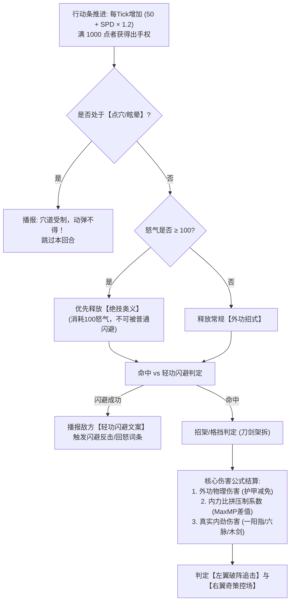

# 《金庸群侠：问道武林》放置数值模型、境界突破与战斗公式设定集

> **设计核心**：
> 1. **克制数值膨胀**：拒绝动辄“百亿/兆”的修仙式崩坏数值，保持纯正武侠的真实量感（新手百血、宗师数万血、终局百万血）。
> 2. **还原金庸“内力比拼”**：独创**【外功招式护甲减免 + 内力深浅压制】**双轨伤害公式，让“内力深厚者震伤对手、内力不足者强练神功反噬”在数据底层真实生效。
> 3. **挂机节奏张弛有度**：采用“平滑日常挂机 + 境界突破阶跃质变”曲线，精准控制首日、次日、7日与月度资料片成长体验。

> **⚠️ 版本说明（按 00 册裁决规则）**：本册的境界体系、冲穴公式与战斗公式仍是权威底稿；但**首日成长节奏以第 17 册为准**（Day1 到 Lv15，而非本册 5.2 的 Lv22），**十重境界与穴位清单以第 16 册为准**，**中长期通关时长以第 13/14 册的 704 有效小时为准**。5.2 的次日/7日曲线仅保留作为早期推演参考。

---

## 一、 全局数值尺度与生命线控制

为保证文字战报阅读清爽，全周期（1~150级，跨越五部资料片）数值跨度控制在 **$10^3$ 到 $10^6$** 之间：

| 成长阶段 | 等级区间 | 对应剧情卷 | 主角标准气血 (HP) | 标准单次外功伤害 | 战力标杆 Boss 参考 |
| :--- | :---: | :--- | :---: | :---: | :--- |
| **初涉江湖** | 1 ~ 15 级 | 射雕·第一章 | $500 \sim 2,200$ | $80 \sim 350$ | 江南七怪 ($1,800$ HP) / 陈玄风 ($4,500$ HP) |
| **名动一方** | 16 ~ 45 级 | 射雕·二至三章 | $2,500 \sim 18,000$ | $400 \sim 3,200$ | 梁子翁 ($15,000$ HP) / 梅超风 ($32,000$ HP) |
| **一代宗师** | 46 ~ 75 级 | 射雕·华山论剑 | $20,000 \sim 85,000$ | $3,500 \sim 18,000$ | 裘千仞 ($120,000$ HP) / 华山五绝 ($250,000$ HP) |
| **大巧不工** | 76 ~ 105 级 | 神雕 & 倚天篇 | $90,000 \sim 320,000$ | $20,000 \sim 65,000$ | 金轮法王 / 百岁张三丰 ($800,000$ HP) |
| **震古烁今** | 106 ~ 135 级 | 笑傲 & 天龙篇 | $350,000 \sim 750,000$ | $70,000 \sim 160,000$ | 东方不败 / 少室山扫地僧 ($2,500,000$ HP) |
| **天人合一** | 136 ~ 150 级 | 侠客岛·终卷 | $800,000 \sim 1,500,000$ | $180,000 \sim 350,000$ | 龙岛主 & 木岛主合击 ($6,000,000$ HP) |

---

## 二、 武道十重境界突破表（每10级一大境界 · 经脉冲穴）

> 口径提示：**Lv10 达成第一重【初窥门径】圆满即冲击第二重**，首日逐分钟动线见第 17 册；各重穴位清单以第 16 册为准。

主角每提升 **10级** 需进行一次**【大境界经脉冲穴突破】**。在冲穴突破前，必须使用真气点通当前经脉的全部核心穴位（详见《16_四大金庸特色系统》）。如果不突破境界，等级经验（真气）将只储存不升级。

| 境界重数 | 境界名称 | 等级范围 | 贯通经脉与原著渊源 | 突破核心解锁权限与全属性阶跃 | 突破成功率基础公式 |
| :---: | :---: | :---: | :--- | :--- | :--- |
| **第一重** | **【初窥门径】** | **1 ~ 10** | **手三阳经** (大肠/三焦/小肠) | 解锁基础外功槽、轻功槽、**暗器奇门槽**；离线打坐倍率 $1.0\times$ | $100\%$（新手保底必成） |
| **第二重** | **【略有小成】** | **11 ~ 20** | **足三阴经** (脾经/肾经/肝经) | **解锁【内功心法槽】与【左翼·破阵伙伴位】**；打坐倍率 $1.25\times$；全属性 $+10\%$ | $85\% + \text{根骨}\times 0.2\%$ |
| **第三重** | **【融会贯通】** | **21 ~ 30** | **阳维脉 · 阴维脉** *(第一卷射雕篇大圆满)* | **解锁【右翼·奇策伙伴位】与【绝技奥义槽】**；打坐倍率 $1.5\times$；全属性 $+15\%$ | $75\% + \text{根骨}\times 0.15\%$ |
| **第四重** | **【炉火纯青】** | **31 ~ 40** | **阳跷脉 · 阴跷脉** (神雕前期) | 神功解锁第 4~5 重上限；解锁【侠侣双剑合璧】羁绊连携 | $65\% + \text{根骨}\times 0.15\%$ |
| **第五重** | **【出类拔萃】** | **41 ~ 50** | **带脉** (神雕中期·绝情幽谷) | 免疫毒功导致之真气流失；解锁自创绝学融合雏形 | $55\% + \text{根骨}\times 0.1\%$ |
| **第六重** | **【神乎其技】** | **51 ~ 60** | **冲脉** *(第二卷神雕篇大圆满)* | 神功解锁第 6 重上限；领悟【玄铁重剑·粉碎格挡】 | $50\% + \text{悟性}\times 0.1\%$ |
| **第七重** | **【登峰造极】** | **61 ~ 70** | **奇经八脉小周天** (倚天前期) | 解锁【太极借力反伤】；外功普攻附带 20% 真实内劲 | $45\% + \text{悟性}\times 0.1\%$ |
| **第八重** | **【一代宗师】** | **71 ~ 80** | **任脉** (阴脉之海·光明顶决战) | 解锁【全队宗师秘宝槽】；每回合行动自动净化一层负面状态 | $40\% + \text{悟性}\times 0.1\%$ |
| **第九重** | **【震古烁今】** | **81 ~ 90** | **督脉·生死玄关** *(第三卷倚天篇大圆满)* | **【神功大圆满解封】**：全武学解禁第 7~10 重；内力生生不息 | $35\% + \text{悟性}\times 0.1\%$ |
| **第十重** | **【天人合一】** | **91 ~ 100+** | **泥丸天门 · 太玄归一** (侠客行) | 招式打破门派兵器界限，万法随心，化气为无形真力 | $30\% + \text{全六维均值}\times 0.05\%$ |

> 💡 **【冲穴专属灵丹与“走火入魔”保护机制】**
> * 当玩家在突破境界失败时，**绝不倒扣等级与真气**，触发文字状态**【气血微沸·小走火】**（持续15分钟，期间出战气血上限 $-10\%$），同时本次失败为你**永久追加 $+20\%$ 的下次必定成功保底补偿**，直到突破成功！
> * **冲穴专属灵丹辅助体系**：
>   * 服用**【玄门·聚气通脉丹】**：可直接抵扣全部真气消耗，瞬间冲通任意常规穴位；
>   * 服用**【纯阳·通脉破障丹】**：专用于大境界关隘冲击，直接提升单次突破成功率 **$+35\%$**；
>   * 随身含服**【天山·冰魄护心丹】**：若突破失败，**$100\%$ 免疫走火入魔状态**，返还全部消耗真气，并为下次突破追加 **$+25\%$** 保底成功率；
>   * 服用**【少林·大乘小还丹】**：直接连续贯通当前经脉 **3 个穴位**，并永久提升根骨 $+6$、内力上限 $+300$；
>   * 吞服**【神品·九转通窍仙丹】**：整条经脉所有剩余穴道**瞬息全通**，全属性永久 $+12$！

---

## 三、 六维基础属性 $\rightarrow$ 二级战斗属性换算公式

角色面板由 **主属性（六维：臂力、根骨、身法、悟性、福缘、侠义）** 与 **二级战斗属性** 构成。换算公式如下：

### 3.1 核心二级属性计算公式
设角色当前等级为 $L$，境界倍率为 $M_{\text{realm}}$（第一重为 $1.0$，每升一重增加 $0.25$）：

1. **最大气血 (Max HP)**：由【等级】、【根骨 (CON)】与【内功/衣甲】共同决定
   $$\text{MaxHP} = \left( 300 + L \times 85 + \text{CON} \times 45 \right) \times M_{\text{realm}} \times (1 + \text{内功气血加成}\%) + \text{装备固定气血}$$

2. **最大内力 (Max MP / 真气池)**：决定高阶招式释放与“内力比拼”减伤
   $$\text{MaxMP} = \left( 100 + L \times 30 + \text{CON} \times 25 + \text{INT} \times 10 \right) \times M_{\text{realm}} \times (1 + \text{心法内力加成}\%)$$

3. **外功攻击力 (ATK)**：由【臂力 (STR)】与【身法 (AGI)】提供
   $$\text{ATK} = \left( 40 + L \times 12 + \text{STR} \times 8.5 + \text{AGI} \times 2.5 \right) \times M_{\text{realm}} + \text{兵刃攻击力}$$

4. **护体防御 (DEF)**：由【根骨 (CON)】与【臂力 (STR)】提供
   $$\text{DEF} = \left( 20 + L \times 6 + \text{CON} \times 5.5 + \text{STR} \times 2.0 \right) \times M_{\text{realm}} + \text{衣甲防御力}$$

5. **行动速度 (SPD)**：完全由【身法 (AGI)】与【轻功槽】决定
   $$\text{SPD} = 100 + \text{AGI} \times 3.2 + \text{轻功速度加成}$$

6. **概率类属性（采用边际递减公式，防止堆满100%无敌）**：
   * **闪避率 (EVA)**：
     $$\text{EVA} = \text{BaseEVA} + \frac{\text{AGI}}{\text{AGI} + 180 + L \times 4} \times 50\% + \text{轻功闪避词条}$$
     *(注：封顶上限为 $65\%$，除非触发《凌波微步》等必闪特技)*
   * **暴击率 (CRIT)**：
     $$\text{CRIT} = 5\% + \frac{\text{AGI} \times 0.6 + \text{INT} \times 0.4}{\text{AGI} + \text{INT} + 250} \times 45\% + \text{兵刃/外功暴击词条}$$
   * **连击率 (COMBO)**（普攻或外功出手后再次出招概率）：
     $$\text{COMBO} = \frac{\text{AGI} \times 0.5 + \text{INT} \times 0.5}{400 + L \times 5} \times 40\% + \text{双手互搏/软剑加成}$$

---

## 四、 回合制核心战斗引擎与结算公式

本游戏采用**“动态行动条 (ATB) + 怒气插队 + 1主2副连携”**的纯文字播报战斗模型。

---

### 4.1 命中、闪避与招架判定（决定战报文字分支）

当攻击方 $A$ 对防守方 $B$ 出手时，依次进行两次掷骰判定：

1. **轻功闪避判定**：
   $$\text{实际命中率 } P_{\text{hit}} = \text{Clamp}\left( 95\% + \text{Hit}_A - \text{EVA}_B,\; 30\%,\; 100\% \right)$$
   * **若未命中**：伤害为 $0$，直接输出防守方装备的**【轻功闪避专属文字】**（如：*“黄药师足踏奇门方位，衣袂微拂，你的掌力擦身而过，击空在三尺之外！”*）。
2. **拆招架卸（格挡）判定**：
   若命中，则判定防守方是否成功“拆招格挡”：
   $$P_{\text{parry}} = 10\% + \frac{\text{INT}_B - \text{INT}_A}{500} + \text{兵刃招架率}$$
   * **若触发招架**：本次受到的外功伤害降低 **$40\%$**，战报输出**【兵刃交击文字】**（如：*“当的一声火星四溅！对方横剑当胸，硬生生卸去你四成掌力！”*）。

---

### 4.2 核心伤害结算公式（外功护甲 + 内力比拼双轨制）

为了完美体现金庸小说中**“内力深厚者一掌震退内力浅薄者”**的设定，总伤害 $D_{\text{total}}$ 由**【外功招式伤害 $D_{\text{phys}}$】**与**【内劲气功伤害 $D_{\text{qi}}$】**两部分组成：

#### **第一步：计算外功护甲减免率 $R_{\text{def}}$**
采用平滑双曲线公式，确保防御永远有效但不会出现“破不了防打1点血”的死局：
$$R_{\text{def}} = \frac{\text{DEF}_B \times (1 - \text{穿透}_A)}{\text{DEF}_B \times (1 - \text{穿透}_A) + 45 \times L_A + 450}$$

#### **第二步：计算金庸特色【内力深浅压制系数 $K_{\text{mp}}$】**
比较攻击方当前内力上限 $\text{MaxMP}_A$ 与防守方内力上限 $\text{MaxMP}_B$：
$$K_{\text{mp}} = \text{Clamp}\left( 1 + 0.25 \times \frac{\text{MaxMP}_A - \text{MaxMP}_B}{\text{MaxMP}_B},\; 0.75,\; 1.50 \right)$$
* **设计效果**：若你的内力上限是敌人的2倍以上，你的所有招式自带 **$+25\% \sim +50\%$ 的内力碾压增伤**，且战报自动追加描述：*“（你内力沛然莫之能御，震得对方气血翻涌！）”*。

#### **第三步：最终单次伤害汇总**
$$D_{\text{phys}} = \text{ATK}_A \times \text{武学倍率} \times (1 - R_{\text{def}}) \times K_{\text{mp}}$$
$$D_{\text{qi}} = \text{ATK}_A \times \text{内劲转化率} \times K_{\text{mp}} \quad (\text{无视外功护甲 DEF，如《一阳指》《六脉神剑》})$$
$$D_{\text{final}} = (D_{\text{phys}} + D_{\text{qi}}) \times \text{暴击倍率}(1.5 + \text{暴伤}) \times \text{招架折减}(0.6 \text{ or } 1.0) \times \text{正邪克制系数} \times \text{随机浮动}(0.95 \sim 1.05)$$

---

### 4.3 怒气循环与“1主角 + 2伙伴”连携公式

1. **怒气获取规则（满 100 怒气释放绝技）**：
   * 主角每次主动出招：**$+25$ 怒气**（若暴击额外 $+10$ 怒气）；
   * 主角每次受到攻击：**$+15$ 怒气**（穿戴【百衲丐衣】或修习《九阳神功》受击额外 $+10$ 怒气）。
2. **左翼伙伴（破阵位）连携追击概率**：
   当主角施展外功命中敌方后，左翼伙伴（如郭靖、杨过、洪七公）立即触发合击的概率为：
   $$P_{\text{assist\_atk}} = 25\%(\text{基础}) + \text{好感度等级}\times 3\% + \text{羁绊共鸣加成}(15\%) + \text{《武穆遗书》加成}(25\%)$$
   * **追击伤害**：等于左翼伙伴自身攻击力的 **$110\%$**，每回合最多触发1次。
3. **右翼伙伴（奇策位）援护与控场概率**：
   * **挡刀/化解**：当主角即将承受致死或暴击伤害时，右翼伙伴（如黄蓉、小龙女）有 $30\% + \text{好感度}\times 3\%$ 概率插队施展巧劲，替主角化解 **$50\%$** 伤害；
   * **奇策点穴**：每 **2个大回合** 结束时，右翼伙伴固定出手一次，释放专属控场/回血技能。

---

### 4.4 胜负判定与阶梯式狂暴机制（彻底杜绝平局与挂机刮痧）

在金庸武侠的世界里，高手生死相搏讲究**“狭路相逢勇者胜”**，绝无“点到为止算平局”的软弱机制。为了避免纯防御龟缩流无限拖回合，并检验玩家是否穿齐当前地图掉落装备，战斗系统彻底废除固定回合平局制，引入**【阶梯式首领狂暴机制 (Enrage System)】**：

#### **1. 阶梯狂暴触发回合 $R_{\text{enrage}}$ 实测定线**
通过挂载 1~30 级全 30 套当前地图专属装备与首领实测模拟，确立如下动态狂暴线：
* **前期初入江湖（首领 HP $\le 10,000$）**：**第 12 回合** 触发狂暴（正常当图装备 2 ~ 5 回合通关，宽限容错 7 回合）。
* **中期渐入佳境（首领 HP $10,001 \sim 50,000$）**：**第 16 回合** 触发狂暴（正常当图装备 7 ~ 11 回合通关，宽限容错 5 ~ 9 回合）。
* **后期绝巅决战（首领 HP $> 50,000$）**：**第 22 回合** 触发狂暴（如华山之巅疯魔欧阳锋 $140,000$ HP，毕业神装需 21 回合击杀，提供 1 ~ 2 回合极限心跳斩杀窗）。
* **PVP 华山论剑 / 仇敌劫镖**：**第 15 回合** 强制狂暴，双方杀气爆发。
* **团队副本（少室山金刚伏魔圈）**：**第 22 回合** 触发狂暴。

#### **2. 狂暴期数值惩罚与斩杀机制**
* **杀气冲霄（狂暴播报）**：到达狂暴线当回合，首领双目赤红，战报插播专属水墨书法破屏横幅【首领狂暴】，并宣告：*“对方久战不克，走火入魔陷入【狂暴】！周身杀气逆冲，招式威力暴涨且无法闪避！”*
* **复合攻击力递增**：狂暴状态下，首领攻击力按每回合 **$+35\%$ 复合倍增**：
  $$\text{ATK}_{\text{enrage}}(R) = \text{ATK}_{\text{base}} \times (1.35)^{R - R_{\text{enrage}} + 1}$$
* **绝对破避**：狂暴状态下首领攻击无法被轻功闪避，破除纯闪避赖皮流。
* **绝对灭顶绝杀（硬狂暴上限）**：狂暴开始后仅给予 **4 回合极限搏杀宽限期**。若在第 $R_{\text{enrage}} + 4$ 回合仍未将首领击杀，首领施展【走火入魔·狂血焚天】，造成 **$99,999$ 点无视防御真实伤害**，强制终结对决。

#### **3. 确定性胜负法则**
* **胜利**：仅当敌方全体目标气血归零时，判定为己方胜利 (`ALLY`) 并掉落图纸装备。
* **败北**：只要己方倒下，或被狂暴绝杀，一律判定为失败 (`ENEMY`)，杜绝任何平局。未能过关的玩家将明确收到装备提示，指引其回对应地图刷齐当级专属套装、洗炼词条或升级武学境界！

---

## 五、 离线挂机经济与养成消耗曲线

放置游戏的核心留存依赖于“睡一觉起来就能突破升阶”的确定性反馈。

### 5.1 离线打坐修为（真气）产出公式
玩家所处的当前主线章节序号为 $C$（如射雕第一章第1节为 $C=1$，第五章末节为 $C=25$）：

$$\text{每小时基础真气 } G_{\text{base}}(C) = 1000 \times (1.18)^{C - 1}$$

$$\text{玩家实际每小时收益 } G_{\text{actual}} = G_{\text{base}}(C) \times \left(1 + \frac{\text{根骨}}{100}\right) \times (1 + \text{内功吐纳词条} + \text{门派阶位加成} + \text{道袍加成})$$

* **离线时长上限**：基础 **12小时**（穿戴全真道袍或激活月卡【闭关聚灵阵】可延长至 **24小时**）。
* **快速闭关（顿悟）**：每日可免费使用1次“顿悟”，立即获得当前 **2小时** 的挂机真气、铜钱与残页掉落。

---

### 5.2 角色升级与武学参悟消耗曲线（卡点节奏表）

> 口径提示：本表为早期推演，**首日等级以第 17 册为准（Day1 Lv15）**；首日之后以第 13/14 册已配平的巡历时长为准（16~30 关 700 小时，约 58 天）。

设升级所需真气为 $\text{Exp}(L)$，为了匹配玩家的离线挂机产出，设计分段指数曲线：

$$\text{Exp}(L) = \text{Round}\left( 500 \times (L)^{1.65} \times (1.12)^{\lfloor L / 5 \rfloor} \right)$$

| 时间节点 | 预期玩家等级 | 达到的武道境界 | 当日核心爽点与卡点设计 |
| :--- | :---: | :---: | :--- |
| **Day 1（首日）** | 1 ~ 22 级 | 第二重【略有小成】 | 约2小时推完《射雕》第一章，拜入首个门派，装备第一本蓝色内功；卡在第二章赵王府梁子翁前，引导睡前挂机。 |
| **Day 2（次留）** | 23 ~ 35 级 | 第三重【融会贯通】 | 早起收取8小时离线真气，一键连升8级！冲破阳维脉，**解锁【左翼伙伴位】（郭靖/穆念慈上阵）**，轻松碾压昨日卡点Boss。 |
| **Day 4（中期）** | 36 ~ 48 级 | 第四重【炉火纯青】 | 登临桃花岛，**解锁【右翼伙伴位】（黄蓉入队）**，“1主+2副”三人行阵容正式成型，开启《双手互搏》奇遇。 |
| **Day 7（周留）** | 49 ~ 62 级 | 第五重【一代宗师】 | 冲击任督二脉生死玄关！参与全服首届【华山论剑】，集齐第一门神品红武《降龙十八掌》或《九阴真经》。 |
| **Day 14 ~ 30** | 63 ~ 75 级 | 射雕篇大圆满 | 尝试【圆满出师】或【叛师】兼修第二门派武学，打造完美Build，备战 **2.0《神雕篇·独孤剑冢》** 资料片开启。 |

---

### 5.3 武学参悟（技能升级）消耗与【经脉关隘·重数封印】阶梯

每门武学分为 **1 ~ 10重（登峰造极·大圆满）**。为了杜绝“前期把绝顶神功直接点满导致版本数值崩塌”，同时契合金庸原著中“经脉不通强练神功必走火入魔”（如郭靖在射雕只能初使降龙十五掌、梅超风强练九阴下卷瘫痪）的武学铁律，**所有功法均严格受到角色等级与大境界的【经脉重数封印】**：

#### 1. 各资料片卷与大境界功法修炼上限表

| 资料片阶段 | 角色等级区间 | 所通经脉与武道境界 | 凡品(绿) / 良品(蓝) 重数上限 | 上品(紫) / 绝品(橙) 重数上限 | 神品(红) 至尊神功 重数上限 | 剧情与数值设计意义 |
| :---: | :---: | :--- | :---: | :---: | :---: | :--- |
| **第一卷：初期** | **Lv 1 ~ 10** | 手三阳经【初窥门径】 | **第 3 重**（初学乍练） | **第 2 重**（略通皮毛） | **第 2 重**（不可多练） | 压制早期数值膨胀，新手以熟悉基础流派为主。 |
| **第一卷：中期** | **Lv 11 ~ 20** | 足三阴经【略有小成】 | **第 4 重**（渐入佳境） | **第 3 重**（初窥堂奥） | **第 3 重**（初领神髓） | 解锁内功槽与左翼伙伴位，开始构筑流派。 |
| **第一卷：圆满** | **Lv 21 ~ 30** | 阳维脉·阴维脉【融会贯通】 *(第一卷射雕篇极限)* | **第 5 重**（登堂入室） | **第 3 重**（初窥堂奥） | **第 3 重**（初领神髓） *(如降龙初掌、九阴筑基)* | **【第一卷封印线】**：即使拿到《降龙十八掌》《九阴真经总纲》，也只能修炼至第 3 重！神功威力虽强，但后 7 重受限于未通奇经八脉，不可强练。 |
| **第二卷：神雕篇** | **Lv 31 ~ 60** | 阳跷脉·阴跷脉 → 带脉 → 冲脉【炉火纯青 $\rightarrow$ 神乎其技】 | **第 8 重**（出类拔萃） | **第 6 重**（渐入化境） | **第 6 重**（威震八方） *(如刚柔并济、神龙摆尾)* | 第一卷拿到的神功在第二卷不仅不过期，而且在此阶段解锁 4~6 重，配合剑冢玄铁重剑实现二次飞跃！ |
| **第三卷：倚天篇及后续** | **Lv 61 ~ 90+** | 奇经八脉小周天 → 任脉 → 督脉·生死玄关【登峰造极 $\rightarrow$ 一代宗师 $\rightarrow$ 震古烁今】 | **第 10 重**（大圆满） | **第 10 重**（大圆满） | **第 10 重**（登峰造极·大圆满） | 冲破生死玄关，万法归一，神功参透全卷终成一代泰斗。 |

#### 2. 升重消耗公式
升重需消耗【修为真气】与【武学领悟度（由悟性折算）】：
$\text{第 } k \text{ 重参悟消耗真气} = \text{品质基数 } B_{\text{tier}} \times k^2 \times \left( 1 - \frac{\text{悟性}}{\text{悟性} + 200} \right)$
* **品质基数 $B_{\text{tier}}$**：凡品(绿) $= 500$，良品(蓝) $= 1,500$，上品(紫) $= 4,500$，绝品(橙) $= 15,000$，神品(红) $= 50,000$。
* **悟性高者的优势**：当主角【悟性 $= 100$】时，参悟所有天下武学消耗的真气直接减少 **$33.3\%$**！高悟性的桃花岛/散人路线在多流派成型速度上拥有极大优势。

---

### 5.4 传奇类爆率模型与功法掉落机制（历练、巡历、残卷升重与VIP专属）

为了还原经典传奇类游戏“白名小怪出基础书、精英小怪爆名著残卷、关卡首领大爆满地神功光柱”的心跳刺激感，同时兼顾放置游戏长线平稳的养成节奏，第一卷《射雕篇》武学掉落采用**【首通整本必得 + 挂机巡历概率残卷/整本 + 隐形防脸黑保底】**三轨模型。

#### 1. 巡历挂机战斗频次与期望模型基准
* **单场战斗耗时**：挂机巡历中，主角小队击杀一组怪物耗时为 **$8 \sim 12$ 秒**（均值约 $10$ 秒/场）。
* **单位时间产出基数**：
  * 每挂机 1 小时约结算 **$360$ 次战斗**；
  * 离线打坐 8 小时约结算 **$2,880$ 次战斗**；
  * 一天 24 小时满挂机约结算 **$8,640$ 次战斗**。

#### 2. 传奇类武学各品质单场掉落概率表

| 武学品质 | 整本直接爆率 (Drop Rate) | 对应传奇爆率基准 | 对应品质【残卷】单场爆率 | 每日挂机期望 (24h) | 隐形防脸黑保底机制 |
| :---: | :---: | :---: | :---: | :---: | :--- |
| **凡品(绿)** | $3.5\%$ (1/28) | 骷髅洞/僵尸洞基础技能书（如《轻身步》《攻杀》） | 掉落即整本，无残卷 | 约 $250 \sim 350$ 本（随手拆解化真气） | 无需保底 |
| **良品(蓝)** | $0.6\%$ (1/166) | 沃玛卫士/中阶技能书（如《刺杀剑术》《地狱火》） | $2.5\%$ (1/40) | 约 $40 \sim 60$ 本整本，残卷数百张 | 累计 300 场必出 1 本良品整本 |
| **上品(紫)** | $0.06\%$ (1/1666) | 祖玛白野猪/高阶稀有书（如《半月弯刀》《魔法盾》） | $0.6\%$ (1/166) | 整本约 $3 \sim 6$ 天爆 1 本；残卷约 $35 \sim 50$ 张/天 | 累计 1,200 场必掉 1 张上品残卷；每章 Boss 首通必得整本 |
| **绝品(橙)** | $0.005\%$ (1/20000)（小怪） $0.35\%$ (1/285)（首领Boss） | 尸王殿教主/顶级神技（如《烈火剑法》《召唤神兽》） | 首领战 $8.0\%$ (1/12) 巡历精锐 $0.05\%$ (1/2000) | 绝品整本极罕见金色光柱；首领残卷约 $3 \sim 5$ 天攒齐一本 | 击败守关 Boss 累计 15 次必出对应橙色残卷；20张残卷合成整本 |
| **神品(红)** | 巡历不掉落整本（保护终极价值） | 屠龙/嗜魂级天花板神作（《九阴》《降龙》） | 华山论剑 / 绝巅深渊 $1.0\%$ | 整本需集齐九阴全卷三大梵文残篇拼合 | 华山绝巅首发通关必得神品自选，九阴全卷任务最终必定觉醒 |

#### 3. 功法参悟升重（1重 ~ 10重大圆满）消耗模型
每门功法不仅影响出招威力，升重时还提供全队被动属性叠加：
* **第 1 重**：消耗对应秘籍整本（或集齐 20 张残卷）激活，解锁招式；
* **第 2 ~ 5 重（登堂入室）**：每重消耗 `品质残卷 × 2/4/6/8` + 基础修为真气，每重威力提高 $8\%$；
* **第 6 ~ 9 重（融会贯通）**：每重消耗 `品质残卷 × 10/12/15/18` + 通脉破障丹，解锁招式专属副词条（暴击/穿透/免控）；
* **第 10 重（登峰造极·大圆满）**：消耗 `专属武学心印 × 1`（关卡首领挑战或论剑兑换），招式倍率质变跃升 $+30\%$，并激活全屏专属出招特效播报！

#### 4. VIP 商业化武学梯队设计
为保障大R、中氪与小氪玩家的付费质感，同时杜绝“数值崩塌逼退平民”，设立三大 VIP 专属武学节点：

| VIP 档位 | 累充门槛 | 赠送功法 | 槽位与品质 | 商业化核心爽点与战力定位 | 平民免费获取对应途径 |
| :---: | :---: | :--- | :---: | :--- | :--- |
| **VIP 1 (首充礼包)** | **¥6 元** | **《九阴·白蟒鞭法》** | 外功(上品·紫) | **【前期推图割草神器】**：全游戏唯一的远距离扇形横扫+流血割裂外功，前 10 关推图清怪效率提升 300%，立刻摆脱单体磨血煎熬。 | 17 关后击败梅超风或太湖水寨秘库概率爆出残卷合成（平民滞后约 3~5 天）。 |
| **VIP 4 (进阶特权)** | **¥198 元** | **《全真·同归剑法》** *(或《白驼·灵蛇拳法》)* | 绝技(绝品·橙) *(外功·橙)* | **【中后期越战翻盘神技】**：伤害倍率高达 2.95，暴击+30%，残血舍生忘死必定孤注一掷秒杀精英 Boss，完美解决中期卡关。 | 28 关击退全真七子考核，或门派晋升三代真传获取（平民滞后约 15~20 天）。 |
| **VIP 9 (至尊天花板)**| **¥1998 元**| **《九阴·易筋锻骨篇》** | 内功(神品·红) | **【终生修行永久质变】**：**离线打坐真气收益永久 +50%，气血上限 +25%**。放置游戏的最高特权，大R冲榜破阶终生领先，全流派 Build 通用，永不贬值。 | 集齐九阴三卷于华山绝巅清音洞石壁终极参悟（平民滞后约 45~60 天）。 |
