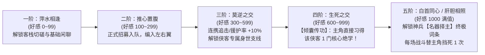
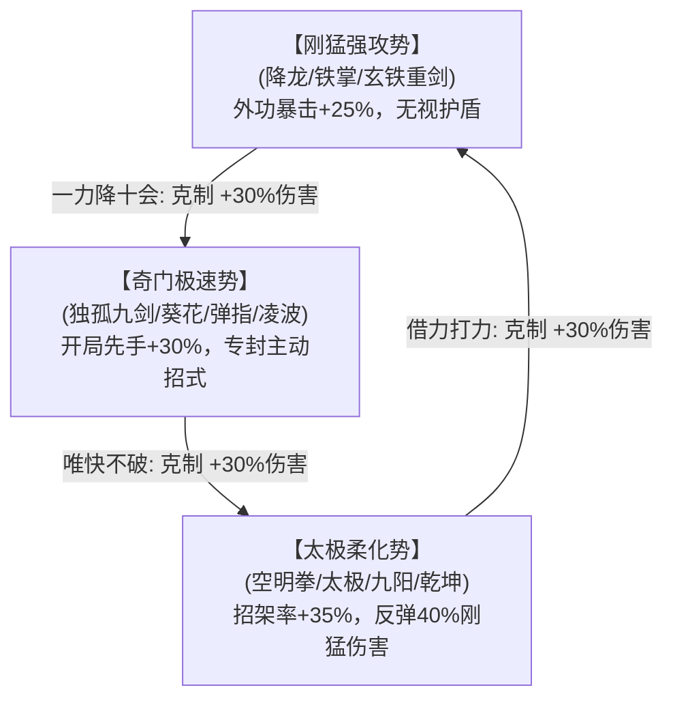

# 《金庸群侠：问道武林》外围江湖系统设定集（客栈结交 · 子时鬼市 · 华山论剑）

> **设计核心**：在“**人物立绘 + 纯正文字表现**”的基调下，摒弃传统手游生硬的“十连抽卡界面”与“商城买买买”，将商业化与外围玩法彻底包装进**【醉仙客栈煮酒】**、**【子时嘉兴鬼市】**与**【华山绝顶论剑】**三大极具武侠沉浸感的场景之中。

---

## 一、 【醉仙客栈 · 煮酒论英雄】—— 伙伴结交与好感传功系统

在“1主角 + 2伙伴”的核心架构下，伙伴不是冷冰冰的卡牌，而是你在风雪客栈中把酒言欢、肝胆相照的江湖知己。

### 1.1 客栈坐堂与“投其所好”请酒机制
客栈分设**【大堂酒桌】**与**【雅间茶席】**，每日随辰、午、酉、亥四个时辰自动刷新到访的江湖名宿。玩家通过奉上美酒、佳肴或奇物与侠客交谈：

| 侠客代表 | 喜好类别 | 最钟爱的极品信物/酒菜（好感 $+80$） | 厌恶之物（好感 $-20$ 并拂袖而去） |
| :--- | :---: | :--- | :--- |
| **洪七公** | 绝味佳肴 | 【叫花鸡】【玉笛谁家听落梅】【好逑汤】 | 粗制滥造的干粮、白驼山毒酒 |
| **乔峰 / 令狐冲** | 塞外烈酒 | 【关外六十度高粱酒】【百年汾酒】【夜光杯葡萄酒】 | 脂粉香囊、阴损暗器谱 |
| **黄药师 / 任盈盈** | 琴箫书画 | 【广陵散残谱】【王羲之字帖】【顾恺之画卷】 | 世俗礼教经书、朝廷官印 |
| **黄蓉 / 郭襄** | 江南巧物 | 【八宝肥鸭】【嘉兴五芳斋粽】【玲珑九连环】 | 苦涩汤药、笨重铁锤 |
| **小龙女** | 清雅自然 | 【终南山野蜂蜜】【古墓寒玉匣】【百花露】 | 荤腥酒肉、俗世金银 |
| **周伯通** | 奇趣玩物 | 【大将军促织（斗蟋蟀）】【糖人】【九宫算术图】 | 枯燥佛经、桃花岛请柬 |
| **欧阳锋 / 梅超风** | 西域奇毒 | 【五毒俱全瓮】【千年毒蛛】【九阴残篇线索】 | 全真教道符、少林禅杖 |

---

### 1.2 好感度五阶成长与“倾囊传功”特权

每位侠客的好感度分为 **5个阶段（0 ~ 1000点）**，不仅决定能否招募入队，更直接关系到**主角能否学到其独门看家绝学**：



* **🔥 核心爽点：【四阶·生死之交倾囊传功】**
  * 哪怕你是【无门派散人】或【全真弟子】，只要在客栈将**洪七公**好感度刷到600点（生死之交），即可触发专属剧情《松林传掌》，直接习得洪七公压箱底的**《降龙十八掌》**！
  * 将**黄药师**好感度刷到600点，无论是否桃花岛弟子，黄药师皆会感念知音难觅，破例传你**《弹指神通》**！

---

### 1.3 客栈对饮文字交互范例

```text
================ 【嘉兴醉仙楼 · 二楼临窗雅座】 ================
【窗外雨声】江南烟雨迷蒙，一位身穿青布袍、须发斑白的老乞丐正自斟自饮，酒葫芦已见了底。
【人物现身】【北丐·洪七公】（当前好感度：540/600 · 莫逆之交）

👉 【动作：奉上刚出炉的「荷叶叫花鸡」与「百年女儿红」】
【文字反馈】洪七公鼻翼微动，双目顿时放光，一把撕下鸡腿塞入口中，大嚼道：
           “妙哉！妙哉！这火候比黄丫头做的也只差了半分！小子，这顿酒肉老叫花子不能白吃你的！”
           >>> 洪七公好感度 +80！（突破至 620/1000 · 达成【生死之交】！）

【传功触发】洪七公抹了抹油嘴，神色忽转凝重，一拍你肩头：
           “随老叫花子去城外松林走一遭，今日便传你这招【亢龙有悔】，看好了——盈不可久，发七分，留三分！”
           >>> 恭喜！你已领悟神品绝技：《降龙十八掌·亢龙有悔》！
=============================================================
```

---

## 二、 【子时嘉兴鬼市】—— 黑市交易、鉴宝与战前奇谋

为丰富日常资源循环，每晚**子时（或消耗【乌木腰牌】随时开启）**，嘉兴城外荒村将开启鱼龙混杂的地下黑市——**【五更鬼市】**。

### 2.1 正邪门派潜入规则（文字彩蛋）
* **【无门派散人 & 白驼/铁掌弟子】**：大摇大摆直接入市，所有摊位享受 **9折优惠**，且可进入鬼市最深处的【暗影阁】。
* **【全真 / 大理 / 武当等名门正派弟子】**：
  * 入市前必须勾选穿戴道具**【夜行蒙面巾】**；
  * 若不蒙面强行入市买卖毒药或禁书，有30%概率触发文字抓包事件：
    > *“【戒律堂撞破】你正蹲在摊前挑选【十香软筋散】，忽听背后一声断喝，竟是同门执法师兄夜巡至此！你羞愧难当，狼狈翻墙遁走。（侠义值 -40，门派贡献 -80）”*

---

### 2.2 鬼市四大特色交互摊位

#### **1. 【泥污旧物摊 · 奇门鉴宝（高悟性/高福缘爽点）】**
摊主摆出5件沾满泥土、真假难辨的江湖旧物（如：`泛黄的梵文羊皮`、`生锈的断剑`、`发霉的食谱`、`缺角的棋盘`）。
* **普通购买**：盲盒随机开出凡铁或真品。
* **【凝神鉴宝】（属性检定）**：
  * 若主角**【悟性 $\ge 50$】**或**【福缘 $\ge 45$】**，文字框会自动浮现一行金色提示：
    > *“【慧眼识珠】你手指摩挲过那卷发霉食谱的夹层，敏锐察觉内里纸张坚韧异常，隐有九阴真气流转之象！”*
  * 仅花500铜钱即可从摊主手中捡漏买走价值连城的**《九阴真经残页》**或**【玄铁重剑碎片】**！

#### **2. 【西域胡商 · 战前奇毒与机关（以弱胜强利器）】**
当玩家在主线卡在某个高难Boss（如欧阳锋、金轮法王）时，可在鬼市购买**一次性战前战术奇物**，在挑战Boss前使用：
* **【悲酥清风】**：开战首回合直接削减敌方全体 **30% 内力上限**（大幅削弱敌方内力压制系数 $K_{\text{mp}}$）；
* **【九花玉露丸】**：战斗中主角气血低于30%时自动服下，瞬间恢复 **50% 最大气血**并清除全部毒伤；
* **【孔雀胆 / 喂毒菱角】**：涂抹于主角与左右翼伙伴兵刃之上，本场战斗所有攻击必定附加【剧毒】（每回合额外扣除Boss 4%最大气血）。

#### **3. 【盲眼说书人 · 江湖密闻录（支线奇遇购买）】**
花费少量碎银请盲眼说书人讲一段江湖秘辛，直接获取**隐藏支线坐标**：
* 例如买下《剑魔独孤求败遗事》 $\rightarrow$ 直接在地图上点亮隐藏副本【襄阳深谷·神雕山洞】；
* 买下《昆仑山白猿传闻》 $\rightarrow$ 下次挂机100%触发《九阳真经》跳崖奇遇！

#### **4. 【药庐炼丹 & 冯铁匠炉火】**
玩家平时挂机掉落的草药（断肠草、天山雪莲、茯苓）与矿石（寒铁、百炼钢、西方精金），可在此处委托冯默风（黄药师弟子）重铸兵刃词条，或炼制永久增加六维属性的奇丹（如：**【梁子翁宝蛇丸：根骨永久 +3】**、**【菩斯曲蛇胆丸：臂力永久 +3】**）。

---

## 三、 【华山论剑】—— 异步PVP天梯与“五绝”文字演武

在没有华丽3D动作的文字武侠里，PVP的核心爽感来自于**“见招拆招的策略博弈”**与**“名扬全服的五绝尊号”**。

### 3.1 登山天梯段位与“天下五绝”席位
每 **14天** 举行一届【华山论剑】。玩家从华山山脚一路向上挑战其他玩家的“1主角+2伙伴”镜像：
1. **【百尺峡 / 千尺幢】**（青铜 ~ 黄金段位）
2. **【苍龙岭 / 金锁关】**（铂金 ~ 钻石段位）
3. **【华山绝巅·群豪榜】**（全服前100名）
4. **👑【天下五绝·至尊席】**（全服前5名唯一头衔）：
   * 前5名玩家可在**【东邪】【西毒】【南帝】【北丐】【中神通】**（后期开启【神雕侠】【北乔峰】）中择一封号，并**自定义专属后缀与立绘判词**！
   * **全服展示**：所有玩家点开【华山论剑】主界面，最上方永远矗立着本服当届“五绝”玩家的半身立绘、所佩神兵与自撰判词（如：*“桃花岛主·陆小鱼：一箫一剑平生意，负尽狂名十五年”*）。其余玩家每日可点击【抱拳论道】领取真气奖励。

---

### 3.2 战前“三才架势”博弈机制（杜绝纯战力碾压）

为了让低战力玩家也能凭武学理解击败高战力对手，论剑切磋引入**【三才迎敌架势】**三角克制机制：



* **战前侦察与针对**：
  * 挑战前，系统会给出一段文字情报：*“【江湖传闻】对手近期常携【郭靖】【洪七公】同行，掌风刚猛绝伦，似走【刚猛强攻】路数。”*
  * 此时你只需在战前将内功切换为《空明拳》或《太极神功》，并将架势调为**【太极柔化势】**，即可在战斗中借力打力，越级反杀高战力莽夫！

---

### 3.3 华山论剑巅峰文字战报范例（PVP演武）

```text
================ ⚔️ 【华山绝巅 · 东邪位争夺战】 ================
【雪满华山】朔风怒号，漫天飞雪之中，你携【杨过】【黄蓉】踏上绝顶青石，
           对面【玩家·剑魔传人】手按「玄铁重剑」，左右【郭靖】【周伯通】凛然而立！

【架势克制】敌方摆出【刚猛强攻势】，气势如虹；你微微一笑，气沉丹田，摆开【太极柔化势】以静制动！
           >>> 触发架势克制！【以柔克刚】：我方全队招架率 +35%，反震伤害 +30%！

【第一回合】
• 【敌方先手】【剑魔传人】双手高举玄铁重剑，大喝一声使出「玄铁剑法·排山倒海」，狂暴剑风压顶而来！
• 【借力打力】你默运「太极神功」，身形如风中杨柳随剑风飘摆，左手一引一送，施展「乾坤大挪移」！
           >>> 成功卸去敌方 50% 剑劲，并将 18,400 点刚猛反震之力原路奉还！敌方虎口崩裂，气血剧震！
• 【右翼奇策】身旁的【黄蓉】觑准敌方旧力已尽、新力未生之机，绿玉打狗棒疾点而出——「缠字诀」！
           >>> 死死缠住敌方左翼【郭靖】手腕，令其本回合无法触发连携追击！
• 【主角反击】你长啸一声，食指中指并拢，无形气剑破空激射——正是大理绝学【六脉神剑·少泽剑】！
           >>> 剑气无视敌方乌蚕宝衣护甲，贯穿胸膛，造成 26,500 点真实内劲暴击！
=================================================================
```
