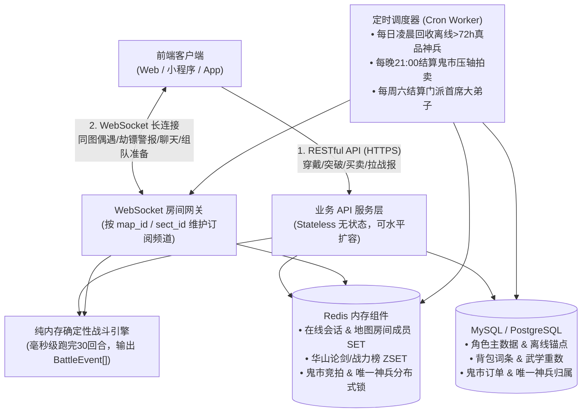

# 《金庸群侠：问道武林》后端服务端架构、数据库与接口协议方案

> **文档定位**：供您独立自研后端使用的**工程落地蓝图**（语言无关：无论您采用 `Go`、`Java/Spring Boot`、`Node.js/NestJS`、`C#/.NET` 还是 `Python/FastAPI` 均可直接照此落地）。  
> **核心原则**：**服务端绝对权威（防改包外挂）** + **惰性计算（零无效定时轮询，单机轻松扛万人在线）** + **前后端共享静态配置表**。

---

## 一、 整体服务端架构拓扑

文字武侠联网游戏没有毫秒级3D物理碰撞同步，网络负载极轻。推荐采用经典的 **“HTTP 事务接口 + WebSocket 房间广播网关 + 关系型数据库 + Redis”** 架构：



---

## 二、 五大核心后端机制设计（防作弊与高性能关键）

### 2.1 零轮询开销的【惰性离线挂机结算（Lazy Settlement）】
* **❌ 错误做法**：用定时任务每秒给全服几万个玩家加真气写库，数据库瞬间被打爆。
* **✅ 标准做法（时间戳差值结算）**：
  1. `players` 表仅记录：
     * `last_settle_at`（上次结算时间戳）
     * `cached_qi_per_hour`（当前计算好的每小时打坐真气效率）
     * `co_cultivate_until`（双人抱拳共修加成截止时间戳）
  2. **何时触发结算函数 `SettleIdleReward(playerId)`？**
     仅在以下 **5个状态变更瞬间** 先调用一次结算并更新 `last_settle_at = NOW()`：
     * 玩家登录上线 / 主动点击“领取打坐收益”；
     * 玩家切换挂机地图（如从嘉兴换到黑沼）；
     * 玩家更换了影响挂机效率的内功、道袍或门派阶位；
     * 玩家与他人发起【抱拳共修】；
     * 玩家在限定纷争区被其他玩家发起PK劫掠前。
  3. **离线奇遇生成**：根据离线时长 $\Delta t$（封顶 12 或 24 小时），按 `floor(Δt / 20分钟)` 计算掷骰次数，结合玩家 `luck（福缘）` 生成 1~3 个待抉择奇遇存入 Redis 队列（有效期24小时），玩家上线点击选项时再校验发放奖励。

---

### 2.2 服务端权威【确定性战斗引擎（Deterministic Battle Engine）】
* 前端**绝不参与伤害计算**，只负责播放战报。
* **执行流程**：
  1. 玩家发起挑战（推图Boss / 华山论剑 / 黑沼劫镖 / 3人组队秘境）；
  2. 后端提取双方 `CombatUnit[3]` 快照（单人模式读 `1主角+2原著伙伴`；组队秘境读 `3名玩家主角`），生成随机种子 `seed`；
  3. 在服务端内存中按 `ATB行动条(满1000出手)` 循环推演（最多30回合，纯内存计算耗时 $< 0.5\text{ms}$），生成 `BattleEvent[]` 序列与胜负结果；
  4. 立即发放掉落/扣减镖银落库，将 `BattleEvent[]` 返回前端供玩家以 `1x/2x` 动画播放。
* **💡 战报存储极简优化**：`battle_replays` 表无需存储几百KB的 `BattleEvent[]` JSON，只需存 **双方战前属性快照 (`attacker_snapshot`, `defender_snapshot`) + `random_seed` + `engine_version`**（不到 4KB），需要回放时重新丢进战斗引擎重算一遍即可 100% 还原每一刀每一剑！

---

### 2.3 【全服唯一真品神兵】归属锁与自动流转
1. 数据库单设一张小表 `server_unique_artifacts`（全服仅约 10 行记录，如 `TRUE_TULONG`、`TRUE_YITIAN`、`TRUE_XUANTIE`、`TRUE_RUANWEI`）。
2. **夺取与并发控制**：
   * 在【王盘山扬刀大会】或击败当前持有者易主时，使用 Redis 分布式锁 `LOCK:ARTIFACT:{code}` 或数据库 `SELECT ... FOR UPDATE` 保证同一时刻绝对不会产生两把真品。
3. **防死号占坑定时回收**：
   * 每日 `04:00` Cron 任务检查 `players.last_online_at`。若真品持有者离线超过 **72小时**，事务内自动将 `owner_player_id` 置空（归入下周扬刀大会奖池），向原主插入一封补偿邮件（发放【百炼玄铁】与永久纪念称号 `曾执屠龙`），并通过 WebSocket 全服广播：*“【江湖传闻】屠龙宝刀自隐世高人手中重现江湖，将于周日王盘山择主！”*

---

### 2.4 【和平区 vs 限定纷争区】PK 校验与防恶意守尸
当玩家 A 请求对玩家 B 发起偷袭/劫镖 (`POST /api/pvp/ambush`) 时，后端按序执行 4 道强校验：
1. `A.map_id == B.map_id`（必须在同一张地图）；
2. 检查地图配置：`MapConfig[map_id].zone_type == 'CONTESTED'` **或者** `B.betrayal_bounty_until > NOW()`（只有在限定纷争区，或者对方是背负【师门追杀令】的全服逆徒，才允许强行开战！否则直接拒绝报错）；
3. 检查保护盾：`B.pk_shield_until < NOW()`（玩家在纷争区战败后，自动被传回临安安全区或获得 **15分钟免战保护盾**，防止大佬无限守尸逼退平民玩家）；
4. 若 A 主动攻击非红名玩家，给 A 增加 `sha_qi（煞气值）`。

---

### 2.5 【子时鬼市】匿名脱敏与并发竞拍
* **匿名脱敏**：数据库 `market_listings` 表真实记录 `seller_id` 与 `buyer_id`（方便后台查RMT工作室倒金），但在拼装返回给前端的 JSON DTO 时，用 `HMAC_SHA256(seller_id + daily_salt)` 映射为随机武侠代号（如 `蒙面客·戌七`）。
* **压轴拍卖防超卖**：采用 Redis Lua 原子脚本校验 `new_bid >= current_bid + min_step`，冻结出价者元宝并立即解冻退还上一位领先者的元宝。

---

## 三、 核心数据库表结构设计（SQL DDL 核心字段参考）

建议使用 **PostgreSQL**（原生 `JSONB` 极适合存储装备随机词条与战前快照）或 **MySQL 8.0+**：

```sql
-- 1. 玩家角色核心表
CREATE TABLE players (
    id              BIGSERIAL PRIMARY KEY,
    account_id      BIGINT NOT NULL UNIQUE,
    nickname        VARCHAR(32) NOT NULL UNIQUE,
    avatar_id       VARCHAR(32) NOT NULL DEFAULT 'youth_01',
    -- 等级与十重境界 (realm_tier: 1~10, realm_stage: 1~3)
    level           INT NOT NULL DEFAULT 1,
    realm_tier      INT NOT NULL DEFAULT 1,
    realm_stage     INT NOT NULL DEFAULT 1,
    break_pity_rate INT NOT NULL DEFAULT 0,          -- 冲穴失败累积的保底成功率(%)
    qi_exp          BIGINT NOT NULL DEFAULT 0,       -- 当前储存的真气修为
    silver          BIGINT NOT NULL DEFAULT 500,     -- 纹银(铜钱)
    gold_ingot      BIGINT NOT NULL DEFAULT 0,       -- 元宝
    -- 六维基础属性
    str             INT NOT NULL DEFAULT 15,         -- 臂力
    con             INT NOT NULL DEFAULT 15,         -- 根骨
    agi             INT NOT NULL DEFAULT 15,         -- 身法
    int_stat        INT NOT NULL DEFAULT 15,         -- 悟性
    luck            INT NOT NULL DEFAULT 15,         -- 福缘
    karma           INT NOT NULL DEFAULT 0,          -- 侠义值 (-1000 ~ +1000)
    sha_qi          INT NOT NULL DEFAULT 0,          -- 煞气值 (PK红名判定)
    -- 门派与地图状态
    current_sect_id VARCHAR(32) DEFAULT NULL,        -- NULL代表【无门派·逍遥散人】
    sect_rank       INT NOT NULL DEFAULT 1,          -- 门派阶位 1~5
    current_map_id  VARCHAR(32) NOT NULL DEFAULT 'jiaxing_suburb',
    max_chapter_id  INT NOT NULL DEFAULT 1,          -- 主线推进到的最高关卡序号
    -- 惰性挂机与保护锚点
    last_settle_at  TIMESTAMPTZ NOT NULL DEFAULT NOW(),
    co_cult_until   TIMESTAMPTZ DEFAULT NULL,        -- 双人抱拳共修截止时间
    pk_shield_until TIMESTAMPTZ DEFAULT NULL,        -- 战败免战保护截止时间
    bounty_until    TIMESTAMPTZ DEFAULT NULL,        -- 叛师追杀令截止时间
    last_online_at  TIMESTAMPTZ NOT NULL DEFAULT NOW(),
    created_at      TIMESTAMPTZ NOT NULL DEFAULT NOW()
);

-- 2. 玩家门派履历与贡献表 (记录出师与叛师历史，防止二次拜入已叛门派)
CREATE TABLE player_sect_history (
    player_id       BIGINT NOT NULL,
    sect_id         VARCHAR(32) NOT NULL,
    contribution    INT NOT NULL DEFAULT 0,
    status          VARCHAR(16) NOT NULL,            -- 'ACTIVE' | 'GRADUATED'(圆满出师) | 'BETRAYED'(强行叛师)
    is_guarding_lib BOOLEAN NOT NULL DEFAULT FALSE,  -- 是否正在藏经阁挂机值守
    PRIMARY KEY (player_id, sect_id)
);

-- 3. 玩家已学武学秘籍表
CREATE TABLE player_skills (
    player_id       BIGINT NOT NULL,
    skill_id        VARCHAR(48) NOT NULL,            -- 对应静态配置表ID，如 'xianglong_18'
    mastery_level   INT NOT NULL DEFAULT 1,          -- 参悟重数 1~10
    is_custom       BOOLEAN NOT NULL DEFAULT FALSE,  -- 是否为2.0自创绝学
    custom_meta     JSONB DEFAULT NULL,              -- 自创武学名称与融合词条
    PRIMARY KEY (player_id, skill_id)
);

-- 4. 玩家阵容与武学装配预设表 (支持3套预设一键切换: preset_idx 1~3)
CREATE TABLE player_loadouts (
    player_id       BIGINT NOT NULL,
    preset_idx      SMALLINT NOT NULL DEFAULT 1,
    stance          VARCHAR(16) NOT NULL DEFAULT 'FIERCE', -- 架势: 'FIERCE'(刚猛) | 'AGILE'(奇门极速) | 'TAICHI'(柔化)
    inner_skill_id  VARCHAR(48),                     -- 内功槽
    outer_skill_id  VARCHAR(48),                     -- 外功槽
    light_skill_id  VARCHAR(48),                     -- 轻功槽
    ult_skill_id    VARCHAR(48),                     -- 绝技槽
    left_comp_id    VARCHAR(32),                     -- 左翼破阵伙伴ID (如 'guojing')
    right_comp_id   VARCHAR(32),                     -- 右翼奇策伙伴ID (如 'huangrong')
    relic_book_id   VARCHAR(32),                     -- 全队共享秘宝典籍ID (如 'wumu_yishu')
    PRIMARY KEY (player_id, preset_idx)
);

-- 5. 原著侠客结交与好感度表
CREATE TABLE player_companions (
    player_id       BIGINT NOT NULL,
    companion_id    VARCHAR(32) NOT NULL,
    affinity        INT NOT NULL DEFAULT 0,          -- 好感度 0~1000 (>=100可上阵, >=600可传功)
    recruited       BOOLEAN NOT NULL DEFAULT FALSE,
    taught_skill    BOOLEAN NOT NULL DEFAULT FALSE,  -- 是否已触发四阶倾囊传功
    weapon_item_uid BIGINT DEFAULT NULL,             -- 伙伴穿戴的兵刃实例ID
    armor_item_uid  BIGINT DEFAULT NULL,             -- 伙伴穿戴的衣甲实例ID
    acc_item_uid    BIGINT DEFAULT NULL,             -- 伙伴穿戴的佩饰实例ID
    PRIMARY KEY (player_id, companion_id)
);

-- 6. 背包装备与道具实例表
CREATE TABLE player_items (
    uid             BIGSERIAL PRIMARY KEY,
    player_id       BIGINT NOT NULL,
    item_code       VARCHAR(48) NOT NULL,            -- 对应静态表编码，如 'xuantie_sword_craft'
    slot_type       VARCHAR(16) NOT NULL,            -- 'WEAPON' | 'ARMOR' | 'ACC' | 'CONSUMABLE' | 'FRAGMENT'
    quantity        INT NOT NULL DEFAULT 1,
    equipped_by     VARCHAR(32) DEFAULT NULL,        -- NULL | 'SELF' | companion_id
    extra_affixes   JSONB DEFAULT '[]'::jsonb,       -- 冯默风淬炼出的随机附加词条
    is_bound        BOOLEAN NOT NULL DEFAULT FALSE
);
CREATE INDEX idx_items_player ON player_items(player_id);

-- 7. 全服唯一真品神兵归属表 (核心争夺资产)
CREATE TABLE server_unique_artifacts (
    artifact_code   VARCHAR(48) PRIMARY KEY,         -- 如 'TRUE_TULONG_SABER', 'TRUE_RUANWEI_ARMOR'
    owner_player_id BIGINT DEFAULT NULL,             -- 当前持有玩家ID (NULL代表在王盘山/剑冢奖池中)
    obtained_at     TIMESTAMPTZ DEFAULT NULL,
    defend_count    INT NOT NULL DEFAULT 0,          -- 连任守擂次数
    version         INT NOT NULL DEFAULT 0           -- 乐观锁版本号
);

-- 8. 子时鬼市寄售与拍卖行表
CREATE TABLE ghost_market_listings (
    id              BIGSERIAL PRIMARY KEY,
    seller_id       BIGINT NOT NULL,                 -- 后端真实卖家ID，返回前端时脱敏为黑衣人代号
    item_code       VARCHAR(48) NOT NULL,
    item_snapshot   JSONB NOT NULL,
    listing_type    VARCHAR(16) NOT NULL,            -- 'FIXED'(一口价摆摊) | 'AUCTION'(21:00压轴竞拍)
    price_currency  VARCHAR(16) NOT NULL,            -- 'SILVER' | 'GOLD'
    current_price   BIGINT NOT NULL,
    highest_bidder  BIGINT DEFAULT NULL,
    expires_at      TIMESTAMPTZ NOT NULL,
    status          VARCHAR(16) NOT NULL DEFAULT 'OPEN'
);
```

---

## 四、 Redis 键空间规划（Key Naming Convention）

| Key 模式 | 数据结构 | 用途说明 |
| :--- | :---: | :--- |
| `online:players` | `HASH` | `playerId -> gatewayNodeId`，判断在线与推送路由 |
| `map:room:{mapId}` | `SET` | 当前停留在该地图挂机的玩家ID集合（供前端展示“附近侠客42人”） |
| `rank:huashan:{season}` | `ZSET` | 华山论剑天梯积分榜，前5名实时映射【东邪/西毒/南帝/北丐/中神通】 |
| `rank:sect:{sectId}` | `ZSET` | 各大门派内部战力/演武榜，榜首即为本派【首席大弟子】 |
| `adventure:pending:{playerId}` | `LIST` | 玩家离线/在线触发但尚未点击选项的奇遇事件队列（带过期时间） |
| `team:room:{roomId}` | `HASH` | 松鹤楼3人结义组队房间状态（队长、队员A/B、准备状态） |

---

## 五、 前后端通信接口契约（REST + WebSocket）

### 5.1 核心 HTTP REST API 路由清单

| 模块 | 方法与路径 | 说明 |
| :---: | :--- | :--- |
| **鉴权创角** | `POST /api/v1/auth/login` | 登录获取 JWT Token |
| | `POST /api/v1/player/create` | 创角并抽取初始先天气运与六维分配 |
| **修行挂机** | `POST /api/v1/cultivate/settle` | 触发惰性离线真气结算，返回收益明细与待处理奇遇 |
| | `POST /api/v1/cultivate/breakthrough` | 发起十重境界冲穴（支持附加九花玉露丸道具ID） |
| | `POST /api/v1/adventure/choose` | 提交奇遇分支选择（如 `choice: 'A'`），服务端校验属性门槛并发奖 |
| **地图交互** | `POST /api/v1/map/move` | 切换挂机地图（自动先触发旧图收益结算，切换 WebSocket 房间订阅） |
| | `POST /api/v1/map/co-cultivate` | 向同图玩家发起【抱拳共修】 |
| | `POST /api/v1/pvp/ambush` | 在**限定纷争区**对目标玩家发起劫镖/灵脉争夺，或追杀叛师逆徒 |
| **武库编成** | `PUT  /api/v1/loadout/{presetIdx}` | 保存 `1主+2副` 站位、`内·外·轻·绝` 4槽、三才架势与秘宝 |
| | `POST /api/v1/skill/upgrade` | 消耗真气参悟提升武学重数（服务端代入悟性减免公式） |
| **门派生态** | `POST /api/v1/sect/join` | 校验六维属性与信物，拜入目标门派 |
| | `POST /api/v1/sect/trial` | 挑战当前门派升阶考核 Boss |
| | `POST /api/v1/sect/leave` | 离开门派（参数 `mode: 'GRADUATE' \| 'BETRAY'`，叛师自动发全服悬赏） |
| | `POST /api/v1/sect/steal-skill` | 散人/外派潜入目标门派藏经阁偷师（匹配值守玩家开战） |
| **市井社交** | `POST /api/v1/inn/gift` | 醉仙客栈向坐堂原著侠客请酒送礼，满600自动解锁倾囊传功 |
| | `POST /api/v1/market/appraise` | 子时鬼市泥污旧物鉴宝（检定玩家悟性/福缘） |
| | `POST /api/v1/market/bid` | 鬼市一口价购买或21:00竞拍出价 |
| | `POST /api/v1/huashan/challenge` | 华山论剑挑战目标排名玩家，返回完整结构化战报 |

---

### 5.2 结构化战斗战报 JSON 协议（前后端核心对接标准）

所有涉及战斗的接口（主线Boss、门派考核、偷师拦截、黑沼劫镖、华山论剑、3人结义秘境）统一返回以下 **`BattleReportDTO`**，前端拿到后即可驱动“3v3立绘对峙台 + 富文本文字播报”：

```json
{
  "battleId": "bt_9823749823",
  "sceneTitle": "嘉兴烟雨楼 · 论剑切磋",
  "stanceAdvantage": {
    "allyStance": "TAICHI",
    "enemyStance": "FIERCE",
    "counterSide": "ALLY",
    "bannerText": "你摆开【太极柔化势】，克制敌方【刚猛强攻势】（招架率+35%，反震+30%）"
  },
  "allyUnits": [
    { "slot": "LEFT", "id": "comp_guojing", "name": "郭靖", "avatar": "guojing", "maxHp": 12000, "hp": 12000 },
    { "slot": "MAIN", "id": "p_10086", "name": "陆小鱼", "avatar": "youth_02", "maxHp": 9500, "hp": 9500, "maxMp": 4200 },
    { "slot": "RIGHT", "id": "comp_huangrong", "name": "黄蓉", "avatar": "huangrong", "maxHp": 7800, "hp": 7800 }
  ],
  "enemyUnits": [
    { "slot": "MAIN", "id": "boss_ouyangfeng", "name": "西毒·欧阳锋", "avatar": "ouyangfeng", "maxHp": 28000, "hp": 28000, "maxMp": 3800 }
  ],
  "winner": "ALLY",
  "events": [
    {
      "round": 1,
      "type": "SKILL_CAST",
      "actorSlot": "ALLY_MAIN",
      "targetSlot": "ENEMY_MAIN",
      "skillId": "xianglong_18",
      "skillName": "降龙十八掌",
      "skillTier": "red",
      "isUlt": false,
      "hitResult": "CRIT",
      "hpDelta": -3420,
      "rageDelta": 35,
      "narrative": "你左腿微屈，右臂内弯，呼的一掌推出，正是【见龙在田】，掌风刚猛无俦！（内力压制 +12%）"
    },
    {
      "round": 1,
      "type": "ASSIST_ATTACK",
      "actorSlot": "ALLY_LEFT",
      "targetSlot": "ENEMY_MAIN",
      "skillName": "双龙取水",
      "hpDelta": -1850,
      "narrative": "身旁的【郭靖】见你掌势已老，当即踏前一步与你掌力首尾相衔！（触发羁绊【侠之大者】）"
    }
  ],
  "rewards": {
    "qiExp": 4500,
    "silver": 1200,
    "items": [{ "itemCode": "jiuyin_frag_1", "name": "九阴真经残页", "qty": 1 }]
  }
}
```

---

### 5.3 WebSocket 实时推送消息类型枚举

客户端连接 `wss://your-server/ws?token=JWT` 后，接收以下轻量 JSON 事件包 `{ "event": "...", "data": { ... } }`：

* `ROOM_PLAYER_JOIN` / `ROOM_PLAYER_LEAVE`：同地图有侠客踏入或离去，刷新附近侠客人数；
* `ROOM_COMBAT_ALERT`：限定纷争区内发生劫镖/PK，向同图玩家推送可点击的 `[路见不平·助拳]` 气泡；
* `SECT_BOUNTY_ISSUED`：有玩家强行叛师，向全服及本门派广播【清理门户追杀令】；
* `SECT_INTRUDER_REPORT`：你在藏经阁值守时成功击退了偷师玩家，实时弹窗战果；
* `UNIQUE_ARTIFACT_CHANGED`：全服唯一真品神兵（如【真·屠龙刀】）易主全服金字横幅播报；
* `TEAM_ROOM_SYNC`：3人结义组队大厅内队友进出、更换武学、点击“准备”状态同步。
