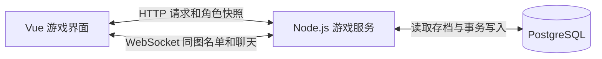

# 问道武林联网后端实施设计

首轮内测让两名玩家用各自的账号进入嘉兴烟雨楼外，看见彼此并聊天。玩家可以领修行收益、换装、闯主线拿掉落，重新登录后接着玩。以 [第 11 册后端蓝图](./11_后端架构与数据库接口协议方案.md) 为基础，本册确定首轮要建的表、要接的接口和验收条件。

## 一、服务结构



- **游戏服务**用 Node.js、TypeScript 和 Fastify，提供 `/api/v1` 和 `/ws`。账号、角色、修行、装备、战斗和地图房间按模块组织，共用同一进程。开发沿用 Vite 到 `8080` 的代理，部署时浏览器通过同一域名访问页面、HTTPS 接口和 WSS。 [Fastify WebSocket 文档](https://github.com/fastify/fastify-websocket)
- **PostgreSQL**保存账号、登录会话和角色档案。地图中的连接、在线人数和同图聊天由进程内房间维护，玩家重连时按档案中的地图重新加入。首轮按单区单进程内测设计。
- **玩法规则**使用 `shared/` 下的地图、关卡、装备、掉落、面板计算和战斗推演。后端放在 `server/`，前后端共用 `shared/protocol.ts` 定义的类型。

客户端通过 `gameActions.ts` 定义的操作接口提交请求。联机操作由服务端结算，客户端应用角色快照并播放战报。试玩操作由模拟引擎分派到本地结算，通过浏览器保存进度。 `gameStore.ts` 接入角色状态、界面状态、会话和各玩法模块。

## 二、角色与存档

内测一账号一个角色。创角只提交昵称和头像，服务器用现有 32 级试玩模板初始化主角、武学、伙伴和三套配装。主角出生在嘉兴，已开放第二关赵王府，修行从创角时间开始计。正式新手的等级和初始资源另行定数值。

沿用已定的约 24 件装备配置。开局穿牛家村玄铁匕首、竹编斗笠、终南玄门道袍、缠布护腕、练功布靴和曲三铁八卦。八个装备位里腰带和秘宝空着。背包有青钢长剑、飞燕护腕和两颗九花玉露丸。腰带从前几关掉落。两件秘宝留给真实三人副本少室山金刚伏魔圈，按每名角色的胜场发放，第一胜给岳武穆遗书，第二胜给笑傲江湖琴箫谱。

| 表 | 首轮保存内容 |
| --- | --- |
| `accounts` | 账号 ID、唯一登录名、密码哈希 |
| `sessions` | 会话令牌哈希、账号 ID、过期时间 |
| `players` | 角色 ID、唯一账号 ID、唯一角色名、头像、等级、境界、六维、真气、纹银、元宝、丹药数量、地图、当前配装序号、最高可挑战关卡、已领首胜奖励的关卡、上次修行结算时间、真气和纹银各自的余数、存档修订号 `revision` |
| `player_items` | 主键为 `(player_id, item_id)`。每种装备拥有一件，穿在身上也记在持有清单里 |
| `player_skills` | 主键为 `(player_id, skill_id)`，保存已学武功及重数 |
| `player_companions` | 主键为 `(player_id, companion_id)`，保存招募、好感与传功状态 |
| `player_loadouts` | 主键为 `(player_id, preset_idx)`，按 `LoadoutPresetDTO` 保存三套配装。八个装备位、武功、打法和伙伴以 `jsonb` 存储，空位统一用 `null` |
| `player_actions` | 主键为 `(player_id, request_id)`，保存操作类型、参数摘要和结果。战斗结果含完整战报，供原请求重试取回 |

背包从装备持有清单里扣除当前穿戴项得到。三套配装可以引用同一件装备，切换时只有当前那套生效。修行速度和装备面板由服务器根据角色、配置和生效的配装计算，快照里的 `nextLevelQi` 和 `qiPerHour` 随之生成。独自修行时 `coCultivatePartner` 为 `null`。

创角先锁账号，再在同一笔事务里创建角色、初始装备、武学、伙伴和配装，`revision` 从 `1` 开始。同一账号重发同样的创角请求时返回已有角色，改昵称或头像再提交时提示「这个账号已有角色」。

## 三、接口与联机房间

登录或注册成功后，服务器通过 Cookie 下发随机会话令牌。密码用 Argon2id 加盐哈希，登录尝试限频。线上 Cookie 设置 `HttpOnly`、`Secure` 和 `SameSite=Lax`。写接口和 WebSocket 握手按允许的站点来源校验 `Origin`，角色身份从登录会话查出。登出时删除该会话并关闭关联连接，连接到期后也要求重新登录。 [OWASP 密码存储](https://cheatsheetseries.owasp.org/cheatsheets/Password_Storage_Cheat_Sheet.html) · [会话管理](https://cheatsheetseries.owasp.org/cheatsheets/Session_Management_Cheat_Sheet.html) · [WebSocket 安全](https://cheatsheetseries.owasp.org/cheatsheets/WebSocket_Security_Cheat_Sheet.html)

HTTP 路径统一使用 `/api/v1` 前缀。

| 方法和路径 | 输入与处理 |
| --- | --- |
| `POST /auth/register`、`POST /auth/login` | 登录名、密码。建立会话，返回是否已创角 |
| `POST /auth/logout` | 注销当前会话 |
| `POST /player/create` | 昵称、头像。初始化档案并返回快照 |
| `GET /player/me` | 读当前角色的快照，供首次进入和重连使用。尚未创角时返回 `404 PLAYER_NOT_CREATED` |
| `POST /cultivate/settle` | 空请求体。按服务器时间结算，`result` 返回 `gainedQi`、`gainedSilver` 和当次巡历掉落 `drops`（若有） |
| `POST /map/move` | `{ mapId, action: 'depart' }` 开始行程，按出发装备返回 `journey`。计时结束后用 `{ mapId, action: 'arrive' }` 抵达，结清旧地图收益后保存新地图。旧客户端可以沿用 `{ mapId }`。海难返回 `voyage: { status: 'WRECK', silverLost }`，保留原地图和共修，最多扣 300 两。风暴中佩戴定风珠通过时返回 `voyage: { status: 'PROTECTED' }`。同一操作编号返回原航行回执。 |
| `PUT /loadout/{presetIdx}` | `{ preset, activate, expectedRevision }`。提交完整配装，`activate` 默认为 `false`，设为 `true` 时同时切换当前方案。`result` 返回自动领取的真气和纹银，未触发结算时为零 |
| `POST /story/{chapterCode}/challenge` | 用 `1-1` 至 `5-3` 的关卡代码。服务器按当前角色及配装推演，`result` 返回 `report` 和 `firstClear` |
| `POST /story/adventures/{adventureId}` | `{ choice: 'A' 或 'B' }`。支线需实际通关关联主线。战斗选项返回战报，胜利后保存选择及实发奖励 |
| `POST /story/reunion/{companionId}` | `{ action: 'inquire'、'wait'、'gift' 或 'battle' }`。故人寻访阶段和进度由服务器保存，重逢胜利后伙伴入队 |

快照包含 `revision`、`serverTime`、`player: PlayerDTO`、`loadouts: LoadoutPresetDTO[]`、`ownedItemIds`、`pillCount`、`learnedSkills`、`companionAffinity`、已领首胜的 `rewardedChapters`、战斗面板 `derivedStats` 和 `idlePreview: { pendingQi, pendingSilver }`。`serverTime` 和 `lastSettleAt` 都用 Unix 毫秒。`GET /player/me` 在一次 `REPEATABLE READ` 只读事务中读取角色及关联表，预估收益只读档。玩法写接口返回 `{ snapshot, result }`。页面以较大的 `revision` 为准，修订号相同就采用较新的 `serverTime`。 [PostgreSQL 事务隔离](https://www.postgresql.org/docs/current/transaction-iso.html)

错误统一返回 `{ code, message }`。`401 SESSION_EXPIRED` 回登录页。`400 INVALID_LOADOUT` 显示具体原因，例如「这件装备还没拿到」。`409 CHAPTER_LOCKED` 提示「先打过上一关」。`409 STALE_REVISION` 先拉取新档案，再让玩家决定是否重新换装。客户端遇到断网或超时，可用原操作号重试这一次。

WebSocket 消息沿用 `{ event, data }`。浏览器连接同域 `/ws`，通过会话确定角色，自动加入角色档案里的地图。

| 消息 | 处理 |
| --- | --- |
| 服务端 `ROOM_SYNC` | 沿用 `mapId`、`onlineCount`、`players: RoomPlayerDTO[]`。进图、离图、重连或公开角色资料改变时推送完整名单。人数按角色去重，界面的附近名单滤掉自己 |
| 客户端 `CHAT_SEND` | 提交 `content`，去除首尾空白后最多 80 字，暂定每个角色每 2 秒一条 |
| 服务端 `ROOM_CHAT` | 向发送者当前地图广播 `id`、`mapId`、`sender`、`content` 和 `sentAt`。发言者与时间由服务器填写，前端按纯文本展示 |
| 服务端 `PLAYER_CHANGED` | 向该角色的连接发送新 `revision`。页面收到更高修订号就补读档案，已收到该修订号的 HTTP 快照时直接采用 |
| 服务端 `CHAT_REJECTED` | 向发言者返回 `{ code, message }`，例如「歇一歇再发」或「一条消息最多 80 字」 |

换图提交成功后，服务器移动该角色的所有连接，再刷新旧图和新图的名单。房间按角色修订号应用最新资料。最后一条连接关闭时离场。心跳初始按 30 秒一轮，上轮未响应的连接在本轮清理。断网时附近侠客显示「正在重连」，重连成功后拉取角色快照并接收新房间名单。首轮显示当前地图的真实人数，聊天从连接建立后开始接收。

## 四、收益、换装和闯关怎样入账

### 修行按实际时间入账

取到角色锁之后读取一次服务器当前时间。用 `clock_timestamp()` 取数据库时钟，避免把等锁之前的事务开始时间当作结算时刻。把结算时刻记为 `T`，取当前时间与 `lastSettleAt` 中较大的值。每次只结算到 `T`，取最近最多 12 小时的未领取时段，之后把 `lastSettleAt` 推进到 `T`。在线打坐和离线累计走同一套规则。 [PostgreSQL 时间函数](https://www.postgresql.org/docs/current/functions-datetime.html#FUNCTIONS-DATETIME-CURRENT)

首轮每小时真气 `R` 沿用地图基础速度、根骨、内功和生效衣甲的现有公式，先取整。`D` 是本次计入的毫秒数。真气和纹银分别用整数商入账，各自保留余数。12 小时是单次未领时长上限。

```text
D = min(T - lastSettleAt, 43_200_000)
真气分子 = 真气余数 + D × R
纹银分子 = 纹银余数 + D × R × 28
真气到账 = 真气分子 ÷ 3_600_000 的整数商
纹银到账 = 纹银分子 ÷ 360_000_000 的整数商
下次真气余数 = 真气分子 mod 3_600_000
下次纹银余数 = 纹银分子 mod 360_000_000
```

换图或换装造成速率变化时，在同一笔事务内先按旧速率结清，再应用新速率。举例，先以每小时 3,600 真气打坐 5 分钟，再以每小时 7,200 真气打坐 5 分钟，总共到账 900 真气和 252 纹银。页面可用 `idlePreview` 展示预计收益，实际到账由写接口返回。

收集羁绊以当前已招募伙伴计算，每套取达成的最高档。打坐加成用于预览和实际发放，气血与攻击加成同时用于角色面板、主线、历练和少室山。少室山逐位读取实际参战玩家的收集加成。

### 换装校验

服务器按 `EQUIP_SLOT_META` 校验八个部位。每件装备须已持有且满足基础属性门槛，武学须已学且装到对应类别。选入的伙伴须已招募，同一伙伴只占一格。保存非当前方案只改变那套配装。保存当前方案或切换时，返回生效配装和新面板。背包按当前方案重新筛选，换下的装备回到背包。空着的部位用 `null`。

上阵伙伴的兵刃随该方案保存在 `companionWeapons`，头饰、衣甲、护腕、腰带、鞋履和饰品保存在 `companionEquipment`。两项均以伙伴 ID 为键，沿用配装 JSON。服务端校验伙伴在阵、装备已持有、部位正确、满足实际穿戴者的基础属性，主角和两位伙伴之间同一件装备只能分配一次。有属性门槛的名器可由配置的原主穿戴。旧配装可以省略两个字段。秘宝是主角专属栏位。

### 闯关和首胜奖励

射雕第一卷五章共 16 个节点，新角色从 1-1 开始。服务器在角色锁内读取实际配装与伙伴，通过共享战斗引擎生成战报。首胜发放真气、纹银、掉落和剧情奖励，并开放下一关。战报奖励栏列实际发放的资源、装备、武学和入队伙伴。播放或跳过只改变展示。

旧联机的 1–5 号依次映射到 1-3、2-2、3-3、4-3、5-3。读取未标记的旧档时映射最高可挑战关卡和已领首胜记录，首次存档时一并写入 `storyProgressVersion: 2`。已领关卡显示「已通关」，开放的新增节点可补打领取首胜。数字请求保留原有映射，历史回执可用原路径和操作编号重放。岳武穆遗书沿用少室山首胜入口。

赵王府的药蛇奇遇使用 `POST /api/v1/story/2-2/adventure`，旧路径 `/api/v1/story/2/adventure` 仍可用。开放该关后可以分饮或放生。分饮校验身法至少 20，结算此前打坐，再写入永久气血、毒抗、根骨和真气。放生写入侠义和纹银。挑战与复战均读取持久化选择，分饮时梁子翁开场惊怒，放生时药蛇离场。直接挑战时药蛇协战，其在梁子翁存活时阵亡才触发惊怒。

黄河四鬼、铁枪庙护送、一灯守战和金刀驸马从对应主线节点进入。护送需保住两名伤员，守战沿用回合胜利条件。失败后可重试或另选支线分支，胜利后的选择和奖励在同一事务提交。梅超风与杨铁心的故人寻访在醉仙客栈推进，线索、停留时间、备礼和重逢入队随角色保存。

### 断线重试与同时操作

1. 修行、换图、换装和闯关都带请求头 `Idempotency-Key`，值为客户端生成的 UUID。一次操作沿用同一请求号，网络失败后重试同一请求和参数。
2. 服务器从会话确定角色，在写事务中用 `SELECT … FOR UPDATE` 锁角色行。先按角色和请求号查回执。同一个请求号和相同方法、路径、参数返回原结果与最新快照，换了操作或参数则返回 `409 REQUEST_KEY_REUSED`。 [PostgreSQL 行锁文档](https://www.postgresql.org/docs/current/explicit-locking.html#LOCKING-ROWS)
3. 新请求再检查配装修订号和业务条件。角色存档变更时递增修订号，与背包、关卡变更及回执一起提交。提交成功后再响应，存档有变动时广播新修订号。回执重放直接返回原战报或原实发数量。页面刷新先读档案，已提交的奖励在档案里可见。

## 五、开工顺序与验收

| 顺序 | 完成条件 |
| --- | --- |
| 1. 账号和角色 | 同账号重复提交创角只有一个角色。两个账号各自穿六件、背包有两件可换装备。伪造角色 ID 无法访问对方档案。重启服务后档案可恢复 |
| 2. 同图联机 | 两个账号在嘉兴互相看见、收到聊天。换到终南山后名单和聊天随房间分开。同角色双标签页占一个名额，关闭一个仍在线，最后断开后离场。重连回到档案里保存的地图 |
| 3. 修行与配装 | 用固定时钟验证，每小时 3,600 真气时 10 分钟领 600 真气和 168 纹银，拆成多次领结果相同，超过 12 小时只按 12 小时发放。换上青钢长剑后玄铁匕首回背包，另一标签页同步，旧修订号写入被拒绝 |
| 4. 主线与支线 | 新档从 1-1 推进到 5-3，刷新后进度和掉落仍在。旧档保留已领首胜并可补打新增节点。护送失败可重试，两个请求并发获胜也只发一份奖励 |
| 5. 叛师悬赏与藏经阁 | 通缉过期失效，并发追缉只发一份赏金。值守者断线后仍以登记的阵容迎战，回线能查看实发奖励和战报。设置本地 PostgreSQL 的 `GAME_TEST_DATABASE_URL` 后，在 `server` 运行 `npm run test:game` |

## 六、双人共修

双人共修持续四小时。同处和平地图的在线玩家可以发出邀请，60 秒内由对方接受。接受时再次确认两人在线、同图且可以结伴，一人同时只能与一人共修。开始后，两人各自的每小时真气收益乘 `1.15`，取整后进入修行结算，纹银随真气产出计算。断线后已生效的共修按原截止时间继续，任一人换图或主动结束时提前停止。 [第 09 册同图互动方案](./09_多人联网大江湖生态与交互方案.md)

`POST /map/co-cultivate` 沿用玩法写入的操作编号和回执。`invite` 提交 `targetPlayerId`，`accept` 和 `decline` 提交 `invitationId`，`end` 提交 `coCultivationId`。`co_cultivations` 保存邀约和生效后的共修时间。提交成功后通过 `PLAYER_CHANGED` 通知双方更新档案，右栏显示待回复邀请或共修倒计时。

接受和提前结束时按角色 ID 顺序锁住两份档案，用同一时刻结清两人在变更前的收益，再更新关系。自然到期保留加成时段到下次结算，把待领时间分为加成段和普通段，合计后一次入账。验收时让甲乙共修后乙断线，甲换图，再让乙重连。两人的加成均在甲换图时结束，乙可以从档案里读到已结清的收益。 [PostgreSQL 多行加锁顺序](https://www.postgresql.org/docs/current/explicit-locking.html#LOCKING-DEADLOCKS)

## 七、三人副本

队长从附近名单邀请两位同图在线侠客。邀约有效 60 秒。三人到齐后各自确认准备，再由队长开打。有人离队、换图或断线时，队伍重新确认准备。候场队伍由当前游戏进程维护，重连会收到最新状态。

`POST /raid/team` 处理邀请、接受、婉拒、准备和离队。邀请新建队伍时可指定 `raidId`，默认 `shaoshi`。队长用 `select` 切换副本后，队伍成员需要重新准备，变更通过 `TEAM_ROOM_SYNC` 推送。`POST /raid/start` 校验队伍与准备修订号，并按角色 ID 顺序锁住三份档案。服务器用三位玩家的生效配装推演队伍选定的副本。少室山和重阳宫在守阵者全部被击败且至少一位侠客仍存活时通关。

少室山的渡难满怒时优先攻击左翼，渡劫满怒时优先攻击右翼。渡厄的伏魔黑索阵第 5 回合蓄力、第 6 回合扫向每名存活队员，实扣气血、护盾与保命分别结算。太极可以化解自身受击，一阳指和兰花拂穴手会优先尝试打断。

重阳宫沿用历练第 28 关的丘处机和王处一，气血为历练的 2 倍，攻击为 1.25 倍，基础速度为 1.8 倍。王处一先居前，两人轮流承受常规正面攻击，当前前排招架率增加 20 个百分点。任一存活且能出手的侠客当回合速度严格超过两名守阵者，或有守阵者退场时破阵，招架加成立即解除。战报显示换位、招架加成、抢位玩家或退场守阵者。两个副本均在第 22 回合开始狂暴。

聚贤庄的五波群豪在第 1、4、7、10、13 回合入场。换波沿用三位玩家当时的气血、内力、怒气、护盾、异常和剩余保命次数。提前击退当波敌人时，仍继续结算每回合的持续效果。第 15 回合全部结算后至少一人存活，即由萧远山接应破围。全队倒下立即判负。回放在换波时切换敌方阵容，逐人列出延续的状态，并显示实际撑过的回合数。

少室山分别递增三人的 `shaoshi_clears`，第一胜给岳武穆遗书，第二胜给笑傲江湖琴箫谱。重阳宫分别递增 `chongyang_clears`，第一胜给天罡北斗阵图，已持有时发当场货币奖励。聚贤庄分别递增 `juxian_clears`，个人第一胜额外发 10,000 真气和 3,000 纹银。每场胜利基础发放 18,500 真气与 5,200 纹银。胜场、货币、装备和开战回执在同一笔事务提交。提交后通过 `RAID_REPORT` 推送共用的战斗过程及个人奖励。重复提交同一个开战编号可取回原战报。

## 八、武功升级

`POST /skill/upgrade` 提交 `skillId` 和界面看到的 `expectedMastery`。服务器沿用试玩的消耗公式，按品质、当前重数和悟性计算真气花费。扣真气、升一重、臂力加一和写入回执在同一笔事务完成，最高十重。

外功和绝技从第二重起，每升一重增加基础威力的 5%。例如悟性 32 的玩家把《越女剑法》从第四重升到第五重，花费 1,358 真气，招式威力从 ×1.3225 提高到 ×1.38。武库预览、主线和少室山副本使用同一条公式，战斗读取各玩家已保存的武功重数。

## 九、同图切磋与押镖

`POST /duel` 处理邀约、接受、婉拒和劫镖。切磋请帖有效 60 秒，同图在线时可递帖，对方接受后从两份档案读取当前配装和武学。切磋不变更角色资源，双方收到同一场战斗的战报。重连时恢复有效请帖。

`POST /escort` 在纷争区接镖，15 分钟后回接镖地点领取 4,800 两镖银。镖车在途时留在同图。劫镖者胜利后获得 30% 镖银，余款由原押镖者交镖领取。同一趟镖车的转账和战报回执随档案更新一并提交。重复提交相同操作编号会取回原结果。

## 十、联机丹房和出战配装

`POST /alchemy/forage` 在当前地图扣 200 真气采药。`POST /alchemy/refine` 按药方扣真气、纹银和药材，成功发药，失败发药渣并提高下次成功率。`POST /alchemy/extract` 以五团药渣换药材和真气。均沿用操作编号，药材、丹药、药渣和炼药保底保存在角色档案。

武库装备页保存暗器、称号与两格药囊。暗器从历练首胜记录解锁，开战按实际腰带限制携带数。称号取当前武学和侠义。闯关、少室山和镖战按战报标记从实际触发者扣药，每次战斗使用与发奖一并提交。

## 十一、鬼市购买与后续成长

`POST /market/ghost/buy` 接收 `{ listingId }`。联机鬼市开放一口价商品，服务端按活动配装取白玉玛瑙垂带或赵王府小王爷腰牌的最高折扣。扣纹银、发装备或秘籍、写入购买记录和操作回执在同一事务完成。重复操作返回原 `spentSilver`，已购买的商品从角色列表移除。

装备面板与修行预览随配装更新。巡历装备的真气与纹银词条分别进入时薪，切换配装或已穿戴收益装升档时先结算旧时段。成色数值保存在 `player_items.affix_roll`，上阵与预览读取该角色持有款式的实际数值。

## 十二、联机华山论剑

`GET /huashan` 返回本届排名、最多 12 名分数相近的镜像、最近结算的一届五绝和个人未领奖项。`POST /huashan` 按 `action` 和 `seasonId` 处理 `mirror`、`challenge`、`claim`、`inscription`、`respect`。挑战和论道提交 `targetPlayerId`。登记冻结防守阵容，挑战方用当前配装。两边以 1000 分起步，按 Elo K=32 转移积分，双方积分、胜场和回执在同一事务入账。

切磋、镖战和论剑共享双方阵位的战斗推演。左翼优先接近战，右翼优先接远程，范围出招按每个存活目标分别入战报，绝技只扣一份怒气和内力。论剑额外启用第 18 册三才架势口径。

赛季按北京时间每两个星期一零点结算。至少完成一场的角色可领奖。前五、前百其余名次和其他名次依次领 10,000／3,000／1,000 真气与 3,000／1,000／300 两。前五可选当届未占用的 `honor`，并用 `suffix` 和 `inscription` 更新后缀与判词。每日对其他五绝论道可领 300 真气。

## 十三、终章首胜与襄阳雕像

`GET /trial/champion` 返回襄阳广场的雕像档案，空位时返回 `statue: null`。第 30 关闯关和复战实际获胜时可写入 `chapter_one_statue`。第一卷只保留一个席位，授予【射雕·天下第一】与战报回执同一事务提交，角色荣誉从该记录读取。旧档以新一场胜利参与。华山玉佩由个人巡历与印记发放。

## 十四、联机门派晋升

`POST /sect` 的 `trial`、`debate`、`prepare` 接收 `sectId` 和 `expectedRank`。污衣接掌提交 `branch: 'WUYI'`，净衣论辩提交 `answer`，三道菜提交 `dishId` 并校验地图和银两。胜利的阶位、武学、道具、实际门派贡献和操作回执在同一事务入账。`salute` 每日发放 1,800 真气和至少 60 贡献，以北京时间零点刷新。

`GET /sect/dagou-staff` 返回联机兵器谱的真·绿玉打狗棒档案。`player_items` 的唯一索引将该棒限制为一份。通过丐帮五阶考核时，棒已有归属的角色照常晋升并习得绝学。

宗门装在拜师和晋升时随奖励发放。`POST /sect` 的 `claim-gear` 可补领本门已达阶位的套装部件。丐帮弟子在嘉兴南湖提交 `beg` 可领当日化缘收益，按实际配装结算，操作回执与发放同一事务提交。

`POST /sect` 的 `wanderer-gear` 校验当前为散人、已通过历练第 13 关且位于嘉兴。发放千机任侠长衫和腰带中尚未持有的部件。当前配装每个不同的门派装备出处提供 5% 全队伤害，最高 30%。

## 十五、叛师悬赏与全真藏经阁

江湖悬赏榜从角色原有的 48 小时通缉记录取有效通缉。`GET /bounties` 列出目标及奖励。`POST /bounties/accept` 提交 `targetPlayerId` 和 `expiresAt`，免费接令，每人同时持有一道。同图在线且双方已抵达地图时，可提交 `POST /duel` 的 `pursue` 发起追捕。开战时在双方角色锁内核对接令和通缉时限。胜利解除通缉并发 100,000 两和基础 60 点侠义，本门弟子另获 2,000 门派贡献。败后通缉与接令继续有效。赏金、通缉和回执同一事务提交。

全真弟子在终南后山用 `POST /sect/library` 的 `guard` 登记当前阵容。登记与华山共用防守镜像的生成和读取，离线后继续值守，启程离开或退出师门时结束值守。到达终南后山的散人或白驼弟子，可提交 `steal` 选尚未学会的金雁功或先天功。系统匹配一位值守者，以共享对战引擎推演。潜入者胜出即习得武功。守方胜出时从对手转入 5,000 两，并获 150 门派贡献。

`GET /sect/library` 返回最近 20 份个人防守战报摘要，`GET /sect/library/reports/{battleId}` 向该场值守者返回完整回放。守方离线期间的胜负、奖励与回执按同一事务写入。重试取回原战报。

## 十六、门派演武与首席

`GET /sect/contest` 返回本门当届周榜、个人名次和上一届选出的在任首席。本门三阶及以上弟子可用 `POST /sect/contest` 的 `mirror` 登记当前配装，或用 `challenge` 挑战另一名已登记的同门。两项都提交 `sectId` 和 `weekId`，挑战另带 `targetPlayerId`。防守方离线也能应战。演武与华山、藏经阁共用镜像与对战引擎，积分从 1,000 分起，沿用华山的分差计算。按积分、胜场和角色 ID 排名，双方积分、场次及开战回执同一事务保存。

北京时间每周六 20:00 换届。读取本门周榜、参赛、请安或离派时结算上一届，从当前仍具参赛资格且至少打过一场的弟子中选第一名。同一门派同一届只保存一条结榜结果。出师或叛门会退出本届演武并清除当期首席身份，空缺留到下一次结榜。

师门请安沿用北京时间每日一次、1,800 真气和门派贡献。有在任首席时，向其请安还给首席发 300 真气，双方收益和回执一起保存。首席本人请安或席位空缺时由传功长老承接。

部署时数据库迁移用 SQL 脚本管理。每台云服务器保留一份最新备份，并验证该备份可恢复。
