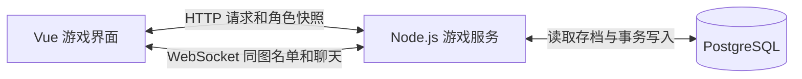

# 问道武林联网后端实施设计

首轮内测让两名玩家用各自的账号进入嘉兴烟雨楼外，看见彼此并聊天。玩家可以领修行收益、换装、闯主线拿掉落，重新登录后接着玩。以 [第 11 册后端蓝图](./11_后端架构与数据库接口协议方案.md) 为基础，本册确定首轮要建的表、要接的接口和验收条件。

## 一、服务结构



- **游戏服务**用 Node.js、TypeScript 和 Fastify，提供 `/api/v1` 和 `/ws`。账号、角色、修行、装备、战斗和地图房间按模块组织，共用同一进程。开发沿用 Vite 到 `8080` 的代理，部署时浏览器通过同一域名访问页面、HTTPS 接口和 WSS。 [Fastify WebSocket 文档](https://github.com/fastify/fastify-websocket)
- **PostgreSQL**保存账号、登录会话和角色档案。地图中的连接、在线人数和同图聊天由进程内房间维护，玩家重连时按档案中的地图重新加入。首轮按单区单进程内测设计。
- **玩法规则**沿用 `gameData.ts` 的地图、关卡、装备和掉落，以及 `mockEngine.ts` 的面板计算和战报推演。后端放在 `server/`，前后端共用的规则和 `protocol.ts` 类型放在 `shared/`。装备的部位、属性门槛和掉落由同一份配置决定。

当前 `apiClient.ts` 有接口封装，游戏状态仍在 `gameStore.ts` 本地模拟。接入时，真实模式的角色数据和操作结果统一来自服务器，界面负责展示和播放战报。独立的试玩模式继续使用本地规则。

## 二、角色与存档

内测一账号一个角色。创角只提交昵称和头像，服务器用现有 32 级试玩模板初始化主角、武学、伙伴和三套配装。主角出生在嘉兴，已开放第二关赵王府，修行从创角时间开始计。正式新手的等级和初始资源另行定数值。

沿用已定的约 24 件装备配置。开局穿牛家村玄铁匕首、竹编斗笠、终南玄门道袍、缠布护腕、练功布靴和曲三铁八卦。八个装备位里腰带和秘宝空着。背包有青钢长剑、飞燕护腕和两颗九花玉露丸。腰带从前几关掉落。两件秘宝留给真实三人副本少室山金刚伏魔圈，按每名角色的胜场发放，第一胜给岳武穆遗书，第二胜给笑傲江湖琴箫谱。

| 表 | 首轮保存内容 |
| --- | --- |
| `accounts` | 账号 ID、唯一登录名、密码哈希 |
| `sessions` | 会话令牌哈希、账号 ID、过期时间 |
| `players` | 角色 ID、唯一账号 ID、唯一角色名、头像、等级、境界、六维、真气、纹银、元宝、丹药数量、地图、当前配装序号、最高可挑战关卡、已领首胜奖励的关卡、上次修行结算时间、真气和纹银各自的余数、存档修订号 `revision` |
| `player_items` | 主键为 `(player_id, item_id)`。每种装备拥有一件，穿在身上也记在持有清单里 |
| `player_skills` | 主键为 `(player_id, skill_id)`，保存已学武功及重数 |
| `player_companions` | 主键为 `(player_id, companion_id)`，保存招募、好感与传功状态 |
| `player_loadouts` | 主键为 `(player_id, preset_idx)`，按 `LoadoutPresetDTO` 保存三套配装。八个装备位、武功、打法和伙伴以 `jsonb` 存储，空位统一用 `null` |
| `player_actions` | 主键为 `(player_id, request_id)`，保存操作类型、参数摘要和结果。战斗结果含完整战报，供原请求重试取回 |

背包从装备持有清单里扣除当前穿戴项得到。三套配装可以引用同一件装备，切换时只有当前那套生效。修行速度和装备面板由服务器根据角色、配置和生效的配装计算，快照里的 `nextLevelQi` 和 `qiPerHour` 随之生成。独自修行时 `coCultivatePartner` 为 `null`。

创角先锁账号，再在同一笔事务里创建角色、初始装备、武学、伙伴和配装，`revision` 从 `1` 开始。同一账号重发同样的创角请求时返回已有角色，改昵称或头像再提交时提示「这个账号已有角色」。

## 三、接口与联机房间

登录或注册成功后，服务器通过 Cookie 下发随机会话令牌。密码用 Argon2id 加盐哈希，登录尝试限频。线上 Cookie 设置 `HttpOnly`、`Secure` 和 `SameSite=Lax`。写接口和 WebSocket 握手按允许的站点来源校验 `Origin`，角色身份从登录会话查出。登出时删除该会话并关闭关联连接，连接到期后也要求重新登录。 [OWASP 密码存储](https://cheatsheetseries.owasp.org/cheatsheets/Password_Storage_Cheat_Sheet.html) · [会话管理](https://cheatsheetseries.owasp.org/cheatsheets/Session_Management_Cheat_Sheet.html) · [WebSocket 安全](https://cheatsheetseries.owasp.org/cheatsheets/WebSocket_Security_Cheat_Sheet.html)

HTTP 路径统一使用 `/api/v1` 前缀。

| 方法和路径 | 输入与处理 |
| --- | --- |
| `POST /auth/register`、`POST /auth/login` | 登录名、密码。建立会话，返回是否已创角 |
| `POST /auth/logout` | 注销当前会话 |
| `POST /player/create` | 昵称、头像。初始化档案并返回快照 |
| `GET /player/me` | 读当前角色的快照，供首次进入和重连使用。尚未创角时返回 `404 PLAYER_NOT_CREATED` |
| `POST /cultivate/settle` | 空请求体。按服务器时间结算，`result` 返回 `gainedQi`、`gainedSilver` |
| `POST /map/move` | `{ mapId }`。结清旧地图收益后保存新地图，`result` 返回 `gainedQi`、`gainedSilver`。重复选当前地图时两项为零 |
| `PUT /loadout/{presetIdx}` | `{ preset, activate, expectedRevision }`。提交完整配装，`activate` 默认为 `false`，设为 `true` 时同时切换当前方案。`result` 返回自动领取的真气和纹银，未触发结算时为零 |
| `POST /story/{chapterId}/challenge` | 空请求体。服务器按角色和关卡推演，`result` 返回 `report: BattleReportDTO` 和 `firstClear` |

快照包含 `revision`、`serverTime`、`player: PlayerDTO`、`loadouts: LoadoutPresetDTO[]`、`ownedItemIds`、`pillCount`、`learnedSkills`、`companionAffinity`、战斗面板 `derivedStats` 和 `idlePreview: { pendingQi, pendingSilver }`。`serverTime` 和 `lastSettleAt` 都用 Unix 毫秒。`GET /player/me` 在一次 `REPEATABLE READ` 只读事务中读取角色及关联表，预估收益只读档。四个玩法写接口返回 `{ snapshot, result }`。页面以较大的 `revision` 为准，修订号相同就采用较新的 `serverTime`。 [PostgreSQL 事务隔离](https://www.postgresql.org/docs/current/transaction-iso.html)

错误统一返回 `{ code, message }`。`401 SESSION_EXPIRED` 回登录页。`400 INVALID_LOADOUT` 显示具体原因，例如「这件装备还没拿到」。`409 CHAPTER_LOCKED` 提示「先打过上一关」。`409 STALE_REVISION` 先拉取新档案，再让玩家决定是否重新换装。客户端遇到断网或超时，可用原操作号重试这一次。

WebSocket 消息沿用 `{ event, data }`。浏览器连接同域 `/ws`，通过会话确定角色，自动加入角色档案里的地图。

| 消息 | 处理 |
| --- | --- |
| 服务端 `ROOM_SYNC` | 沿用 `mapId`、`onlineCount`、`players: RoomPlayerDTO[]`。进图、离图、重连或公开角色资料改变时推送完整名单。人数按角色去重，界面的附近名单滤掉自己 |
| 客户端 `CHAT_SEND` | 提交 `content`，去除首尾空白后最多 80 字，暂定每个角色每 2 秒一条 |
| 服务端 `ROOM_CHAT` | 向发送者当前地图广播 `id`、`mapId`、`sender`、`content` 和 `sentAt`。发言者与时间由服务器填写，前端按纯文本展示 |
| 服务端 `PLAYER_CHANGED` | 向该角色的连接发送新 `revision`。页面收到更高修订号就补读档案，已收到该修订号的 HTTP 快照时直接采用 |
| 服务端 `CHAT_REJECTED` | 向发言者返回 `{ code, message }`，例如「歇一歇再发」或「一条消息最多 80 字」 |

换图提交成功后，服务器移动该角色的所有连接，再刷新旧图和新图的名单。房间按角色修订号应用最新资料。最后一条连接关闭时离场。心跳初始按 30 秒一轮，上轮未响应的连接在本轮清理。断网时附近侠客显示「正在重连」，重连成功后拉取角色快照并接收新房间名单。首轮显示当前地图的真实人数，聊天从连接建立后开始接收。

## 四、收益、换装和闯关怎样入账

### 修行按实际时间入账

取到角色锁之后读取一次服务器当前时间。用 `clock_timestamp()` 取数据库时钟，避免把等锁之前的事务开始时间当作结算时刻。把结算时刻记为 `T`，取当前时间与 `lastSettleAt` 中较大的值。每次只结算到 `T`，取最近最多 12 小时的未领取时段，之后把 `lastSettleAt` 推进到 `T`。在线打坐和离线累计走同一套规则。 [PostgreSQL 时间函数](https://www.postgresql.org/docs/current/functions-datetime.html#FUNCTIONS-DATETIME-CURRENT)

首轮每小时真气 `R` 沿用地图基础速度、根骨、内功和生效衣甲的现有公式，先取整。`D` 是本次计入的毫秒数。真气和纹银分别用整数商入账，各自保留余数。12 小时是单次未领时长上限。

```text
D = min(T - lastSettleAt, 43_200_000)
真气分子 = 真气余数 + D × R
纹银分子 = 纹银余数 + D × R × 28
真气到账 = 真气分子 ÷ 3_600_000 的整数商
纹银到账 = 纹银分子 ÷ 360_000_000 的整数商
下次真气余数 = 真气分子 mod 3_600_000
下次纹银余数 = 纹银分子 mod 360_000_000
```

换图或换装造成速率变化时，在同一笔事务内先按旧速率结清，再应用新速率。举例，先以每小时 3,600 真气打坐 5 分钟，再以每小时 7,200 真气打坐 5 分钟，总共到账 900 真气和 252 纹银。页面可用 `idlePreview` 展示预计收益，实际到账由写接口返回。

### 换装校验

服务器按 `EQUIP_SLOT_META` 校验八个部位。每件装备须已持有且满足基础属性门槛，武学须已学且装到对应类别。选入的伙伴须已招募，同一伙伴只占一格。保存非当前方案只改变那套配装。保存当前方案或切换时，返回生效配装和新面板。背包按当前方案重新筛选，换下的装备回到背包。空着的部位用 `null`。

### 闯关和首胜奖励

服务器读取拿到锁时的当前配装与角色面板，检查关卡已开放，再生成带唯一 ID 的战报。首轮暂定每关首胜发真气、纹银和配置掉落，复战用于试招。首胜是否已发独立于最高可挑战关卡，所以开局已开放赵王府的内测角色仍能回第一关领首胜奖励。首胜时 `firstClear` 为 `true`，记录已领关卡并开放配置中的下一关。战报里的奖励只列本次实际发放的内容，已拥有的装备和已学武功跳过发放。

赵王府首胜给 5,600 真气、1,800 纹银、青布腰带和《九阴白骨爪》，开放第三关。青布腰带装备后气血上限增加 260。界面按实际结果显示「首胜奖励已到账」「这关奖励已领过」或「这次没打过」，播放和跳过战报都只改变展示。

### 断线重试与同时操作

1. 修行、换图、换装和闯关都带请求头 `Idempotency-Key`，值为客户端生成的 UUID。一次操作沿用同一请求号，网络失败后重试同一请求和参数。
2. 服务器从会话确定角色，在写事务中用 `SELECT … FOR UPDATE` 锁角色行。先按角色和请求号查回执。同一个请求号和相同方法、路径、参数返回原结果与最新快照，换了操作或参数则返回 `409 REQUEST_KEY_REUSED`。 [PostgreSQL 行锁文档](https://www.postgresql.org/docs/current/explicit-locking.html#LOCKING-ROWS)
3. 新请求再检查配装修订号和业务条件。角色存档变更时递增修订号，与背包、关卡变更及回执一起提交。提交成功后再响应，存档有变动时广播新修订号。回执重放直接返回原战报或原实发数量。页面刷新先读档案，已提交的奖励在档案里可见。

## 五、开工顺序与验收

| 顺序 | 完成条件 |
| --- | --- |
| 1. 账号和角色 | 同账号重复提交创角只有一个角色。两个账号各自穿六件、背包有两件可换装备。伪造角色 ID 无法访问对方档案。重启服务后档案可恢复 |
| 2. 同图联机 | 两个账号在嘉兴互相看见、收到聊天。换到终南山后名单和聊天随房间分开。同角色双标签页占一个名额，关闭一个仍在线，最后断开后离场。重连回到档案里保存的地图 |
| 3. 修行与配装 | 用固定时钟验证，每小时 3,600 真气时 10 分钟领 600 真气和 168 纹银，拆成多次领结果相同，超过 12 小时只按 12 小时发放。换上青钢长剑后玄铁匕首回背包，另一标签页同步，旧修订号写入被拒绝 |
| 4. 闯关掉落 | 内测开局能打赢赵王府。赢下后直接刷新，第三关已开放，背包可找到青布腰带，穿戴后气血上限加 260。模拟丢失响应后用原键重试得到同一战报。两个不同请求号同时打赢也只发一份首胜奖励 |

## 六、双人共修

双人共修持续四小时。同处和平地图的在线玩家可以发出邀请，60 秒内由对方接受。接受时再次确认两人在线、同图且可以结伴，一人同时只能与一人共修。开始后，两人各自的每小时真气收益乘 `1.15`，取整后进入修行结算，纹银随真气产出计算。断线后已生效的共修按原截止时间继续，任一人换图或主动结束时提前停止。 [第 09 册同图互动方案](./09_多人联网大江湖生态与交互方案.md)

`POST /map/co-cultivate` 沿用玩法写入的操作编号和回执。`invite` 提交 `targetPlayerId`，`accept` 和 `decline` 提交 `invitationId`，`end` 提交 `coCultivationId`。`co_cultivations` 保存邀约和生效后的共修时间。提交成功后通过 `PLAYER_CHANGED` 通知双方更新档案，右栏显示待回复邀请或共修倒计时。

接受和提前结束时按角色 ID 顺序锁住两份档案，用同一时刻结清两人在变更前的收益，再更新关系。自然到期保留加成时段到下次结算，把待领时间分为加成段和普通段，合计后一次入账。验收时让甲乙共修后乙断线，甲换图，再让乙重连。两人的加成均在甲换图时结束，乙可以从档案里读到已结清的收益。 [PostgreSQL 多行加锁顺序](https://www.postgresql.org/docs/current/explicit-locking.html#LOCKING-DEADLOCKS)

## 七、少室山三人副本

队长从附近名单邀请两位同图在线侠客。邀约有效 60 秒。三人到齐后各自确认准备，再由队长开打。有人离队、换图或断线时，队伍重新确认准备。候场队伍由当前游戏进程维护，重连会收到最新状态。

`POST /raid/team` 处理邀请、接受、婉拒、准备和离队，队伍变更通过 `TEAM_ROOM_SYNC` 推送。`POST /raid/start` 校验队伍与准备修订号，并按角色 ID 顺序锁住三份档案。服务器用三位玩家的生效配装推演战斗，渡难、渡劫和渡厄全部被击败才算通关。

通关时分别递增三人的 `shaoshi_clears`。各自第一胜给岳武穆遗书，第二胜给笑傲江湖琴箫谱，之后胜利发真气和纹银。胜场、货币、装备和开战回执在同一笔事务提交。提交后通过 `RAID_REPORT` 推送共用的战斗过程及个人奖励。重复提交同一个开战编号可取回原战报。

## 八、武功升级

`POST /skill/upgrade` 提交 `skillId` 和界面看到的 `expectedMastery`。服务器沿用试玩的消耗公式，按品质、当前重数和悟性计算真气花费。扣真气、升一重、臂力加一和写入回执在同一笔事务完成，最高十重。

外功和绝技从第二重起，每升一重增加基础威力的 5%。例如悟性 32 的玩家把《越女剑法》从第四重升到第五重，花费 1,358 真气，招式威力从 ×1.3225 提高到 ×1.38。武库预览、主线和少室山副本使用同一条公式，战斗读取各玩家已保存的武功重数。

## 九、后续成长

角色升级和突破沿用同一套写入规则，装备面板与修行速度随成长更新。

后续推进华山论剑、门派和鬼市交易。联机界面中的可用操作随服务端能力逐项开放。

部署时数据库迁移用 SQL 脚本管理。每台云服务器保留一份最新备份，并验证该备份可恢复。
