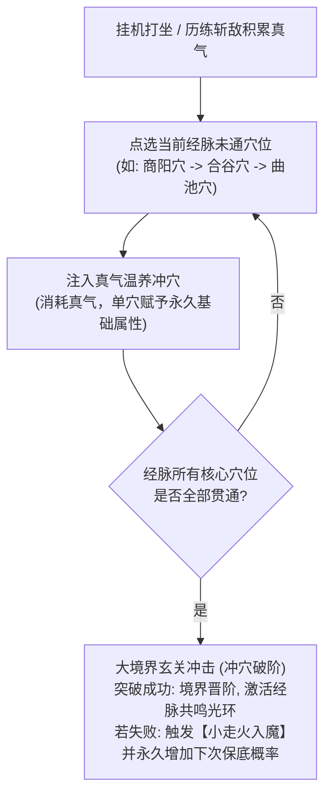
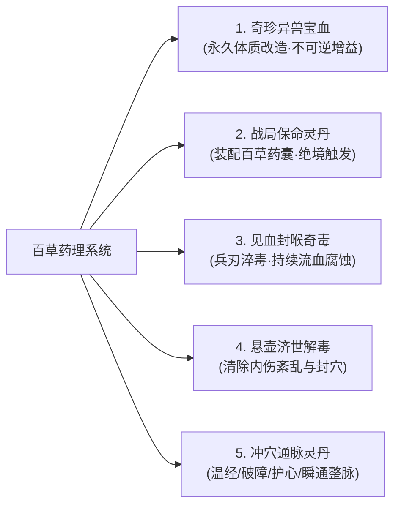
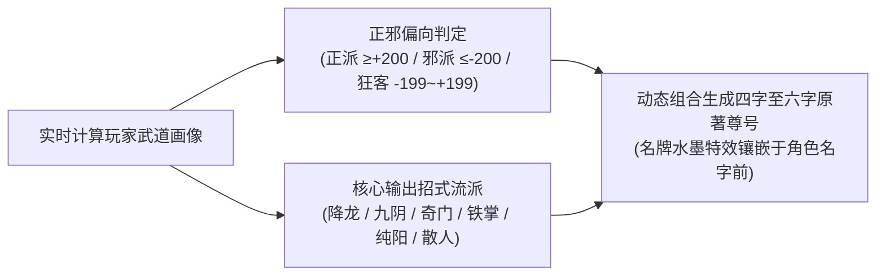
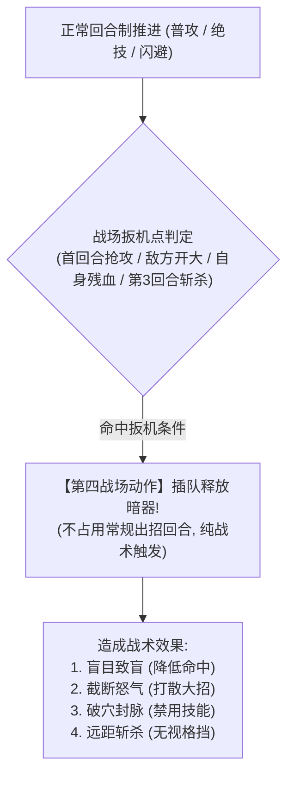

# 《金庸群侠：问道武林》四大金庸特色系统：经脉冲穴、百草丹毒、江湖绰号与暗器奇门全设定

> **设计宗旨**：
> 武侠的精髓，不在于冰冷数值的无限膨胀，而在于原汁原味的“江湖规矩”与“武学细节”。
> 本案将**“每10级一大境界的经脉冲穴”**、**“百草丹道与药蛇奇毒”**、**“江湖绰号与正邪声望”**、**“暗器机括与副手奇门”**四大金庸经典设定深度植入数值与战斗底层，打造极具金庸烟火气的大江湖。

---

## 目录索引
1. [系统一：每10级大境界与经脉冲穴系统](#一-系统一每10级大境界与经脉冲穴系统)
2. [系统二：百草药理、丹道与奇毒抗性系统](#二-系统二百草药理丹道与奇毒抗性系统)
3. [系统三：江湖绰号与正邪声望行迹系统](#三-系统三江湖绰号与正邪声望行迹系统)
4. [系统四：暗器机括与副手奇门系统](#四-系统四暗器机括与副手奇门系统)
5. [四大系统战斗结算与战报文字播报协议](#五-四大系统战斗结算与战报文字播报协议)

---

## 一、 系统一：每10级大境界与经脉冲穴系统

### 1.1 经脉冲穴核心闭环
角色每升 1 级积累基础真气，**每 10 级遭遇一次【大境界经脉壁障】**。玩家不能直接突破境界，必须使用打坐真气逐一温养点通对应经脉的 **5~6 个核心穴位**，最后凝聚一口纯阳真气冲击“生死关隘”，方可冲穴破关晋阶！



---

### 1.2 全武道十重境界与经脉穴位全谱（每10级一阶）

第一卷《射雕篇》（Lv 1 ~ 30）覆盖前三重境界，后续资料片自然向下延展。**边界口径：Lv10 达成第一重圆满即冲击第二重，Lv20 达成第二重圆满即冲击第三重**（与第 13/17 册关卡节奏一致）。

| 境界重数 | 境界名称 | 对应等级区间 | 贯通经脉与原著渊源 | 核心穴位清单 (由浅入深逐一冲通) | 单穴属性增益与经脉贯通共鸣特权 |
| :---: | :---: | :---: | :--- | :--- | :--- |
| **第一重** | **【初窥门径】** | **Lv 1 ~ 10** | **手三阳经**<br>(大肠经、三焦经、小肠经)<br>新手入门，初感气机 | 1. **商阳穴**：臂力 +2<br>2. **合谷穴**：外功攻击 +18<br>3. **曲池穴**：破甲 +10<br>4. **肩髃穴**：招架率 +2%<br>5. **迎香穴**：命中率 +3% | **【经脉共鸣】**：解锁外功招式槽、轻功身法槽、暗器奇门槽；离线打坐基础倍率 $1.0\times$。 |
| **第二重** | **【略有小成】** | **Lv 11 ~ 20** | **足三阴经**<br>(脾经、肾经、肝经)<br>气沉丹田，内息循环 | 1. **隐白穴**：根骨 +3<br>2. **涌泉穴**：出手速度 +12<br>3. **三阴交**：内力上限 +120<br>4. **太冲穴**：暴击率 +2.5%<br>5. **期门穴**：受到暴击伤害减免 5% | **【经脉共鸣】**：**解锁【内功心法槽】与【左翼·破阵伙伴位】**；打坐倍率提升至 $1.25\times$；全属性 $+10\%$。 |
| **第三重** | **【融会贯通】** | **Lv 21 ~ 30** | **阳维脉 · 阴维脉**<br>(维络诸阳诸阴，气贯周身)<br>**第一卷射雕篇大圆满** | 1. **金门穴**：护体防御 +25<br>2. **阳交穴**：闪避率 +3%<br>3. **筑宾穴**：内劲伤害转化 +4%<br>4. **府舍穴**：气血上限 +450<br>5. **天突穴**：受击回复怒气 +3<br>6. **廉泉穴**：真气吐纳效率 +8% | **【经脉共鸣】**：**解锁【右翼·奇策伙伴位】与【绝技奥义槽】**；打坐倍率 $1.5\times$；获得华山绝巅首通入场凭证。 |
| **第四重** | **【炉火纯青】** | **Lv 31 ~ 40** | **阳跷脉 · 阴跷脉**<br>第二卷《神雕篇》古墓剑冢 | 申脉、照海、交信、附阳、睛明 | 神功解锁第 4~5 重修炼权限；解锁【侠侣双剑合璧】羁绊。 |
| **第五重** | **【出类拔萃】** | **Lv 41 ~ 50** | **带脉** (束腰环回，真气固摄)<br>神雕中期绝情幽谷 | 带脉穴、五枢穴、维道穴、日月穴 | 免疫一切剧毒导致的真气流失；解锁自创绝学融合雏形。 |
| **第六重** | **【神乎其技】** | **Lv 51 ~ 60** | **冲脉** (十二经之海，血海喷涌)<br>第二卷《神雕篇》大圆满 | 幽门、通谷、商曲、石关、阴都 | 神功解锁第 6 重上限；领悟【玄铁重剑·大巧不工粉碎格挡】。 |
| **第七重** | **【登峰造极】** | **Lv 61 ~ 70** | **奇经八脉小周天**<br>第三卷《倚天篇》冰火岛武当 | 鸠尾、水分、气海、关元、中极 | 解锁【太极借力反伤】；外功普攻附带 20% 真实内劲。 |
| **第八重** | **【一代宗师】** | **Lv 71 ~ 80** | **任脉** (阴脉之海，绵绵若存)<br>光明顶总坛决战 | 会阴、曲骨、石门、下脘、膻中 | 解锁【全队宗师秘宝槽】；每回合行动开始时自动净化一层负面状态。 |
| **第九重** | **【震古烁今】** | **Lv 81 ~ 90** | **督脉·生死玄关**<br>第三卷《倚天篇》大圆满 | 长强、命门、身柱、大椎、百会 | **【神功大圆满解封】**：全武学解禁第 7~10 重；内力生生不息。 |
| **第十重** | **【天人合一】** | **Lv 91 ~ 100+** | **泥丸天门 · 太玄归一**<br>侠客岛石室终极悟道 | 神庭、上星、囟会、前顶、天灵 | 招式打破门派兵器界限，万法随心，化气为无形真力。 |

---

### 1.3 冲穴消耗公式与“走火入魔”保底保护

1. **单穴温养真气消耗公式**：
   设角色处于第 $R$ 境界（$1 \le R \le 10$），冲通该经脉的第 $p$ 个穴位（$1 \le p \le 6$）：
   $$\text{Cost}_{\text{qi}}(R, p) = \text{Round}\left( 800 \times (R)^{1.8} \times (1.25)^{p - 1} \times \left(1 - \frac{\text{INT}}{\text{INT} + 250}\right) \right)$$
   * *悟性减免*：高悟性角色冲穴真气消耗最高可减免 $28.5\%$。

2. **最终冲穴破关成功率与小走火机制**：
   * 第一重（初窥门径）：$100\%$（新手引导必成）；
   * 第二重（略有小成）：$85\% + \text{根骨} \times 0.2\%$；
   * 第三重（融会贯通）：$75\% + \text{根骨} \times 0.15\%$。
   * **小走火保护机制**：若破关掷骰失败，**绝不倒扣等级与真气**，角色进入持续 15 分钟的【气血微沸·小走火】状态（气血上限临时 $-10\%$），同时系统为本次突破**永久追加 $+20\%$ 的下次必定成功保底补偿**，直到突破成功为止！

---

### 1.4 冲穴专属灵丹宝典（五大金庸通脉破障神丹）

冲穴乃逆天改命之举，单凭自身苦修常遇阻滞，金庸江湖历来有名门丹道相辅佐。本游戏将冲穴丹药与日常经络温养深度结合：

| 冲穴灵丹品名 | 品质 | 核心功效机制 | 原著出处与获取途径 | 服用战报与气韵文案 |
| :--- | :---: | :--- | :--- | :--- |
| **【玄门·聚气通脉丹】** | 良品(蓝) | **温经活络·免气通穴**<br>冲穴温养时使用，直接**抵扣 100% 冲穴真气消耗**，瞬间打通当前经脉任意常规穴位！ | 全真教丹房贡献兑换 / 巡历小极品挂机掉落 / 嘉兴客栈掌柜奇遇 | *“一口吞下聚气通脉丹，一股温润草木内息沿经络飞速流转，郁结之气豁然开朗，穴道顺畅贯通！”* |
| **【纯阳·通脉破障丹】** | 上品(紫) | **生死玄关·强行破障**<br>专用于每 10 级大境界冲关冲击。**突破成功率直接提升 $+35\%$**，并使冲关真气消耗减少 $20\%$。 | 各章守关首领概率掉落 / 全真纯阳宫大考奖励 / 子时鬼市秘宝鉴赏 | *“破障丹入腹，如纯阳烈火涤荡经络，生死玄关壁障应声而碎，天地纯和之气浩荡汇聚丹田！”* |
| **【天山·冰魄护心丹】** | 上品(紫) | **锁固心脉·辟除心魔**<br>冲穴突破随身含服。若冲关失败，**$100\%$ 豁免走火入魔惩罚**，立即返还全部消耗真气，并为下次突破追加 $+25\%$ 额外保底。 | 塞外雪山天壁采摘天山雪莲炼制 / 桃花岛药房秘制 / 华山绝巅首通宝箱 | *“冰魄护心丹化作一线冰寒清流死死锁住心脉，任凭体内真气狂暴冲撞，神识灵台始终稳如泰山！”* |
| **【少林·大乘小还丹】** | 绝品(橙) | **百穴齐鸣·连通三穴**<br>少林药局至宝。服下一丸，百脉具苏，**直接连续贯通当前经脉 3 个穴位**，并永久提升角色根骨 $+6$、内力上限 $+300$。 | 少林罗汉堂达摩院秘传 / 华山论剑至尊宝匣 | *“小还丹入口即化，馥郁沉香透骨而出，数十股雄浑佛门内劲分走诸穴，阻滞穴道摧枯拉朽般被连破三道！”* |
| **【神品·九转通窍仙丹】** | 神品(红) | **至尊神品·整脉全通**<br>天下第一冲穴仙丹。一丸入腹，**整条经脉所有剩余未通穴位瞬间全部贯通**！直接迎来大境界突破契机，全属性永久 $+12$。 | 第一卷华山绝巅论剑天下第一奇遇 / 万人阵营战全服首功 | *“九转仙丹霞光隐现，服之周身三百六十穴无不大放光明，真气化作滔天狂澜横扫奇经八脉，整条经脉全线贯通！”* |

---

## 二、 系统二：百草药理、丹道与奇毒抗性系统

在《射雕英雄传》中，江湖绝不仅仅是刀光剑影，更有梁子翁养了二十年的腹蛇宝血、黄药师的九花玉露丸、欧阳锋的白驼蝮蛇奇毒，以及大理断肠草与雪莲解毒方。



### 2.1 【奇珍宝血】：永久体质淬炼（全卷仅此一份的奇遇造化）

| 奇珍宝血名称 | 原著出处与获取奇遇 | 永久体质改造数值 | 战报原著描述文字 |
| :--- | :--- | :--- | :--- |
| **【梁子翁·二十年药蛇宝血】** | 赵王府后院梁子翁药房击杀宝蛇分饮 | **永久气血上限 $+15\%$，永久白驼蛇毒抗性 $+50\%$** | *“你仰头将碗中温热蛇血一饮而尽！只觉一股滚烫热流自喉间直灌丹田，四肢百骸如沐烈火，百毒不侵之质初成！”* |
| **【深谷巨雕·菩斯曲蛇胆】** | 第二卷剑冢试炼击杀菩斯曲怪蛇采集 | **永久臂力 $+25$，外功攻击真实穿透 $+5\%$** | *“腥苦蛇胆吞入腹中，骨骼噼啪作响，全身力气如怒潮狂涌，神力顿生！”* |
| **【黑沼通灵·九尾灵狐血】** | 湘西黑沼协助瑛姑解开算数奇遇赠取 | **永久身法 $+18$，闪避率永久 $+3\%$** | *“灵狐引血三合，身轻如飞絮飘落，足履生风，步履轻捷宛若游狐！”* |
| **【雪山绝巅·万年天山雪莲】** | 塞外奇遇采摘雪山天壁之雪莲 | **永久内力上限 $+200$，打坐修行真气 $+10\%$** | *“含服九叶天山雪莲冰瓣，体内燥热尽除，灵台清明如镜，内力生生不息！”* |

---

### 2.2 【百草药囊】：战局主动灵丹与兵刃淬毒（出战携带 2 格）

玩家角色面板新增 **【百草药囊（2个槽位）】**，可自由搭配 1 瓶救命灵丹 + 1 盒淬毒毒膏：

| 药丹/毒油品名 | 品质 | 携带类型 | 战斗触发条件与实战机制 | 战中原著风味文字播报 |
| :--- | :---: | :---: | :--- | :--- |
| **【桃花岛·九花玉露丸】** | 绝品(橙) | 保命灵丹 | 当角色即将承受致死伤害时**必定锁血 1 点**，并瞬间回复自身 $40\%$ 最大气血与全部内伤（每场限 1 次）。 | *“心脉欲碎之际，你急服一颗九花玉露丸！幽香扑鼻，强提一口先天纯阳真气，硬生生化死局为生路！”* |
| **【全真教·纯阳金丹】** | 上品(紫) | 辅助金丹 | 战斗第 2 回合自动服用，立即清除全队所有中毒与封穴状态，并在 3 回合内提升护体防御 $30\%$。 | *“服下全真纯阳金丹，玄门至正浩气流转周身，毛孔逼出黑紫浊血，万邪皆避！”* |
| **【少林·大还丹】** | 绝品(橙) | 回气神丹 | 自身内力低于 $20\%$ 时触发，瞬间补满真气池，并提升本回合绝技奥义威力 $25\%$。 | *“大还丹入口即化，汹涌真气如长河决堤般自气海奔涌而出，招式光华大盛！”* |
| **【白驼山·蝮蛇见血膏】** | 上品(紫) | 兵刃淬毒 | 出战前涂抹于兵刃上。前 5 回合所有外功招式命中目标附带【见血封喉】，每回合扣除敌方最大气血 $3.5\%$，叠满 3 层腐蚀敌方 $25\%$ 护甲。 | *“剑锋隐泛青蓝幽光，白驼剧毒顺着伤口侵入经脉，敌方面色泛紫，气血止不住地狂涌外泻！”* |
| **【黑沼·通灵化瘀散】** | 良品(蓝) | 应急药粉 | 受到暴击时自动洒出，回复自身 $18\%$ 气血并降低自身所受下一击外功伤害 $40\%$。 | *“扯开化瘀散拍在伤口，清凉药力瞬息封住渗血裂口，顶住当头重击！”* |

---

### 2.3 【百草采集】：神州四大名川灵草产出矩阵

金庸江湖地大物博，自江南水乡至塞外大漠，每处水土皆孕育独特药性草木。玩家可通过**【巡历挂机被动产出】**或**【百草丹房·采药寻草主动搜山】**获取药材：

| 地图区域 | 出产药材品名 | 品质 / 稀有度 | 药理特性与原著典故 | 最佳采集时辰 / 特殊气象加成 |
| :--- | :--- | :---: | :--- | :--- |
| **嘉兴烟雨楼外**<br>(江南水乡泽地) | **田七三七** | 凡品(绿) · 普通 | 甘微苦温，止血散瘀、消肿定痛。江南草甸丛生，为入门通脉散基药。 | 常规全天平缓采集 |
| | **车前草** | 凡品(绿) · 普通 | 清热利尿、渗湿通淋。叶贴地而生，调和体内燥热内火。 | 常规全天平缓采集 |
| | **淮南红花** | 良品(蓝) · 优秀 | 活血通经、散瘀破结。花开转红时采收，药力雄劲，助冲关破滞。 | 辰时烟雨迷蒙时药力充盈 |
| | **南湖荷顶露** | 良品(蓝) · 稀有 | 卯时大荷叶心凝聚之纯净甘露，中和天下虎狼药猛烈火燥。 | **卯时·平旦 (05:00~07:00)** 朝露最盛，产出概率大增 $+50%$ |
| **终南山·后山密林**<br>(道门玄宗灵山) | **终南金银花** | 凡品(绿) · 普通 | 一蒂二花、黄白相映。清热解百草炉火微毒。 | 常规全天平缓采集 |
| | **终南赤茯苓** | 良品(蓝) · 优秀 | 千岁松脂渗入地底化神。皮黑肉红，宁心安神、益脾和胃，玄门筑基必配。 | 常规全天平缓采集 |
| | **百年何首乌** | 上品(紫) · 珍奇 | 百年以上初具人形。大补气血精髓，坚筋骨，延寿强脉。 | 申时夕照斜阳时分较易于绝壁石缝寻获 |
| | **全真纯阳芝** | 绝品(橙) · 史诗 | 王重阳活死人墓外讲道所遗灵芝，通体赤红如霞，蕴含纯阳道力。 | **午时·日正 (11:00~13:00)** 天地纯阳正盛，采获概率 $+50%$ |
| **大漠古商道**<br>(西域塞外苍茫) | **塞外麻黄** | 凡品(绿) · 普通 | 发汗解表、宣肺平喘。生于戈壁胡杨乱石滩，走奇经八脉如飞箭。 | 常规全天平缓采集 |
| | **天山红景天** | 良品(蓝) · 优秀 | 生长于雪线碎石绝壁，抗高寒缺氧阴霾，强心提气。 | 申时寒风初起时药力凝聚 |
| | **西域天山雪莲** | 上品(紫) · 珍奇 | 万年极寒峭壁五年一开，叶密如毡、花白胜雪，解天下奇热剧毒。 | 戌时薄暮风雪交加之时偶现 |
| | **菩斯曲蛇胆** | 绝品(橙) · 史诗 | 独孤求败神雕所猎异蛇之胆，头生肉角、通体金光，食之神力暴增！ | **子时·夜半 (23:00~01:00)** 异蛇出洞，斩杀采胆机率 $+50%$ |
| **湘西·黑沼泥潭**<br>(毒障禁地泥沼) | **幽潭蛇涎草** | 良品(蓝) · 优秀 | 受万千毒蛇涎液浇灌，通体青绿斑纹，以毒攻毒、透关通络。 | 阴雨夜半毒瘴泛滥时 |
| | **百足赤蜈蚣** | 良品(蓝) · 优秀 | 铁掌峰后山红甲大蜈蚣蜕壳，药力刚猛，白驼山庄秘制淬毒灵料。 | 常规全天平缓采集 |
| | **绝情断肠草** | 上品(紫) · 珍奇 | 情花下三尺伴生。见血封喉、剧毒断肠，物极必反，为化腐生肌圣药。 | 子时阴阳交割之时药力最烈 |
| | **黑沼灵狐仙草** | 神品(红) · 传说 | 瑛姑通灵九尾白狐守护之旷世灵草。九叶九蕊泛微荧光，九转神丹唯一药引！ | **子时·夜半** 灵狐出穴觅食，仙草华光大放 |

---

### 2.4 【神农鼎炉与丹方秘典】：火候、悟性与炼制全法则

角色在【百草丹房】中操控“神农八卦鼎”起炉炼药，核心炼制机制如下：

1. **三阶炉火境界**：
   * **【文火温养】**：药力温和清润，用于聚气散、九花玉露丸、冰魄护心丹；
   * **【武火猛炼】**：真火烈焰，逼退阴毒、强开玄关，用于纯阳破障丹、白驼见血膏、纯阳金丹；
   * **【三昧真火】**：内力外放、紫火纯青、神丹化形，用于少林大小还丹、九转通窍仙丹。

2. **炼丹成率与一炉双丹暴击公式**：
   * 炼丹综合成功率：`Rate_craft = min(98%, max(15%, BaseRate + (INT - MinINT) × 1.5% + LUCK × 0.4% + Pity))`
     * *悟性加成*：玩家悟性每高出丹方门槛 1 点，成功率提升 $+1.5%$；
     * *福缘加成*：福缘每点追加 $+0.4%$ 炼成率。
   * **一炉双丹（双倍暴击率）**：`Rate_double = min(40%, Round(LUCK × 0.8% + INT × 0.3%))`

3. **药渣机制（炼制失败保护）**：
   * 若炼制失败，不会倒扣真气经验，系统将焦黑药沫收纳为 **【炼丹药渣】**（丹方累积 $+6%$ 必定成功保底）；
   * 每积攒 **5 团药渣** 可在丹房选择 **【药渣回炉萃精】**，反哺提炼出 2 株随机珍稀草药与 800 点纯阳真气！

4. **九大神农传世丹方总览**：

| 丹方秘卷品名 | 品质 | 所炼成药与类型 | 火候类型 | 悟性门槛 | 基础成率 | 消耗真气/工本 | 配方药材清单 |
| :--- | :---: | :--- | :---: | :---: | :---: | :---: | :--- |
| **《聚气通脉散方》** | 良品(蓝) | 【玄门·聚气通脉丹】<br>(常规免气通穴) | 文火 | 20 | $95%$ | 300 真气<br>60 两纹银 | 田七三七 $	imes 2$<br>车前草 $	imes 2$<br>终南赤茯苓 $	imes 1$ |
| **《纯阳破障金丹方》** | 上品(紫) | 【纯阳·通脉破障丹】<br>(大境界突破率 $+35%$) | 武火 | 26 | $80%$ | 1,200 真气<br>180 两纹银 | 全真纯阳芝 $	imes 1$<br>淮南红花 $	imes 3$<br>百年何首乌 $	imes 1$ |
| **《天山冰魄护心方》** | 上品(紫) | 【天山·冰魄护心丹】<br>(豁免走火·全额返还) | 文火 | 28 | $75%$ | 1,500 真气<br>240 两纹银 | 西域天山雪莲 $	imes 2$<br>天山红景天 $	imes 2$<br>南湖荷顶露 $	imes 2$ |
| **《少林大乘小还丹谱》**| 绝品(橙) | 【少林·大乘小还丹】<br>(连通三穴·根骨 $+6$) | 三昧 | 30 | $60%$ | 2,600 真气<br>520 两纹银 | 百年何首乌 $	imes 2$<br>菩斯曲蛇胆 $	imes 1$<br>终南赤茯苓 $	imes 3$<br>全真纯阳芝 $	imes 1$ |
| **《神品九转通窍仙方》**| 神品(红) | 【神品·九转通窍仙丹】<br>(整脉全通·全属性 $+12$) | 三昧 | 32 | $45%$ | 5,000 真气<br>1,600 两纹银| 黑沼灵狐仙草 $	imes 1$<br>菩斯曲蛇胆 $	imes 2$<br>西域天山雪莲 $	imes 2$<br>全真纯阳芝 $	imes 2$ |
| **《桃花九花玉露秘卷》**| 绝品(橙) | 【桃花岛·九花玉露丸】<br>(濒死锁血回 $40%$) | 文火 | 28 | $70%$ | 2,200 真气<br>400 两纹银 | 南湖荷顶露 $	imes 3$<br>西域天山雪莲 $	imes 1$<br>淮南红花 $	imes 2$<br>终南金银花 $	imes 3$ |
| **《全真纯阳金丹录》** | 上品(紫) | 【全真教·纯阳金丹】<br>(净毒封穴·防御 $+30%$) | 武火 | 24 | $85%$ | 1,000 真气<br>150 两纹银 | 全真纯阳芝 $	imes 1$<br>终南赤茯苓 $	imes 2$<br>终南金银花 $	imes 2$ |
| **《白驼蝮蛇见血膏方》**| 上品(紫) | 【白驼山·蝮蛇见血膏】<br>(兵刃淬毒·流血破甲) | 武火 | 24 | $82%$ | 1,100 真气<br>160 两纹银 | 幽潭蛇涎草 $	imes 3$<br>百足赤蜈蚣 $	imes 2$<br>绝情断肠草 $	imes 1$ |
| **《少林大还丹大宗秘典》**| 绝品(橙) | 【少林·大还丹】<br>(内力瞬满·绝技 $+25%$) | 三昧 | 30 | $55%$ | 3,000 真气<br>680 两纹银 | 百年何首乌 $	imes 3$<br>塞外麻黄 $	imes 3$<br>菩斯曲蛇胆 $	imes 1$<br>天山红景天 $	imes 2$ |

---

## 三、 系统三：江湖绰号与正邪声望行迹系统

在金庸武侠中，没有一个响彻江湖的名号等于锦衣夜行。“北侠郭靖”、“南山樵子南希仁”、“铁掌水上漂裘千仞”、“赤炼仙子李莫愁”，绰号是江湖对一位侠客行事作风与绝艺的最高认证。

### 3.1 动态江湖绰号生成矩阵
系统实时根据玩家的 **【当前主修武学】 + 【正邪倾向（侠义值 $-1000 \sim +1000$）】 + 【主修兵刃 / 门派】**，为玩家动态生成专属江湖头衔：



| 正邪阵营判定 | 核心武学 / 门派构筑 | 动态生成的江湖尊号 | 称号被动属性光环 | NPC 与客栈交际剧情演变 |
| :---: | :--- | :--- | :--- | :--- |
| **正道仁侠**<br>(侠义 $\ge +300$) | 主修《降龙十八掌》/ 掌法 | **【金龙震岳 · 仁义狂客】** | 全队外功防御 $+6\%$，对邪派敌人伤害 $+10\%$ | 临安客栈小二与掌柜躬身作揖：“哎哟！原来是威震大江南北的仁义狂客少侠！上房已备好！” |
| **正道名门**<br>(侠义 $\ge +200$) | 主修《全真剑法》/ 先天功 | **【纯阳拂尘 · 终南逸士】** | 离线打坐真气收益 $+12\%$，封穴抗性 $+20\%$ | 全真道童肃然起敬，称呼师叔；参拜终南山祖师殿免除门规核验。 |
| **绿林邪枭**<br>(侠义 $\le -300$) | 主修《九阴白骨爪》/ 毒掌 | **【幽冥裂骨 · 赤炼阎罗】** | 暴击率 $+6\%$，攻击必定附带 $2$ 回合重伤减疗 | 正派弟子见之退避三舍，临安城守军巡逻频频盘查；但嘉兴黑市鬼市掌柜奉为上宾，交易暗折 $8$ 折！ |
| **西域邪宿**<br>(侠义 $\le -200$) | 主修《蛤蟆功》/ 灵蛇拳 | **【白驼万毒 · 噬魂蛇君】** | 受到致命伤时反震施毒者最大气血 $15\%$ | 白驼山庄副总管亲迎，赐予绝密蛇药饲喂方。 |
| **世外狂生**<br>(中立 $-199 \sim +199$) | 主修《落英神剑掌》/ 碧波曲 | **【碧海落梅 · 逍遥客】** | 战斗先手速度 $+15$，闪避率 $+4\%$ | 桃花岛仆从以礼相待；可无视世俗礼教自由出入烟花与官宦府邸。 |
| **逍遥散人**<br>(中立 终身不拜师) | 主修奇门枪杖 / 散人杂学 | **【踏波行云 · 塞外浪子】** | 连击率 $+5\%$，击杀敌人额外获取铜钱 $+20\%$ | 江湖各派争相招揽，老顽童周伯通与洪七公偶遇结拜好感翻倍。 |

---

## 四、 系统四：暗器机括与副手奇门系统

为解决回合制战斗中纯靠出招、缺乏“突施冷箭、以巧破力、绝境偷袭”的局限，设立独立于常规招式的 **【暗器/副手奇门槽位】**，作为战斗中的**第四个战场动作（无消耗/自动触发式战术工具）**！



### 4.1 第一卷四大射雕名门暗器图鉴

| 暗器名称 | 品质 | 装配槽位 | 战术触发时机 (Trigger) | 专属战术机制与数值 | 战中原著风味文字出招播报 |
| :--- | :---: | :---: | :--- | :--- | :--- |
| **【柯家·飞天淬毒黑菱】** | 上品(紫) | 暗器槽 | **战斗开局首回合（先声夺人）** | 战斗开始瞬间抢先掷出！造成攻击力 $95\%$ 的无视护甲暗器穿透伤害，并使敌方命中率降低 $35\%$（持续 2 回合）。 | *“未及交兵，你手腕一翻，三枚淬毒铁菱裹挟尖啸破空激射！当的一声擦过敌方面门，毒雾弥散，激得对方双目泪流难辨虚实！”* |
| **【黄药师·弹指飞蝗玉石】** | 绝品(橙) | 暗器槽 | **敌方怒气达 100 准备放绝技时** | **【战术打断神技】**：中指弯曲借巧劲凌空弹出！造成 $120\%$ 真实伤害，并**强行打散敌方 40 点怒气**，硬生生断其绝技奥义！ | *“眼见敌方真气汇聚欲下杀手，你屈指按在大指之下，嗤的一声！一枚碧玉飞蝗石如流星贯日精准命中其右腕，敌方气机一滞，蓄力大招生生被破！”* |
| **【彭连虎·毒龙透骨银针】** | 上品(紫) | 暗器槽 | **自身气血低于 $30\%$ 时（绝地反制）** | 袖内机关暗簧激发，射出三道蓝芒银针，造成高额流血，并使敌方陷入【破脉】（本回合无法施放任何外功与绝技）。 | *“生死悬于一线之间，你肘后机括咔嗒轻响，三根毒龙透骨细针电射而出直透敌方胸口大穴，打得敌方经脉剧痛倒退三步！”* |
| **【郭靖·玄铁燕尾利箭】** | 绝品(橙) | 暗器槽 | **第 3 回合初（穿云贯日）** | 摘下塞外玄铁宝弓挽雕翎利箭射出！必定暴击，对目标造成 $220\%$ 暴烈破甲伤害，并击碎其护体气盾。 | *“深吸一口气挽弓如满月，弦响如雷！玄铁燕尾巨箭带着呼啸旋风洞穿敌方重铠护盾，带出一蓬血雨！”* |

---

## 五、 四大系统战斗结算与战报文字播报协议

为了让“经脉冲穴、丹药救命、江湖称号、暗器破招”在纯正水墨文字战报中栩栩如生，后端与前端统一采用如下**战报结构化协议与演播逻辑**：

```markdown
【战报演播示范 · 综合战局实况】：

【场域信息】：午时·日正 | 临安牛家村荒林
【侠士入场】：【金龙震岳·仁义狂客】少侠 携左翼【郭靖】、右翼【黄蓉】抱拳迎敌！
--------------------------------------------------------------------------------
【暗器先手】：未及交兵，你手腕一翻，【柯家·飞天淬毒黑菱】破空激射！击中敌方天泉穴，敌方身中剧毒，视线模糊！
【回合 01】：你运起足三阴经【涌泉穴】飞步疾驰，使出一招《降龙十八掌·见龙在田》轰向敌方前胸！
【经脉反馈】：（你胸口【膻中穴】真气自然反震，敌方还击掌力被消弭四成！）
【回合 02】：敌方怒气翻腾，长啸蓄力欲施展终结绝杀！
【暗器打断】：电光石火间，你十指一扣，【黄药师·弹指飞蝗玉石】嗤然弹出！精准打散敌方 40 点怒气，断其杀招！
【濒死救赎】：敌方暴起偷袭，你气血跌至濒危！【桃花岛·九花玉露丸】药力瞬息化开，幽香扑鼻，锁血回春重聚 40% 真气！
【绝地反杀】：怒气满盈！跃上半空，双掌携万钧雷霆轰出《降龙·飞龙在天》！金龙龙吟撕裂云霄，轰然爆裂！
【战利结算】：敌首授首！获得修为真气 3,800 点，获得【白驼蝮蛇见血膏 × 1】！
```

---

## 六、 总结与工程集成路线

1. **数值底层**：
   * 将大境界突破严格重塑为 **每 10 级一阶**（第一卷 Lv 1~30 完美划分为初窥门径、略有小成、融会贯通三重境界）；
   * 引入 **经脉核心穴位（商阳、合谷、涌泉、气海...）**，让挂机打坐获得的真气有了逐个点亮的细腻成长反馈。
2. **战术博弈**：
   * 新增 **【百草药囊】**（灵丹/毒油）与 **【暗器奇门槽】**（打断/致盲/破甲），使回合制战斗拥有了第四动作与逆风救赎策略。
3. **沉浸代入**：
   * 动态生成 **【金庸江湖绰号】**，让玩家的正邪善恶与武功流派真实反馈在江湖NPC、客栈掌柜与战报大典中！
