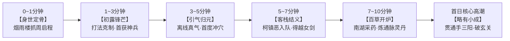
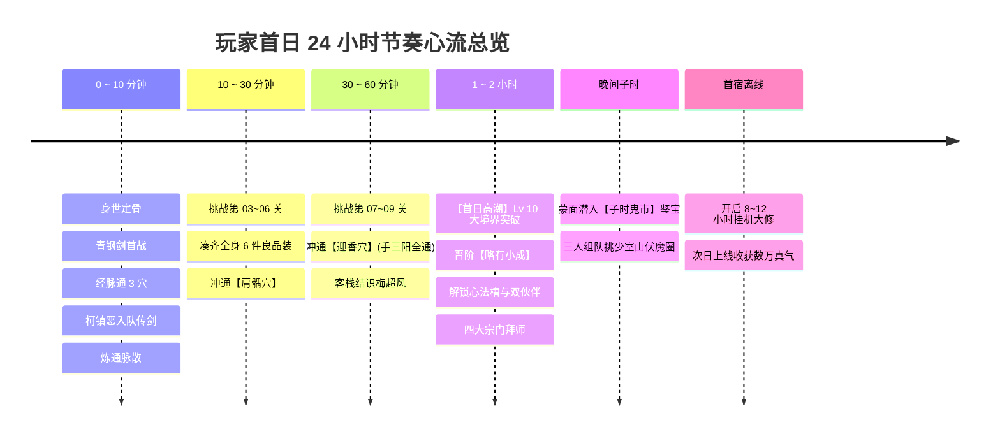
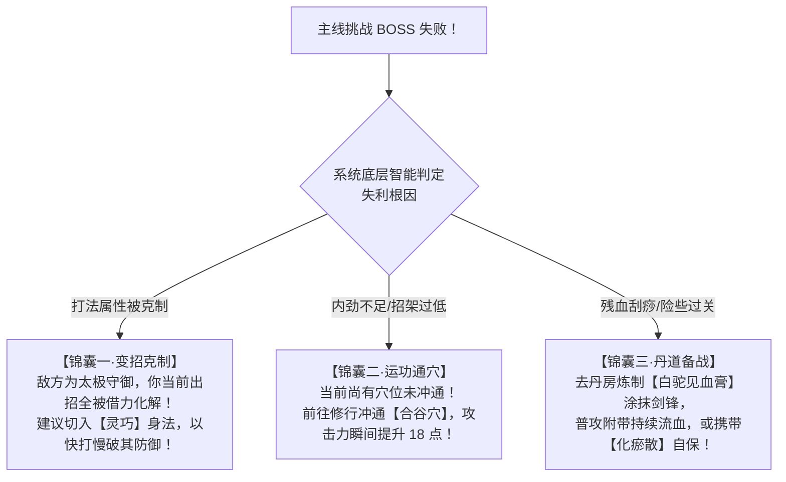

# 《金庸群侠：问道武林》首日新手体验与前10分钟黄金心流策划案

> **策划案编号**：17  
> **设计定位**：新手导入体验（FTUE - First Time User Experience）与首日成长节奏蓝图  
> **核心指标**：次日留存率 $\ge 52\%$，首日平均在线时长 $\ge 45\text{ 分钟}$，7日留存率 $\ge 28\%$  
> **适用版本**：第一卷《射雕篇》（Lv 1 ~ 30）

---

## 目录索引
1. [设计宗旨与心流哲学](#一-设计宗旨与心流哲学)
2. [前10分钟黄金动线逐分钟精准拆解](#二-前10分钟黄金动线逐分钟精准拆解)
3. [第一天（Day 1）全天节奏与阶段性里程碑](#三-第一天day-1全天节奏与阶段性里程碑)
4. [首日数值投放与防挫败（防卡点）模型](#四-首日数值投放与防挫败防卡点模型)
5. [系统组件与程序落地规范（《江湖行历》实现）](#五-系统组件与程序落地规范江湖行历实现)

---

## 一、 设计宗旨与心流哲学

### 1.1 传统放置游戏新手体验之三大弊病
1. **死板黑幕强制遮罩**：整个屏幕变黑，仅留一个小圆圈逼迫玩家机械点击，剥夺自主探索权，玩家宛如没有感情的“打工测试员”；
2. **数值空洞无代入感**：一上来就是抽卡池、首充6元大弹窗、红点满天飞，缺少武侠江湖的烟火气与沉浸感；
3. **成长反馈脱节**：打了半天怪只是经验条挪动一丝，无法直观感受到自己“内力变深、招式变猛、经络通畅”的体感变化。

### 1.2 《问道武林》FTUE 核心设计准则
* **“30秒一爽点，1分钟一成长，5分钟一大境界雏形”**；
* **“无死板遮罩，轻量卷轴引路”**：采用常驻的**【江湖行历卷轴】**，仅呈现单一核心目标，点击即丝滑切转场景，不剥夺操作自由；
* **“纯正金庸风貌与具象爽感”**：
  * 首战让玩家亲身体验**“打法见招拆招克制”**的策略感；
  * 首次升级让玩家亲手**“打通穴道、气机流转”**，感受经脉贯通的质变；
  * 首次结交让名宿柯镇恶**“请酒对饮、倾囊传功”**，而非冷冰冰的抽卡出货；
  * 首次炼丹体验到**“三昧真火与一炉双丹”**的意外之喜。



---

## 二、 前10分钟黄金动线逐分钟精准拆解

### ⏱️ 第 0 ~ 1 分钟：【初入江湖 · 身世定骨】
* **情境视听**：
  * 界面呈现水墨烟雨江南，伴随悠扬古琴与南湖橹声。主场景定格在【嘉兴南湖·烟雨楼外】。
  * 旁白墨字浮现：*“南宋宁宗年间，江湖波诡云谲。《九阴真经》再现武林，华山论剑各显神通……你本是初涉江湖的一介布衣，今日行至嘉兴烟雨楼前……”*
* **玩家交互：身世定骨（四选一抓周）**：
  * 玩家录入江湖名号（如：陆小鱼、叶无痕），并挑选初始身世（微量影响初始六维与气质标签，不锁死后续路线）：

| 初始身世选项 | 属性微调 | 专属初始气韵标签 | 原著意向与设计目的 |
| :--- | :--- | :--- | :--- |
| **【书香门第】** | 悟性 $+3$，身法 $+1$ | *“博闻强记，经纶在胸”* | 降低冲穴真气消耗，更易参悟丹方与高阶心法。 |
| **【山野游侠】** | 福缘 $+3$，身法 $+1$ | *“餐风饮露，福缘深厚”* | 提升野外奇遇、采药暴击率与炼丹【一炉双丹】概率。 |
| **【将门之后】** | 臂力 $+3$，体质 $+1$ | *“岳家遗风，筋骨如铁”* | 提升外功攻击与破甲，适合刚猛爆发路线。 |
| **【玄门道童】** | 根骨 $+3$，定力 $+1$ | *“纯阳童身，气定神闲”* | 提升内力上限与真气吐纳收益，适合太极持久流派。 |

* **界面解禁**：点击“启程入江湖”后，主屏右下角常驻浮现古风卷轴卡片：**【江湖行历 · 卷一】**。当前任务提示：`前往主线·烟雨楼外击退滋事地痞 (0/1)`。

---

### ⏱️ 第 1 ~ 3 分钟：【初露锋芒 · 打法克制与首得神兵】
* **剧情事件**：
  * 南湖醉仙楼酒家外，几个金国爪牙与市井恶霸正围殴过路镖师。主角拔剑喝止，切入演武演播战台。
* **核心战斗教学：三系打法克制机制（自然代入）**：
  * 对手【恶霸头目】头顶明确标注打法状态：**【刚猛 FIERCE】**（重刀狠劈，力道千钧）。
  * 此时主角默认出招为刚猛，系统在战前准备区高亮提示：
    > *“敌方刀势刚猛暴烈！以【灵巧 AGILE】身法变招切入侧翼，可破其破绽，伤害提升 $+20\%$ 且招架其重劈！”*
  * 玩家轻点切换为【灵巧】打法，点击“出手迎敌”。
* **战斗演播体验**：
  * 第 1 回合：恶霸怒吼 *“吃老子一记五虎断门刀！”*，主角身形如灵燕滑步掠开（**闪避格挡！**）；
  * 第 2 回合：主角剑锋斜刺破绽，打出金色暴击特写（`克制破甲！-180 真实内劲伤害`），恶霸踉跄倒地！
* **首战斩获与爽点反馈**：
  * 结算弹窗：首战必爆良品蓝色武器——**【青钢剑】**（外功攻击 $+42$，破甲 $+8$）；
  * 点击“一键装备”，主界面战力从 $120$ 跃升至 $245$，伴随金色墨浪动效，右侧系统频道播报：`少侠「陆小鱼」换装【青钢剑】，锋芒初露！`

---

### ⏱️ 第 3 ~ 5 分钟：【引气归元 · 离线真气与首度冲穴】
* **行历任务引导**：`[行历目标 2] 回归打坐静修，冲通手三阳经第一穴【商阳穴】 (0/1)`。
* **核心系统教学：打坐收益与经脉冲穴**：
  1. **离线打坐收益结算教学**：
     * 玩家切换至【修行】页签，屏幕提示“你在南湖打坐凝神，已吸纳天地灵气”；
     * 弹出首发“入门顿悟机缘”：直接领取 **1,200 点真气与 300 两纹银**（模拟离线挂机收益）。
  2. **经脉冲穴初体验**：
     * 界面展示人体十二正经之首——**【手三阳经】**（大肠经、三焦经、小肠经）。
     * 点选第一穴位**【商阳穴】**：消耗 300 真气，一声洪亮破障钟鸣，穴位瞬间金光充盈贯通！
     * 获得永久属性：**臂力 $+2$**，角色周身浮现微弱气劲微光。
  3. **顺势冲击第二穴【合谷穴】**：
     * 消耗 375 真气，冲通**【合谷穴】**，永久增益：**外功攻击 $+18$**。
  4. **建立核心心智模型**：
     * 玩家彻底理解：**“本游戏的等级不是随意点点加号，每 10 级必须先把经脉的所有穴位逐一点通，方可叩开大境界的大门！”**

---

### ⏱️ 第 5 ~ 7 分钟：【醉仙相逢 · 柯镇恶入队与传授越女剑】
* **行历任务引导**：`[行历目标 3] 前往醉仙客栈，结交名宿「柯镇恶」 (0/1)`。
* **原著人物登场**：
  * 点击任务直接平滑跳转至【市集 $\rightarrow$ 醉仙客栈】。
  * 客栈雅座上，江南七怪之首**【飞天蝙蝠 · 柯镇恶】**手拄铁杖独酌，面容冷峻。
* **伙伴结交与传功教学**：
  1. 玩家拥有方才所获纹银，点击“请柯大侠饮嘉兴黄酒”（消耗 50 两，好感度 $+20$）；
  2. 柯镇恶豪迈大笑：*“好酒！南湖的女儿红，二十年没喝到了！”*；
  3. 系统赠送新手名茶“明前龙井”，玩家送上喜欢的礼物，好感度直接突破 **100 大关**；
  4. **首位伙伴正式上阵**：
     * 达成 100 好感，柯镇恶正式受邀加入队伍，解锁【右翼·奇策伙伴位】！
     * 柯镇恶带来专属援护战技：**【听声毒菱】**（替主角抵挡致命一击，并掷出剧毒铁菱削弱敌方命中）。
  5. **倾囊传功**：
     * 柯镇恶念及主角仁侠心性，当场倾囊相授韩小莹绝技——良品进阶剑法：**《越女剑法》**！
     * 玩家前往【武库】，将《越女剑法》装入外功招式槽，输出战力再度飙升。

---

### ⏱️ 第 7 ~ 10 分钟：【百草炉烟 · 地图采药与第一炉灵丹】
* **行历任务引导**：`[行历目标 4] 在南湖采摘草药，起炉炼制一丸【聚气通脉散】 (0/1)`。
* **百草与丹道教学（自给自足闭环）**：
  1. **地图搜山采药**：
     * 玩家在当前【嘉兴烟雨楼外】点击“采药寻草”，消耗 200 点真气；
     * 拾得江南特产：【田七三七】x2、【车前草】x2；
  2. **神农八卦鼎炼丹**：
     * 跳转至【市集 $\rightarrow$ 百草丹房】，炉火正旺；
     * 放入药方《聚气通脉散方》，显示所需材料正好齐全，悟性成率高达 $95\%$；
     * 点击“起炉炼丹”！鼎炉烈焰升腾，触发特殊惊喜概率：
       > **【一炉双丹！】天工开物，紫火纯青，竟然炼出双丸【玄门·聚气通脉丹】！**
  3. **丹药反哺冲穴**：
     * 玩家拿起刚炼出的通脉丹，直接点击使用；
     * 丹药化作清流，**无需消耗一丁点真气，直接冲通手三阳经第三穴【曲池穴】**（破甲 $+10$）！

---

### 🏁 第 10 分钟卡点与第一阶段成就达成
在游戏第 10 分钟，玩家达成首阶段闭环，弹出成就金章：
* 🎖️ **【初出茅庐 · 剑指八荒】**：
  * 身披青钢长剑，左膀右臂有名侠柯镇恶；
  * 身怀《越女剑法》，手三阳经已破 3 穴；
  * 背包尚存 1 丸多炼出的聚气通脉丹备用；
  * 战力突破 $600$，完全熟悉打坐、主线、武库、客栈、丹房全貌！
* 📜 **主线行历目标更新（首日大愿景）**：
  * **“贯通手三阳经剩余穴位，冲击 Lv 10 大境界【略有小成】，拜入名门正宗！”**

---

## 三、 第一天（Day 1）全天节奏与阶段性里程碑



### 3.1 首日体验阶段分拆与规划表

| 体验阶段 | 游玩时长 | 目标等级 | 经脉与穴位进度 | 系统开放与主线章节 | 玩家核心追求与爽点 |
| :--- | :---: | :---: | :--- | :--- | :--- |
| **阶段一：初试啼声** | 10 ~ 30m | Lv 3 ~ 6 | 冲通手三阳经第 4 穴<br>【肩髃穴】(招架 $+2\%$) | • 推进至第 03~06 关<br>• 挂机巡历首爆良品护腕与布靴 | 凑齐全身 6 件装备，战力突破 800；体验战胜第一个精英怪的快感。 |
| **阶段二：经络通达** | 30 ~ 60m | Lv 7 ~ 9 | 冲通手三阳经第 5 穴<br>**【迎香穴】(命中 $+3\%$)**<br>手三阳经全部穴位大贯通！ | • 推进至第 07~09 关<br>• 解锁【终南山·后山密林】舆图，挂机收益跃升至 2900/时<br>• 醉仙客栈结识【梅超风】 | 经脉全通共鸣激活！迎来人生第一次大关隘：**准备叩击第 10 级生死玄关！** |
| **阶段三：首日高潮<br>【大境界突破】** | **1 ~ 2h** | **Lv 10** | **冲击大境界玄关！**<br>从【初窥门径】晋阶为<br>**【略有小成】**！ | **★ 核心系统质变大解禁**：<br>1. **解锁【内功心法槽】**（装配《全真吐纳法》，内力暴增）；<br>2. **解锁【左翼·破阵伙伴位】**（实现三人行同台作战）；<br>3. **解锁宗门拜师**（全真教/丐帮/桃花岛/散人）；<br>4. 获赠首颗保底破障灵丹【纯阳·通脉破障丹】。 | 感受“脱胎换骨”的大飞跃！全属性额外 $+10\%$，从初学晚辈变为真正名门弟子，战力破 2500！ |
| **阶段四：宗门与江湖** | 2 ~ 3h | Lv 11 ~ 13 | 开启第二重【足三阴经】<br>冲通【隐白穴】(根骨 $+3$) | • 拜入心仪师门，完成每日门派首轮早课与切磋；<br>• 开启三人组队结义副本：【少室山·金刚伏魔圈】初试；<br>• 尝试在黑沼或大漠古商道采摘中级药草。 | 形成流派雏形（刚猛外功流、太极防御流或灵巧流）；拥有两名伙伴并肩作战。 |
| **阶段五：夜半探秘<br>(晚间活跃)** | 首宿前 | Lv 14 ~ 15 | 冲通【涌泉穴】(出手 $+12$) | • 真实时间夜半，戴上夜行蒙面巾，潜入**【子时嘉兴鬼市】**；<br>• 体验首次鬼市鉴宝，低价买下旧物地摊奇珍；<br>• 将百草药囊装配【见血膏】与【回血散】备战。 | 体验子时暗黑玄墨风视觉；捡漏神兵残片；安心退出游戏。 |
| **阶段六：首宿离线** | 隔夜 | Lv 15+ | 积攒足三阴经【三阴交】穴所需真气 | • 离线 8~12 小时挂机打坐修行；<br>• 顺路搜集挂机巡历药材与小极品装备。 | 次日上线“一键领取 3~4 万巨额真气与上千银两”，直冲次留核心目标！ |

---

## 四、 首日数值投放与防挫败（防卡点）模型

### 4.1 首日基础资源投放天平

| 资源类别 | 首日预期总产出 | 消耗去向占比 | 投放控制目的 |
| :--- | :---: | :--- | :--- |
| **真气 (经验池)** | **28,000 ~ 36,000 点** | • 冲通手三阳经 5 穴：约 2,200<br>• 突破 Lv 10 境界：约 3,500<br>• 升至 Lv 13~15：约 18,000<br>• 采药寻草搜山：约 1,200 | 既能让活跃玩家体验到突破大境界的极度爽感，又在 Lv 15 附近建立平缓的节奏阻隔，留足次日期待。 |
| **纹银 (铜钱)** | **4,500 ~ 6,500 两** | • 客栈请客送礼：约 1,200<br>• 鼎炉炼制工本：约 800<br>• 装备强化磨砺：约 2,500<br>• 鬼市鉴宝门票：约 500 | 足够支撑初期养成循环，避免“有丹方却没钱生火”的挫败感。 |
| **元宝 (代金珍宝)** | **300 ~ 500 元宝**<br>*(主线首通成就掉落)* | • 鬼市首次暗拍加价<br>• 购买高阶药材种子或洗炼石 | 100% 免费赠送，让白嫖玩家首日体验拍卖行与鉴宝的乐趣。 |

---

### 4.2 首日挫败预警与“武学对策锦囊”（拒绝无脑逼氪）
放置游戏首日流失的最大痛点：**在第 05 关或第 08 关遇到卡点打不过 BOSS，玩家一怒之下卸载**。

我们坚决**不弹“6元限时首充神装”大弹窗**，而是触发原汁原味的**【武学对策锦囊】**机制：



* **战后贴心补偿**：挑战失败绝不倒扣任何体力或真气，并赠送 1 团【炉火药渣】或鼓励文案：*“胜败乃兵家常事，大侠稍作歇息，参悟招式破绽再战不迟！”*

---

## 五、 系统组件与程序落地规范（《江湖行历》实现）

为了将本方案无缝接入现有代码仓库（[gameStore.ts](file:///d:/code/Demo/new/wuxia/frontend/src/stores/gameStore.ts) 与 Vue 视图），我们需要落地一套轻量优雅的引导组件与任务状态机。

### 5.1 《江湖行历》新手任务清单（Task Model）

> 已落地：配置在 `shared/ftueQuests.ts`，进度与领赏由 `frontend/src/stores/gameStore.ts` 推导，卷轴组件为 `frontend/src/components/JianghuQuestScroll.vue`。下方为策划原始示例，字段以代码为准（新增 `PIERCE_ALL`、`rewardPillId`）。

在 `shared/gameData.ts` 或前端配置中定义首日 10 阶行历任务：

```typescript
export interface JianghuQuestConfig {
  id: number
  title: string
  subtitle: string
  desc: string
  targetType: 'STORY' | 'PIERCE' | 'COMPANION' | 'FORAGE' | 'REFINE' | 'BREAKTHROUGH' | 'SECT'
  targetValue: string | number
  rewardQi: number
  rewardSilver: number
  rewardItemName?: string
  jumpTab: 'CULTIVATE' | 'JIANGHU' | 'ARSENAL' | 'MARKET' | 'SECT'
  jumpSub?: string
}

export const FTUE_QUESTS: JianghuQuestConfig[] = [
  {
    id: 1,
    title: '行历一 · 初试身手',
    subtitle: '前往主线击退南湖恶霸',
    desc: '南湖水畔有恶徒滋事，出手将其制服，夺回佩剑。',
    targetType: 'STORY',
    targetValue: 1,
    rewardQi: 600,
    rewardSilver: 200,
    rewardItemName: '青钢剑',
    jumpTab: 'JIANGHU',
    jumpSub: 'STORY',
  },
  {
    id: 2,
    title: '行历二 · 气贯周天',
    subtitle: '打坐运功冲通【商阳穴】',
    desc: '引真气归元，冲击手三阳经首穴商阳，增益臂力。',
    targetType: 'PIERCE',
    targetValue: 'shangyang',
    rewardQi: 500,
    rewardSilver: 100,
    jumpTab: 'CULTIVATE',
  },
  {
    id: 3,
    title: '行历三 · 气海凝神',
    subtitle: '继续冲通第二穴【合谷穴】',
    desc: '合谷穴乃气血大关，冲通可大幅提升外功杀伤。',
    targetType: 'PIERCE',
    targetValue: 'hegu',
    rewardQi: 600,
    rewardSilver: 150,
    jumpTab: 'CULTIVATE',
  },
  {
    id: 4,
    title: '行历四 · 醉仙会友',
    subtitle: '在醉仙客栈请柯镇恶饮酒',
    desc: '飞天蝙蝠性格刚烈，以美酒投其所好结为莫逆之交。',
    targetType: 'COMPANION',
    targetValue: 'kezhene',
    rewardQi: 800,
    rewardSilver: 300,
    rewardItemName: '《越女剑法》秘籍',
    jumpTab: 'MARKET',
    jumpSub: 'INN',
  },
  {
    id: 5,
    title: '行历五 · 本草寻真',
    subtitle: '在嘉兴南湖采药搜山一次',
    desc: '草甸水泽多灵草，搜山采摘田七与车前草。',
    targetType: 'FORAGE',
    targetValue: 'jiaxing_suburb',
    rewardQi: 400,
    rewardSilver: 100,
    jumpTab: 'MARKET',
    jumpSub: 'ALCHEMY',
  },
  {
    id: 6,
    title: '行历六 · 八卦炉烟',
    subtitle: '在丹房炼制一丸通脉灵丹',
    desc: '以神农百草鼎起炉，炼成《聚气通脉散》。',
    targetType: 'REFINE',
    targetValue: 'recipe_tongmai_dan',
    rewardQi: 1000,
    rewardSilver: 200,
    rewardItemName: '纯阳破障丹',
    jumpTab: 'MARKET',
    jumpSub: 'ALCHEMY',
  },
  {
    id: 7,
    title: '行历七 · 经脉全通',
    subtitle: '冲通手三阳经全部 5 个穴位',
    desc: '将商阳、合谷、曲池、肩髃、迎香全部贯通。',
    targetType: 'PIERCE',
    targetValue: 'yingxiang',
    rewardQi: 2000,
    rewardSilver: 500,
    jumpTab: 'CULTIVATE',
  },
  {
    id: 8,
    title: '行历八 · 玄关破障',
    subtitle: '冲击 Lv 10 突破【略有小成】',
    desc: '服下纯阳破障丹，冲破大境界，引天地纯和之气！',
    targetType: 'BREAKTHROUGH',
    targetValue: 2,
    rewardQi: 3000,
    rewardSilver: 800,
    rewardItemName: '《全真吐纳法》残卷',
    jumpTab: 'CULTIVATE',
  },
  {
    id: 9,
    title: '行历九 · 名门正派',
    subtitle: '拜入师门或成为逍遥散人',
    desc: '在宗门大殿选择武道方向，参悟门派绝学。',
    targetType: 'SECT',
    targetValue: 'any',
    rewardQi: 1500,
    rewardSilver: 500,
    jumpTab: 'SECT',
  },
  {
    id: 10,
    title: '行历十 · 初试论剑',
    subtitle: '与华山五绝石碑前侠客切磋',
    desc: '前往华山绝巅，体验名宿论剑威仪。',
    targetType: 'STORY',
    targetValue: 5,
    rewardQi: 3000,
    rewardSilver: 1000,
    jumpTab: 'MARKET',
    jumpSub: 'HUASHAN',
  },
]
```

---

### 5.2 前端《江湖行历》UI 组件交互形态
* **组件位置**：
  * 常驻于屏幕顶部导航条下方，或浮动于【修行/打坐台】右侧边缘；
* **视觉形式**：
  * 水墨泛黄折扇 / 竹简卷轴样式，带有毛笔红印章；
  * 左侧为目标标题与简要进度（例如：`冲通【合谷穴】 0/1`）；
  * 右侧为醒目的金框按钮：`前往寻缘`（点击直接调用 `store.selectTab(quest.jumpTab)` 并切换至相应子页签）；
  * 目标达成时：按钮转变为金光闪烁的 `领赏`，点击跳出轻柔铜钱真气动效，自动滑出下一卷任务，**毫无拖泥带水之感**！

---

## 六、 总结与结语

本策划案为《金庸群侠：问道武林》确立了**“首日不劝退、十分钟入江湖、有策略有爽点”**的完整新手成长模型：
1. **前 10 分钟**：让玩家彻底建立对“打法克制、冲穴温养、客栈送礼结交、采药炼丹反哺”的核心系统认知；
2. **首日 2 小时**：以突破第 10 级大境界【略有小成】为首日高潮，赋予玩家心法槽与双伙伴出战的质变飞跃；
3. **首宿离线**：以子时鬼市与次日数万巨额真气为次留诱因，保障极高的次日返回意愿。

方案已正式归档为项目策划分册第 17 号文档。
后续可在前端直接实施该《江湖行历》引导组件，将整个射雕宏大江湖丝滑推到玩家面前。
